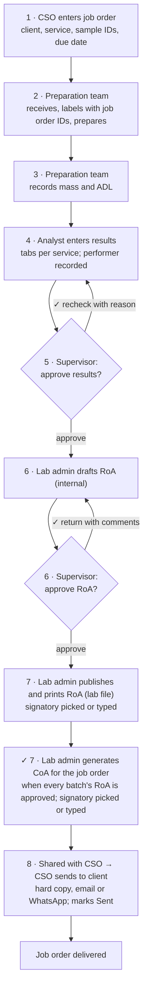
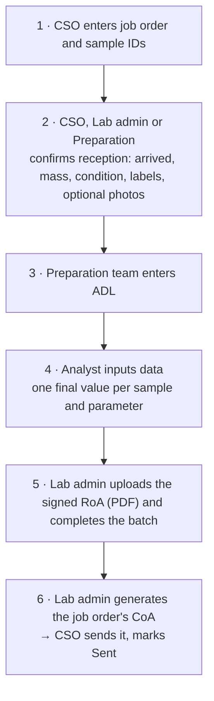
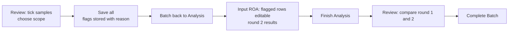
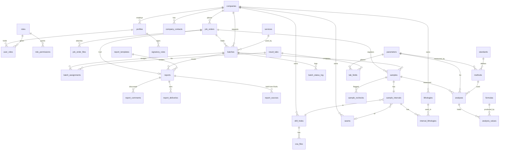

# Coal LIMS — Development Specification

Oct 21, 2026 · working draft · companion to `Coal_LIMS_Research_and_Project_Plan.md`, `../Dashboard/Dashboard_v2_Screen_Plan.md` and `../Navigation/Navigation_Screen_Plan.md`

**Revision Oct 20, 2026.** Added the product owner's brief (section 3.4): coal-only scope, RoA internal and CoA for the client, no instrument integration, and the nine-step role flow with supervisor gates. Added Clarity LIMS (section 4.6) and the general LIMS presentation (section 4.7) as references. Rewrote roles (section 8), the workflow (section 9) and the report flow; added job orders, work queues, approvals, CoA generation, search and sample history; closed D-01 and D-21 and narrowed D-02, D-03, D-04, D-09, D-10 and D-11.

**Revision Oct 21, 2026.** Applied the product owner's update (section 3.5): six roles (CSO, Preparation team, Analyst, Lab admin, Supervisor, Manager) with titles and demo personas; the eight-step flow, which **removes the supervisor gate before analysis** and gives reception, labelling and preparation measurements (ADL) to the Preparation team; analyst assignment optional, but the person who performed each step is always recorded; RoA printed with a conditional signatory; **one CoA per job order**; delivery outside the system by hard copy, email or WhatsApp. Added the RoA vs CoA comparison (section 9.8) and Clarity's step-recording and unhappy-path videos (section 4.6.1). Closed D-33 to D-37 and D-39; opened D-40 to D-43. Later the same day: closed D-40 and D-42, narrowed D-41 (signatory picked or typed), defaulted D-43 to no spec column, and re-read the shipment workbook (section 3.6), which settles D-13, narrows D-12 and gives the Net CV formulas.

**Revision Oct 29, 2026.** Applied the lab-meeting feedback and Revision C of the Reception and Preparation plan (section 15 there): **v1 is report and monitoring of job orders**, so the analyst worksheet is out of v1 and the analyst only **inputs data** (a final value per sample and parameter) (section 1.1); **batch number** editable while a batch is Created; **CSO, Lab admin and Preparation** confirm reception (the step is renamed **Confirm reception**); **photos** at reception; preparation in v1 is **ADL only** (mass after preparation and top size stay as next goal); the **performer chip is withdrawn** (the signed-in account is stamped); sample states become expected, in batch, received, awaiting arrival, not received; **Complete batch** needs the lab's signed RoA as a PDF. Opened D-44 to D-49. Design source is now **FigCraft** (`.context/design/figcraft`), after the pen.dev and Figma plan limits.

Written for: the development team and the product owner who has to fix the open details.

## 1. About this document

This is the build-side specification: features, screens, user flows, database schema, rules and architecture. It has no roadmap, phases, timeline, estimates or staffing. The research plan keeps the market and domain background; this document does not repeat it except where a build decision depends on it.

The project has no fixed details. SIM Lab is the only complete reference, and it is only partly visible (screenshots in a proposal and a deck). So every statement here carries one of three tags:

| Tag          | Meaning                                                                                                                     |
| ------------ | --------------------------------------------------------------------------------------------------------------------------- |
| **Fixed**    | Backed by a project document or a vendor's public documentation. The source is named.                                       |
| **Proposed** | Our recommendation, built on evidence but not confirmed by the lab or client. We can build against it.                      |
| **Open**     | Cannot be decided without a resource we do not have. A default is given so work can continue, plus the cost of being wrong. |

ID prefixes used throughout: `R-` resource to gather, `D-` decision, `F-` feature, `S-` screen, `V-` validation rule, `T-` table.

Scope is grouped by module, not by time: **Core modules** (the exploration flow SIM Lab shows) and **Extended modules** (the rest of the SUCOFINDO proposal's list). Which is built first is a separate planning question and is not covered here.

### 1.1 v1 scope (Oct 29, 2026, Proposed, D-44)

The goal of the first version is to **report and monitor job orders**: where each job order, batch and sample is, who handled it and what the lab reported. It is not yet the place where the lab works out its results. Everything below that is "next goal" stays in this specification so that it is not lost, but the first build and the prototype do not include it.

| Topic | In v1 | Next goal (kept in this document) |
| --- | --- | --- |
| Job order, batches, samples | Entry, batch list, five sample states, batch number (editable while Created) | Contract specs, shipments (Extended) |
| Reception | CSO, Lab admin and Preparation confirm reception: arrived, mass, condition, remarks, labels, optional photos | Condition codes beyond the five, scanner hardware |
| Preparation | **ADL only**, entered by the Preparation team; the account is stamped (Entered by) | Mass after preparation, top size and other preparation values (S-09 Preparation tab) |
| Analysis | The Analyst **inputs data**: one final value per sample and ordered parameter, as on the signed RoA; FC calculated; range warnings | The worksheet: replicates, weighings, crucible masses, instrument readings, basis conversion, on-screen review and rechecks (S-09, S-10, section 12) |
| RoA | The lab's own signed RoA (PDF, with its number) is uploaded per batch; the Lab admin **completes the batch** | RoA draft, supervisor approval gate, snapshot and print from the system (F-RPT-05) |
| CoA | Existing flow once every batch is completed | — |
| Roles | CSO, Preparation, Analyst, Lab admin act; Supervisor and Manager sign on paper | Supervisor and Manager gates in the system |

The next-goal items keep their IDs (S-09, S-10, S-11, F-RES, F-REV, F-RPT, section 12) and stay valid; v1 reads them as "not built yet".

## 2. The central problem and the design response

### 2.1 What is known and what is not

| Known (Fixed)                                                                                                                         | Source                                             |
| ------------------------------------------------------------------------------------------------------------------------------------- | -------------------------------------------------- |
| 9 SIM Lab Coal screens: Dashboard, Users, Companies, Drill hole, Lithology, Seam, Batch list, Input ROA, Review ROA                   | Proposal PDF pp. 17–22                             |
| Login screen: email, password, "Lupa Password?" link, Login button                                                                    | `source-documents/simlab view.pptx` slide 1                         |
| Parent SIMLab shows an **Order Lab** screen with order, ERP, customer and queue concepts                                              | `source-documents/simlab view.pptx` slide 2                         |
| Input ROA has 8 tabs and a 5-point rules box; Information tab columns Kode Lab, Drill Hole, Sample ID, Ply/Comp, Depth From, Depth To | Proposal PDF pp. 21–22                             |
| Batch states seen: Created, Finished Analysis, Completed; counters like `258 / 258` and `0 / 328`                                     | Proposal PDF p. 21                                 |
| Output formats: one CoA (per barge, ASTM) and one RoA (per job, 4 samples)                                                            | `source-documents/pdf-p-COA contoh.pdf`, `source-documents/pdf-roa-contoh.pdf`       |
| Parameter catalogue: 245 rows, 15 categories, IDs P001–P275                                                                           | `Surveyor_Template` sheet of the shipment workbook |
| Basis formulas reproduce the workbook and both sample reports                                                                         | Research plan, and re-checked in section 12        |

| Not known (Open)                                                                   | Why it matters                      |
| ---------------------------------------------------------------------------------- | ----------------------------------- |
| Full column lists of the other 7 tabs, especially Form of Sulphur and Metal in Ash | Result-entry grids cannot be fixed  |
| What SIM Lab does when a recheck is flagged                                        | Batch state machine                 |
| Who reviews, who signs, how many approval levels                                   | Roles, permissions, report issue    |
| Rounding, decimals and the exact derivation of fixed carbon on each basis          | Every printed number                |
| Sample and lab-code conventions                                                    | Registration form, uniqueness rules |
| Report layouts per client and the CoA scope                                        | Report engine                       |
| Hosting, authentication, data-protection constraints                               | Architecture                        |

### 2.2 Design response: unknowns become data

Five rules keep the open items from becoming rework:

1. **Fields are data, not code.** Parameters, result tabs, tab fields, methods, bases, validation rules, services and report templates live in tables. Changing a tab's columns is an admin edit or a seed migration, not a code change.
2. **Measure once, derive the rest.** Store each value on the basis it was measured on. Derived bases come from versioned formulas and are snapshotted when a batch completes, so a report reproduces years later.
3. **Lookups over enums** for anything a lab might rename (lithology kind, sample flags, services). Enums only for workflow states that code branches on.
4. **Free attributes with a definition table.** Sample columns nobody has specified yet go in a typed `attributes` field, with definitions the admin can add. See D-17.
5. **Every open item has a default and a switch-point.** The decision register (section 5) says what we build against now and what changes if the answer differs.

### 2.3 How an item becomes fixed

Gather the resource (section 3.3) → decide in the register (section 5) → record the evidence link in the row → set the tag to **Fixed**. A decision is closed only when its row names the document or person that settled it. Nothing else about order or timing is implied.

## 3. Evidence and resources

### 3.1 What we hold

| File                                                                | What it fixes                                                                                                                                                                                                                           | What it does not                                                       |
| ------------------------------------------------------------------- | --------------------------------------------------------------------------------------------------------------------------------------------------------------------------------------------------------------------------------------- | ---------------------------------------------------------------------- |
| `source-documents/Proposal LIMS PT Energy Fortune Invesment.pdf` (SUCOFINDO, 29 pp.) | Module list, SIM Lab screen screenshots, security stance (encryption, role access, audit trail, ISO 17025, UU PDP No. 27/2022), "Basic or Full Analysis" service idea, SharePoint report storage, instrument and IoT integration claims | Field lists beyond the Information tab, business rules, report layouts |
| `source-documents/simlab view.pptx`                                                  | Login screen and parent SIMLab Order Lab list (columns and actions)                                                                                                                                                                     | Anything on slides 3–4 (empty)                                         |
| `source-documents/52. OL.294_MV ZHONGHAIHUARUN 1_MELAWAN COAL (1).xlsm` (17 sheets)                        | Parameter catalogue (`Surveyor_Template`), rapid and final tiers, contract spec table, distribution list, CoA sheet, formulas                                                                                                           | Exploration data; it is a shipment workbook                            |
| `source-documents/pdf-p-COA contoh.pdf`, `source-documents/pdf-roa-contoh.pdf`                        | Certificate and report layout, method editions, header and footer fields                                                                                                                                                                | Numbering rules, signature rules                                       |
| `research/inspiration/dashboard-concept.webp`                                                    | Visual inspiration for the operations dashboard (another industry's product)                                                                                                                                                            | Nothing about coal                                                     |
| `screens.pen`                                                       | Design file for the screens (encrypted; use the pencil tools)                                                                                                                                                                           | —                                                                      |
| AssayNet and CCLAS public documentation                             | Feature and workflow reference (section 4)                                                                                                                                                                                              | Coal-specific behaviour                                                |
| `research/assaynet/` (16 frames from a [LIMS 4 demo video](https://www.youtube.com/watch?v=s734aLAzxg8)) | LIMS 4 browser screens: shell, dashboard, sample batches, results, export, lab jobs, data capture, instrument runs, control charts, sample login (section 4.3) | Configuration, reports, security screens; demo data is metals assay, not coal |
| Product owner brief, Oct 20, 2026 (conversation)                    | Industry (coal), outputs (RoA internal, CoA to client), no instrument integration, nine-step role flow (section 3.4)                                                                                                                    | Who receives samples, approval position, signatories, numbering        |
| `research/clarity-lims/videos/` (46 Illumina Clarity LIMS training videos) and `research/clarity-lims/screenshots/` (frames of videos 02, 29, 34, 35, 36, one folder each; step-video frames are named after what they show) | Clarity's screens: projects and samples, workflow assignment, Lab View queues, configuration (workflows, protocols, steps, consumables, custom fields, users, automation), advanced search, genealogy, dashboards, admin (section 4.6) | Record-details step screens (other videos in the set); anything coal-specific; it is a genomics product |
| `research/lims-demo/` (66 frames of a general LIMS training deck) | What a LIMS contains, the generic sample flow, roles, environments, master data, functions (section 4.7)                                                                                                                                | Any product screen; it is a slide deck                                 |

### 3.2 SIM Lab facts read from the screenshots

These are **Fixed** unless marked. They correct or sharpen the research plan.

| Screen                    | Facts                                                                                                                                                                                                                                                                                                                   |
| ------------------------- | ----------------------------------------------------------------------------------------------------------------------------------------------------------------------------------------------------------------------------------------------------------------------------------------------------------------------- |
| Users                     | Columns Perusahaan, Email, Name, Role, Status, Registration Date, Actions (Lihat, Hapus). Filters: search, Role, Tanggal Dibuat, Status, Reset. "Total User: 7". 10 rows per page. Admin and Superadmin rows show no company ("-"); the Client row has one                                                              |
| Companies                 | Columns Nama Perusahaan (with logo), Kode Perusahaan (PTBA), Alamat (Lahat), Status, Total Sample (1,783), Tanggal Pembuatan; Edit, Hapus. Filter: Status. 25 rows per page                                                                                                                                             |
| Drill hole                | "Total Drill Hole: 100". Columns Code, Description (holds a batch label such as "Batch 5"), Total Sample, Company, COA ("No COA" or a file); Edit, Upload COA, Delete. Codes like `BTBB_035-R2`                                                                                                                         |
| Lithology                 | Columns Interval (the name), Description, Total Sample, Company. The description column holds a kind: Coal, Parting or No Litology. Names seen: Losscoal, Coaly Claystone, Coreloss, Siltstone, Sandstone, Silicified Coal, Carbonaceous Claystone, Claystone, Coal (1,759 samples)                                     |
| Seam                      | "Total Seam Classification: 62". Columns Code, Description (empty), Company. Codes like CO, B1U3, EN2, A2L, A2U2, SM1, X10                                                                                                                                                                                              |
| Batch list                | Filters: search by batch number, Status, Tanggal Kedatangan, Deadline, Reset. Columns Perusahaan, No. Batch, Tanggal Batch, Deadline, Total Sample (`258 / 258`), Status, ROA (PDF, XLSX, CSV icons or "No ROA"), Actions (delete, edit, open). "Total Batch: 9"                                                        |
| Input ROA                 | Batch picker; Batch Information (Company, Nomor Batch, Total Sample, Dibuat Oleh, Tanggal Dibuat with time, Deadline, Status, Tanggal Batch); export PDF, XLSX, CSV; Preparation card (started, finished, performed by, Start and Finish buttons); Analysis card (same); the rules box; "Simpan & Tambah"; per-row Save |
| Review ROA                | Same header; note "Pilih sample untuk menandai recheck"; "Simpan Semua"; "Complete Batch"; columns Drill Hole, Sample ID, Ply/Comp, Depth From, Depth To, Thickness, Interval Lithology (shown as a removable chip, e.g. "Coal ×")                                                                                      |
| Global                    | Collapsible sidebar, notification bell with unread badge, user chip with role, "Copyright PT SUCOFINDO" footer                                                                                                                                                                                                          |
| Login                     | Email, Password, "Lupa Password?", Login; branded page                                                                                                                                                                                                                                                                  |
| Order Lab (parent SIMLab) | Columns Nomor Order, Nomor ERP, Jenis Order (Reguler), Nomor Sales Agreement, Pelanggan, Customer Service, Lab, Nomor IWO, Pengirim IWO, Jumlah Sample, Tanggal Order, Status; row actions; "Buat Order"; "Buka Loket Antrian" (open queue counter). Menu: Beranda, Peta Sabaran Lab, Jobs & Transaksi, Master          |

The five rules in the Input ROA box, translated:

1. Use a **period** as the decimal separator.
2. Enter sample information in order from top to bottom. Columns marked `*` are required.
3. Make sure sample information is complete before moving on.
4. When sample information is done, click **Start Preparation** in the Preparation widget above.
5. From that stage a sample **cannot be deleted**, to protect analysis data integrity.

Inferences, marked **Proposed** until confirmed with R-01:

- The batch counter is _samples registered / samples expected_. Evidence: Created batches show 129 / 322 and 0 / 328, while Finished Analysis and Completed batches show equal numbers.
- Sample IDs encode context: `51-164-BTBB_033-A1U-CR` reads as prefix, sequence, drill hole, seam, and a ply suffix. Suffixes seen: `CR`, `CB`, `CF`, `COM`. Composite rows (`COM`) span the depth of the plies before them (18.35–20.8 m over plies 18.35–18.45, 18.45–20.7, 20.7–20.8).
- Lab codes are an 8-digit running series (14000165, 14000166, …).
- The Review thickness is `depth_to − depth_from` (0.1, 2.25, 0.1, 2.45 in the sample rows).

### 3.3 Resources to gather

| ID   | Resource                                                                                                                                    | Likely holder       | Unblocks                       | Done when                                                  |
| ---- | ------------------------------------------------------------------------------------------------------------------------------------------- | ------------------- | ------------------------------ | ---------------------------------------------------------- |
| R-01 | Live SIM Lab access, or a screen recording of every screen including add/edit forms, empty states, error messages and the recheck action    | SUCOFINDO / client  | D-05 to D-09, all screen specs | Every screen in section 10 has a recording frame behind it |
| R-02 | Full column list of the Information tab (it scrolls sideways) and a screenshot of each of the 7 other tabs                                  | SIM Lab             | D-17, section 11               | Each tab's columns, required marks and units are listed    |
| R-03 | One finished SIM Lab batch with its PDF, XLSX and CSV exports                                                                               | Lab                 | D-10, D-12, D-13               | Our computed values match the export digit for digit       |
| R-04 | Field lists and methods for Form of Sulphur and Metal in Ash                                                                                | Lab                 | Section 11                     | Both tabs have a parameter list, units, basis              |
| R-05 | Controlled method list: standard, edition, repeatability r, reproducibility R per parameter                                                 | Lab quality manager | T-methods, V-rules             | Every parameter shown on a tab has a default method        |
| R-06 | Decimals and rounding rules per parameter and basis, and whether printed values or full precision feed later calculations                   | Lab                 | D-12, D-13                     | A one-page rule table signed off                           |
| R-07 | Sample coding scheme: lab code, sample ID pattern, what `CR`, `CB`, `CF`, `COM` mean, who generates them                                    | Lab / geology       | D-18, S-09                     | Pattern written as a rule with 5 worked examples           |
| R-08 | Master lists as files: 100 drill holes, 62 seams, 9 lithologies, company list                                                               | Geology             | Seed data                      | Imported without edits                                     |
| R-09 | People and chain of approval: who registers, prepares, analyses, reviews, signs; whether two people may be the same                         | Lab manager         | D-02, D-08, D-09               | Role list and a permission matrix                          |
| R-10 | RoA and CoA templates: logo, signatory, form code, numbering, wording                                                                       | Lab, client         | D-10, D-11, S-11               | Template files and a numbering rule                        |
| R-11 | Hosting target, domain, connectivity at the lab, authentication requirement (email login or company directory), data-protection obligations | Client IT           | D-22, D-23, D-25               | Written constraints                                        |
| R-12 | Shipment: who issues the CoA, contract specs per buyer, rapid workflow                                                                      | Client commercial   | D-26, D-27                     | Sample contract and one full shipment file set             |
| R-13 | Instrument list and file export formats, if import is wanted                                                                                | Lab                 | D-21                           | Sample output file per instrument                          |
| R-14 | Notification needs: events, recipients, in-app or email                                                                                     | Lab                 | D-28                           | Event table                                                |
| R-15 | Historical data scope and the Excel files in use today, including the import template                                                       | Lab                 | S-16                           | File samples and a scope statement                         |
| R-16 | Whether reports must be stored in SharePoint as the proposal says                                                                           | Client IT           | D-22                           | Yes/no and target site                                     |
| R-18 | Export needs for geological software (collar, interval, assay files)                                                                        | Geology             | Extended export                | Sample file in the target format                           |

R-17 is intentionally unused. It was an AssayNet demo request, removed because a design reference does not block any decision.

| ID   | Resource                                                                                                     | Likely holder | Unblocks         | Done when                                      |
| ---- | ------------------------------------------------------------------------------------------------------------ | ------------- | ---------------- | ---------------------------------------------- |
| R-19 | ~~Names and roles of the people in the flow~~ **Done Oct 21, 2026**: six roles given (section 3.5)            | Lab manager   | D-33 to D-36     | Each step in section 3.5 has a named role      |
| R-21 | The lab's signatory rule: who signs which RoA or CoA (manager always, or by client, product, value), with their printed titles | Lab manager | D-41 | A rule table with one line per case |
| R-20 | One real job order as the CSO writes it today (quote, PO or email) and the CoA sent for it                    | CSO           | S-17, D-37, D-38 | Every job order field traces to a real document |

### 3.4 Product owner brief (Oct 20, 2026)

These statements come from the product owner and are **Fixed** unless a row says otherwise.

| #   | Statement                                                                                                                                         | Effect on this spec                                                                                    |
| --- | ------------------------------------------------------------------------------------------------------------------------------------------------- | ------------------------------------------------------------------------------------------------------ |
| B-1 | The product is a LIMS for the **coal mining industry**                                                                                             | Confirms the coal parameter set and basis engine; no other matrices                                     |
| B-2 | The system must produce **RoA and CoA**                                                                                                            | CoA generation moves from Extended into Core (F-COA)                                                    |
| B-3 | **RoA is for internal use.** The CoA is the document the client receives                                                                          | RoA becomes an internal, reviewed draft; the CoA is built from the approved RoA (D-10, D-11)           |
| B-4 | **No instrument integration**                                                                                                                      | D-21 closed: results are typed or imported from a spreadsheet; no instrument files or connectors       |
| B-5 | A typical job runs Proximate, TM, TS and CV                                                                                                        | Seeds a default service (section 11.3); confirms Basic Analysis as the main tab                         |
| B-6 | The nine-step role flow below                                                                                                                      | Adds a job order layer (D-01), a reception step, two supervisor gates on lab work and one on the report |

The flow as given, kept word for word in meaning, with the product owner's note that it is "totally not perfect":

| Step | Actor                                 | Action                                                             |
| ---- | ------------------------------------- | ------------------------------------------------------------------ |
| 1    | Superadmin / Customer Service Officer | Agrees the work with the client, closes the deal, enters a job order |
| 2    | (not named)                           | Waits for the samples; retrieves and labels them when they arrive  |
| 3    | Supervisor                            | Approves the samples before analysis                               |
| 4    | Analyst                               | Does the analysis                                                  |
| 5    | Supervisor                            | Checks the results                                                 |
| 6    | Lab admin                             | Drafts the RoA once results are approved                           |
| 7    | Supervisor                            | Checks the RoA                                                     |
| 8    | Lab admin                             | Publishes it and sends it to the CSO                               |
| 9    | CSO                                   | Sends the document to the client                                   |

Gaps we fill as **Proposed** (section 9): rejection paths at steps 3, 5 and 7; a preparation stage between steps 3 and 4 (SIM Lab has one, and coal samples must be crushed, divided and air-dried before analysis); analyst assignment at step 3; the CoA as what step 8 publishes; report revisions after publishing. Open points go to the register as D-33 to D-39.

The nine-step flow is **superseded by section 3.5**; it stays here as history.

### 3.5 Product owner update (Oct 21, 2026)

**Fixed** unless a row says otherwise. Where this differs from section 3.4, this section wins.

**Answers to the proposed gaps (section 3.4):**

| Gap | Answer | Effect |
| --- | --- | --- |
| Return with a reason at each supervisor check | Yes | V-24 kept |
| Preparation stage before analysis | Replaced by the updated flow: the Preparation team labels, prepares and measures | Batch states revert to SIM Lab's (section 9.2) |
| Supervisor assigns analysts | Yes, but an analyst may start work without being assigned. **The person who performed each step must be recorded** | Assignment is optional; `performed_by` on every preparation event and result (V-25) |
| Analyst ≠ approver; drafter ≠ approver; a setting relaxes it | Yes | V-16, V-20 kept |
| Corrections create a new CoA revision; old one kept | Yes | F-COA-03 kept |
| Clients do not log in; the CSO sends the CoA | Yes | D-35 kept |

**Roles (B-7):** Customer Service Officer (CSO), Preparation team, Analyst, Lab admin, Supervisor, Manager. Section 8 gives each a code, a printed title and a demo persona.

**Updated flow (B-8):**

| Step | Actor | Action |
| --- | --- | --- |
| 1 | CSO | Gets the client and enters a new job order in the LIMS, with the sample IDs |
| 2 | Preparation team | Prepares the samples, including labelling each with the ID registered on the job order |
| 3 | Preparation team | Can take measurements, for example ADL (air-dry loss) |
| 4 | Analyst | Analyses the samples and enters the results for the supervisor |
| 5 | Supervisor | Reviews the results |
| 6 | Lab admin | Once results are approved, drafts the RoA and returns it to the supervisor |
| 7 | Lab admin | Publishes and prints the RoA. It carries a **signature placeholder**; the signatory depends on the case, for example the manager |
| 8 | Lab admin → CSO → client | Lab admin shares it with the CSO; the CSO shares it with the client |

**Other answers (B-9 to B-12):**

| # | Question (register) | Answer |
| --- | --- | --- |
| B-9 | Who receives and labels samples (D-33) | Preparation team |
| B-10 | Is there an approval before analysis (D-34) | No. Analysis follows preparation directly |
| B-11 | CoA scope (D-37) | **One CoA per job order** |
| B-12 | How the CoA reaches the client (D-39) | Outside the system: hard copy, email or WhatsApp, sent by the CSO |
| B-13 | RoA vs CoA (D-38) | In the product owner's words: the RoA is the laboratory's internal document with the full, raw and detailed test record; the CoA is the official summary issued to the client as proof that the product meets the standard specification. Detail in section 9.8 |

**Follow-up answers (Oct 21, 2026):**

| # | Question | Answer |
| --- | --- | --- |
| B-14 | Which document goes to the client (D-40) | Confirmed: the RoA is printed and signed for the lab file; the CoA built from it is what the CSO sends |
| B-15 | Who signs (D-41) | Depends on the client; how it is decided is not known. The system offers a step to choose the name, or to type it manually |
| B-16 | Does the Manager act in the system (D-42) | Signs the printed document and answers escalations only |
| B-17 | Spec comparison on the CoA (D-43) | The product owner does not know; the sample CoA shows none, so the default is no |

**The reading below was confirmed as B-14.** Steps 7 and 8 say the lab admin publishes and prints the *RoA* and shares *it* with the CSO for the client, while B-3 and B-13 say the RoA is internal and the client receives the CoA. Default until confirmed: steps 6 and 7 produce the internal RoA per batch (reviewed, printed and signed for the lab file); the lab admin then generates the job order's CoA from the approved RoAs, with the same signatory placeholder, and **the CoA is what goes to the CSO and the client**.

### 3.6 Shipment workbook re-read (Oct 21, 2026)

`source-documents/52. OL.294_MV ZHONGHAIHUARUN 1_MELAWAN COAL (1).xlsm` is a surveyor's working file for one vessel loading (SUCOFINDO's Tanjung Bara laboratory, for the mine's marketing department). Section 3.1 used it for the parameter catalogue and basis formulas; a full read of all 16 sheets (6 hidden) adds the facts below. They are **Fixed** for this file; whether our lab works the same way is noted per row. Personal names and the email distribution list in the file are not copied here.

**What the sheets are:**

| Sheet | What it is |
| --- | --- |
| `Quality Control ` | Live log during loading: per lot the tonnage, rapid TM, IM, Ash, TS, an estimated CV, **time sample received and time reported** (target one hour), rolling averages, and a **Target / Min / Max** block per parameter for the cargo |
| `Rapid Report` | "Rapid Analysis Report": header (lab address, reference, vessel, date received, date reported, buyer), one row per lot with TM, IM, Ash, TS, then **Scheme**, **Analysis Unit** and **Method Detection Limit** rows (TM 0.1, IM 0.1, Ash 0.1, TS 0.01), "Page 1 of 1", "Approved By: ____" |
| `Test Report`, `#1`, `#2` | The final "Test Report", three pages. **Cover:** lab name and address, "Report to" (a named person, title and company), our reference, vessel, cargo, load port, buyer, destination, loading and sampling start and end, draft-survey and weightometer tonnage, a **methods list** (standard + number + test, e.g. ISO 13909-2 sampling, 13909-4 preparation, 589 TM, 1171 ash, 562 VM, 19579 TS, 1928 CV, an in-house method for mercury), "Issued at *place* on *date*", "This Test Report shall not be reproduced except in full without approval of the laboratory.", page *n* of 3. **Page 2:** sub-lot results (tonnage, ADL, RM, TM, IM, Ash, VM, FC, TS, GCV adb, daf, ar), **tonnage-weighted mean**, 4.75 mm and 0.2 mm composite checks, the results on four bases, "Date / Signed: ____". **Page 3:** additional analysis (ultimate, chlorine `<0.01`, HGI, Net CV, AFT, ash analysis, trace elements, sizing), "Date / Signed: ____". A note above page 1: the results are for the client's named departments only, and **the signed report is the final report** |
| `COA` | One summary row per vessel; **the columns change with the buyer**: a buyer-name lookup swaps parameters (for example Phosphorus, Net CV in kJ/kg, VM dmmf, AFT IDT reducing, Hg, sizing fractions, Carbon or Hydrogen on a chosen basis) for ten named buyers |
| `For MVP` | A one-page summary titled "details specification & parameters" with **"Prepared by," and "Checked by,"** signature lines |
| `Report` | Email To and Cc lists, separately for rapid and final results |
| `Surveyor_Template` | The parameter catalogue already used in section 11 |
| `Corr. Combust. & Non Combust.` | IM + Ash against CV per sub-lot (a correlation check) |
| `Database`, `DBComp`, `DBLbL`, `Source1`, `QUALITY BARGE TB` (hidden) | History of earlier shipments and barges with the same columns; barge log with received time, report time and turnaround |
| `DBCust` (hidden) | Buyer list: date awarded, country, volume, contract CV (GAR), contract duration, term |

**Effects on this spec:**

| # | Finding | Effect |
| --- | --- | --- |
| W-1 | Derived bases are computed **from the rounded ADB values and the rounded TM**, and FC on every basis is 100 minus the **rounded** components on that basis (formulas `F71`, `H71`, `H73`, `H74` of the Test Report) | **D-13 closed**: difference per basis on rounded inputs. Matches section 12.1's FC ar 36.7 and FC db 47.7 |
| W-2 | Printed decimals: ADL, RM 2; TM, IM, Ash, VM, FC 1; TS 2; GCV and NCV 0; C, H, N 2; HGI 0. Weighted means are rounded before the basis step | **D-12 narrowed**: these become the seed decimals; still confirm with our lab (R-06) |
| W-3 | TM per sub-lot = ADL + RM × (1 − ADL/100), rounded to 1 decimal; shipment values are **tonnage-weighted means** of sub-lots | Confirms F-CAL-03 and the ADL step given to the Preparation team (B-8); weighted means belong to Extended shipment (F-SHP) |
| W-4 | **Net CV (ar)** has one formula per standard and per buyer: ISO: (GCV ar × 4.1868 − 206 × H ad × (100 − TM)/(100 − IM) − 23.05 × TM) / 4.1868; ASTM: GCV ar − 5.72 × 9 × (H ad × (100 − TM)/(100 − IM) + 0.1119 × TM); buyer-specific variants for three Japanese and Korean buyers. Also GCV at a stated moisture (16 % for this coal), VM dmmf (Parr), CV dmmf | Closes section 12.1's "Net CV needs the lab's method" **for this file**: seed NCV as a formula per method family, with buyer overrides as versioned formula rows |
| W-5 | The job carries a **method family** (ISO or ASTM) that picks the methods list and the NCV formula | Add `method_family` to the job order (S-17); service methods follow it |
| W-6 | The CoA parameter set **depends on the buyer** (`COA` sheet) | Confirms per-client CoA templates (D-11) choose parameters and bases (section 9.8) |
| W-7 | Every signature is a **blank line**: "Signed: ____" with a date, "Approved By: ____", "Prepared by," / "Checked by," — no printed names | Supports B-15 (pick or type). Templates may need **one or two signature blocks** (signed; or prepared by and checked by) — F-SIG-01 |
| W-8 | Target, Min and Max per parameter exist, but only on the internal QC log; neither the Test Report nor the COA prints them | Supports D-43 (no spec column on the CoA); an internal limit check on Review ROA stays a QC idea (F-QC) |
| W-9 | Method detection limits are printed under results; values below show as `<0.01` | Confirms `methods.detection_limit` and qualifiers (D-15) |
| W-10 | Received time and reported time are logged per sample, with a turnaround target | Confirms turnaround KPIs (S-01) and per-sample `received_at`; reported time = report issue |
| W-11 | Report footers: "Issued at *place* on *date*", "not reproduced except in full", page *n* of *m*, intended-use note, "signed report is final" | CoA and RoA template fields (section 9.8) |
| W-12 | Two report levels for shipments: rapid (TM, IM, Ash, TS per lot) and final | Extended shipment (F-SHP) already lists rapid and final tiers |

### 3.7 Lab meeting feedback (Oct 29, 2026)

Passed on by the product owner after a meeting with the lab team. Treated as **Fixed** for scope, **Proposed** for the design built on it. Detail in section 15 of the Reception and Preparation plan.

| # | Statement | Effect |
| --- | --- | --- |
| B-18 | v1 is **report and monitoring of job orders**. The worksheet the analyst would fill is out of scope for now. Asked what the analyst does technically, the lab answered "Input data aja, seperti prep" (just input data, like Preparation) | D-44, D-47: v1 has an input-data Analysis tab; the worksheet is next goal (section 1.1) |
| B-19 | The batch number can be edited (next goal as stated; built as D-45 because it is cheap) | D-45, F-BAT-02 |
| B-20 | CSO, Lab admin and Preparation can confirm sample reception | D-46, section 8 |
| B-21 | Reception gets photo inputs (the sample's condition, or the sample being weighed), attached in the reception table | D-48, F-REC-03 |
| B-22 | Preparation in v1 needs only ADL; mass after preparation and top size are not needed, but are kept in the documentation | F-REC-02, section 9.2.1 |
| B-23 | Remove the performer in preparation; use the signed-in account | Section 8 rule, glossary, V-25 |
| B-24 | Separate received, registered and "already in a batch" samples | Five sample states (F-ORD-05) |

Questions the lab has not answered, with the defaults in use: the lab's batch number format (D-45), the per-parameter basis, unit and typical ranges (D-47, V-31), whether photos may change after Confirm reception (default no), who uploads the signed RoA (default Lab admin, D-49).

## 4. Reference systems

### 4.1 How each is used

| System                  | Evidence level                    | Used for                                                                                               |
| ----------------------- | --------------------------------- | ------------------------------------------------------------------------------------------------------ |
| SIM Lab (SUCOFINDO)     | Screenshots only                  | Target behaviour for the Core modules                                                                  |
| CCLAS (Datamine)        | Public help                       | Feature ceiling for commercial coal labs                                                               |
| **AssayNet (Datamine)** | **Public docs and release notes** | **Design reference for batches, preparation, QC, approvals, retests, limits, security and dashboards** |
| SENAITE                 | Open source                       | State machines, retest, publish                                                                        |
| Clarity LIMS (Illumina) | Walkthrough video and 45 training videos | Work queues per step, workflow configuration with draft and active versions, custom fields per entity, multi-role users, advanced search, sample genealogy, dashboards (section 4.6) |
| LIMS training deck      | Slides                            | Generic flow, roles, master data, environments (section 4.7)                                           |
| Shipment workbook       | Real files                        | Parameters, shipment rules                                                                             |

### 4.2 AssayNet in detail

AssayNet is a laboratory information management system for mining laboratories. Datamine acquired it in May 2023 ([Canadian Mining Journal](https://canadianminingjournal.com/news/datamine-acquires-assaynet-lims-for-operating-mines)). The documentation describes it as conforming to the ASTM level II LIMS specification.

**Product family** ([docs index](https://docs.dataminesoftware.com/AssayNet/index.htm)):

| Product                           | What it is                                                                                                                                                             |
| --------------------------------- | ---------------------------------------------------------------------------------------------------------------------------------------------------------------------- |
| AssayNet LIMS 4                   | Browser-based, hosted on a central server; version 4.3 is called the biggest upgrade in 25 years; 4.4.7 is the latest release notes entry (July 2026); runs on .NET 10 |
| AssayNet LIMS 3.16                | Earlier Microsoft Access application. The online "Latest" help pages mostly describe this version                                                                      |
| AssayNet Mobile 4.0, Sample Track | Companion apps                                                                                                                                                         |
| Instrument Manager                | Local program that links instruments, COM ports and label printers to the browser application                                                                          |

Caveat: the step-by-step procedures below come from the LIMS 3.16 help. LIMS 4 is rebuilding the same screens one by one, so names carry over. The LIMS 4 interface itself is known only from 16 frames of a demo video (section 4.3); its configuration, report, security-matrix and approval screens remain unseen. A vendor demo would fill that gap, but nothing in this spec waits on it. Those frames match the help's vocabulary (Job Book, Sample Batches, Client Jobs, Laboratory Jobs, Instrument Runs, Sample Login, Submittals). Neither the pages nor the video mention coal, proximate analysis or basis conversion. It is a metals-assay system at heart.

**Workflow** (LIMS 3.16 help, section names):

| Stage           | What happens                                                                                                                                            |
| --------------- | ------------------------------------------------------------------------------------------------------------------------------------------------------- |
| Sample Batches  | Samples are logged by wizard, manual entry, import, or registered by the client as a "submittal". Each gets a unique batch ID                           |
| Client Jobs     | Created from the packages attached to samples; one batch can hold several, one per analysis code                                                        |
| Laboratory Jobs | Pre-analysis work such as digestions; weight, volume and dilution captured; reference materials and method blanks added; each worksheet has a unique ID |
| Instrument Runs | A run is built from lab jobs, uses a template, captures and calculates results, then is verified, QC'd and approved                                     |
| Reports         | Client-specific templates, PDF, after approval                                                                                                          |

**Batch fields** ("Add Sample Batches"): Received By, Site, Crew, Batch Name, Description, COC Number (chain of custody, up to 255 characters), Client, Date Received, Time Received, Work Order, Project, Quote, Sample Type, Prep Code, Submitted By, Invoice To, No. of Samples, Status, Special Instruction, Report To, Packages, Flags, Due Date (defaults to the receive date), Shipper, Shipping Reference, Document Scan, Comments.

**Batch statuses:** pending (default), received, prepped, samples weighed in process, weighed, read, partial approval, ready to report, complete, on hold.

**Preparation sheet:** display groups (Samples, Products, Storage), label by Lab ID or Client ID, sort by line or sample ID, templates, tray breaks, move sample up/down, QC duplicates added through a "Split" tab.

**Sample Login module:** for exploration samples; barcode prefixes pre-assign client, project, sample type and prep code; scan the first tag and the rest follow; NCS (non-conforming sample) codes per sample; "Submit" then print labels.

**Analysis codes and packages:** an analysis code has Code (25 characters), Code Name, Description, Area, Priority, Report Name, Rack Size, **Turnaround** (days or hours), Allow Merging Codes, Use All Products, No Prep QC, Active. Analyte schemes attach to it with a report option (Yes, Data Only, QC Only, No), plus at least one fraction. Packages group codes and can be cloned.

**Analyte scheme** (the equivalent of our parameter):

| Property       | Options                                                                                                                                                                                                            |
| -------------- | ------------------------------------------------------------------------------------------------------------------------------------------------------------------------------------------------------------------ |
| Type           | Numeric Value, Calculated Value (calculator-style equation editor), Character Data, User Defined (pick list)                                                                                                       |
| Options        | Calculate initial/final measurement, calculate dilution, show at sample or analysis level, use for QC, check for QC, cascade approval, use for statistics, active, is accredited                                   |
| Display format | Fixed decimal places, Integers, Significant figures (with a separate setting at the low limit)                                                                                                                     |
| Scale-up       | Unit switches when the value exceeds a threshold                                                                                                                                                                   |
| Limits         | Named limits with Symbol (4 characters), Qualifier (1 character, `<` or `>`), Type (High or Low), Instrument Limit, Reporting Limit or Method Limit, display options. The default detection limit shows as `<0.01` |
| Corrections    | Correction value subtracted when a threshold is crossed; blank and standard correction                                                                                                                             |

**QC:** QC templates insert randomized and fixed-position QC samples by rules; preparation duplicates, splits, blanks, spikes, calibration standards, control samples and reference materials; live QC charts that refresh as data changes, with saved chart templates per login, and a click on a point opens the run; control limits with warning limits.

**Result approval** ([View and Approve Results](https://docs.dataminesoftware.com/AssayNet/LIMS/Latest/en-us/Instrument-Runs/View-and-Approve-Results.htm)):

- Green cells are within limits; red are outside.
- "Verify QC Before Approval" on the analysis code raises a "Data Validation Error" that needs a comment to continue.
- Approval is by **level** (example "Tech1" up). A user's level comes from the personnel list. Higher levels need the lower levels first, and are removed first.
- Options on approve: date, update QC results database, update status by triggers, export results, send notifications.
- **Hold** (cell turns red) excludes a sample from export until released by approving it. **Flag** (cell turns yellow) marks it for attention.
- Approved runs cannot be edited until approvals are removed.

**Retest** ([Configure a Sample Retest](https://docs.dataminesoftware.com/AssayNet/LIMS/Latest/en-us/Instrument-Runs/Configure-a-Sample-Retest.htm)):

| Type       | What restarts                                                             |
| ---------- | ------------------------------------------------------------------------- |
| Re-Run     | New instrument run from the same lab job                                  |
| Re-Analyze | New lab job from the same client job (new weights or measurements needed) |
| Re-Test    | New client job, same or different packages                                |

- Candidates can be picked by hand or by criteria: above or below instrument limit, above or below method limit, above a client flag value, on hold, flagged, has a comment, has an NCS code.
- On creating a retest the originals can be unapproved, held, or left alone.

**Security** (4.3 and 4.4 notes): Active Directory sign-in, role-based access, a **Security Matrix** (roles by permissions in one grid), users and roles administration, lockout message, role assignments kept when the matrix changes.

**Dashboard** (4.1): work in progress and active batches; turnaround graph by project; samples received in a period; determinations completed; filters by period, client, project; export of dashboard data.

**Reports and exports:** report templates have list and edit screens; each report loads the layout named in its template at print time; layouts are files edited in a visual designer; export logic (CSV, Excel, file names) is script-based per project; a dedicated export sends data to Datamine Fusion.

**Other:** sample storage with a location and container hierarchy (a location cannot be deleted while it holds samples); configurable custom fields copied from sample type to samples; weight entry at reception; a configuration hub that is searchable; sites, crews, shifts, vendors, priorities, flags and activities as configurable lists.

### 4.3 AssayNet LIMS 4 screens (demo video)

Source: `research/assaynet/`, taken from [this demo video](https://www.youtube.com/watch?v=s734aLAzxg8). The data is demo data (gold, copper and silver assays, mill and blast-hole samples). Read as **Fixed** for what the screen shows, not for how a coal lab should use it.

**Shell (every screen)**

| Part | What it shows |
| --- | --- |
| Sidebar | Dark, collapsible (hamburger in the page header). Groups: Dashboard; Job Book (Sample Batches, Client Jobs, Laboratory Jobs, Instrument Runs); Jobs (Sample Login, Submittals); Reports; QC (Control Chart); Configure; Help and Support |
| Page header | Breadcrumb (`LIMS / Job Book / Sample Batches`), large page title, global search box |
| Top right | User name (`jane.doe`), **database name** (`LIMS_D01`), sign-out icon |
| List toolbar | Working View toggle, Add, Refresh, Export, Audit, Filter, column chooser icon |
| List footer | "0 batches selected" with bulk-action icons; paging "1–30 of 180" with first, previous, next, last |
| Master–detail | Lists have a resizable bottom pane for the selected row's children, with tabs (for example Client Jobs, Reports) |
| Filter panel | Slides in from the right: saved filter picker, field filters, Save, Clear, Edit Filters |

**Dashboard** (`/dashboard`)

| Widget | Content |
| --- | --- |
| Work in Progress | Table: Batch (code on a coloured chip: green, yellow, red), Received, Project, Status (partial approval, in process), Jobs (chips per analysis code with a count, e.g. `FA-AAS (15)`, `MULTI (10)`); Filter and Refresh |
| Turnaround | Bar per project, % complete, coloured by bands: Achieved target, 100–110%, 110–125%, 125–150%, 150–200%, 200–300%, >300% of target |
| Samples Received | Bars per project, coloured by sample type (Rock, Pulp, Bullion, Blast Holes) |
| Determinations | Stacked bars per project by method (FA-AAS, AR-AAS) |

**Sample Batches** (`/jobBook/sampleBatches`)

| Part | Content |
| --- | --- |
| Columns | Code (`A25-0057`), Name, Client, Package, Type, Samples, Site, Submitted By, Received, Status, Actions |
| Status badges | pending (grey), in process (yellow), read (orange), partial approval (green) |
| Row actions (on hover) | Edit, setup, preparation, results grid, delete |
| Filters | Batch Name, Batch Code, Description, Sample ID, Date Range, Submitted By, Client, Project, Status; saved filters |
| Bottom pane | "Client Jobs for Batch A25-0046": Code, Description, Samples, Date, Priority (`24hr`), Status, Actions; tabs Client Jobs and Reports |
| Add | Dialog with three choices: **Create from Submittal**, **Create from Series**, **Create Manually** |
| Working View | Toggle that pins one batch ("Sample Batch A25-0058"). The pin carries over to Laboratory Jobs and Instrument Runs, so every Job Book list shows only that batch's work |

**Batch results** (`/jobBook/sampleBatches/results/:id`)

- Title "Sample Batch A25-0058 Results". Toolbar: **Validate**, **Retest**, **Format**, **Export**, **Print**.
- Columns: Sample ID (client's ID), Lab Code (`A25-0058-1`, i.e. batch code plus sequence), then one column per analyte.
- Each analyte column has a **three-row header**: Analyte Symbol (Au), Method Code (FA-AAS), Unit Symbol (g/Mt).
- Cells are green when within limits; grey cells have no result.

**Export batch** (`/jobBook/sampleBatches/results/:id/export`)

| Panel | Options |
| --- | --- |
| Project | Project; Project File (named export profile, e.g. "Blasthole Results") |
| Formats | Database, CSV, Excel, Fusion (several at once) |
| Show | Prep Duplicates, Pulp Duplicates, Standards, Method Blanks |
| Options | Update sample status, Send notifications, Overwrite existing results |
| Preview | Line, Sample ID, QC Type (Unknown, Sample Splits, …), analyte columns |
| Progress | Dialog with one progress bar per format ("Exporting CSV 80%") |

**Laboratory Jobs** (`/jobBook/laboratoryJobs`)

- Worksheets / Racks switch. Columns: Job Number (`J25.09-9`), Description, Code, Created By, Analyses, Created On, Status (`locked`).
- Bottom pane "Client Jobs in Lab Job": Batch Code, Job #, Samples (`15 (15)`), Description, Date, Code, Status; tabs Client Jobs and Instrument Runs.

**Lab job data capture** (`/jobBook/laboratoryJobs/data/:id`)

| Panel | Content |
| --- | --- |
| Job Details | Analysis Code, Final Volume (10.0 ml), Target Weight (30.00 ± 1.00 g), Storage Location |
| Data Capture | Capture Mode Auto or Manual; **Connect to Instrument** (balance) |
| Analyses grid | P and S marker columns, Analysis no., Rack, Sample ID, Product, Weight (input), Tag; Edit, Inputs, Print; paged by rack |
| QC rows inline | `ABC111 PR.DUP` (prep duplicate), `PREP BLK ABC141` (prep blank), `Blank`, `G914-5` (reference material), `ABC171 .1` and `.2` (splits) |

**Instrument Runs** (out of scope for us): Run ID, Instrument (Agilent 240 AA), Description, Code, Read By, Analyses, Started On, Status (open, final approval); bottom pane "Lab Jobs in Instrument Run".

**Control Chart** (`QC / Control Chart`)

- A grid of four charts with a settings gear.
- Replicate charts: scatter of original against replicate with a trendline and its R²; side panel with Type of samples, Analyte Scheme, Analysis Method, Number of Analyses, Minimum.
- Standard charts: value over time against Control Limit (red dashed), Action Limit (orange) and Warning Limit (yellow); side panel with Standard (`CCU-1b`), Analyte Scheme, Analysis Method, Number of Analyses, Accepted Value, Found Value.

**Sample Login** (`/jobs/sampleLogin`)

| Panel | Content |
| --- | --- |
| Sample Details | "Scan a sample barcode to begin"; after a scan it shows the sample ID large (`ABC141`) and its service (`FA-AA CORE`) |
| Data Capture | Auto or Manual; Connect to Instrument (balance for weights) |
| Preparation Template | Template picker, Use Template, Show All |
| Batch Details | Batch Name, Client, Sample Type, Submitted By, Prep Code, Number Samples (filled from the first scan) |
| Samples grid | Line (sortable), Sample ID, Weight (input), Actions; toolbar Submit, Insert, Clear, Options |
| Submit | Creates the batch, then asks "Clear local Samples?". Rows are held in the browser until Submit |

### 4.4 Fit assessment

| Question                          | Answer                                                                                                            |
| --------------------------------- | ----------------------------------------------------------------------------------------------------------------- |
| Does it cover coal?               | Not in anything we read. There is no basis conversion, no proximate set, no calorific value handling in the pages |
| Does it fit the exploration flow? | Closely. Client submittal, batch, preparation, QC, approval, retest and report map to SIM Lab's flow              |
| Can we reuse it?                  | No. It is a commercial closed product; we use it as a design reference                                            |
| Which parts are out of scope?     | Quotations, invoicing, stock levels, price lists, instrument runs with racks and autosamplers                     |
| What is the risk?                 | Copying metals-assay concepts that do not suit coal (fire assay, digestions, dilution, scale-up)                  |

### 4.5 What we borrow from AssayNet

| AssayNet idea                                                           | Our use                                                                                                                           | Tag                         | Where            |
| ----------------------------------------------------------------------- | --------------------------------------------------------------------------------------------------------------------------------- | --------------------------- | ---------------- |
| Packages (analysis code + schemes)                                      | **Services** table: Basic and Full analysis, as the proposal says; a service decides which parameters a batch is expected to have | Proposed                    | D-16, T-services |
| Analyte scheme types                                                    | `parameters.kind`: numeric, calculated, text, list                                                                                | Proposed                    | T-parameters     |
| Display format                                                          | Decimals as a setting per parameter and basis; significant figures not needed                                                     | Proposed                    | D-12             |
| Limits and qualifiers (`<`, `>`, symbol, instrument vs reporting limit) | Result qualifier, detection limit per method. The workbook already has `<0.01` for chlorine                                       | Fixed need, Proposed design | D-15             |
| Approval levels, cascade                                                | Optional approval levels; default is one reviewer plus Complete Batch                                                             | Open                        | D-09             |
| Hold vs Flag                                                            | Recheck flag (blocks completion) vs note flag (informational)                                                                     | Proposed                    | D-07             |
| Retest taxonomy                                                         | `recheck.scope`: rerun, reanalyze, retest                                                                                         | Proposed                    | D-07             |
| Auto-select retest candidates                                           | Review screen "suggest rechecks" by rule (range breach, missing, comment)                                                         | Proposed                    | S-10             |
| Security matrix                                                         | Roles and permissions tables from the start; three seed roles                                                                     | Proposed                    | D-02             |
| Dashboard widgets                                                       | Determinations completed, turnaround by company, samples received per period                                                      | Proposed                    | S-01             |
| Report templates as list and edit screens, per client                   | `report_templates` table, chosen per company                                                                                      | Proposed                    | D-11             |
| Custom fields copied to samples                                         | `field_definitions` and `samples.attributes`                                                                                      | Proposed                    | D-17             |
| Chain-of-custody number                                                 | Batch field `coc_no`                                                                                                              | Open                        | D-17             |
| Turnaround on the analysis code                                         | Service turnaround sets the default batch deadline                                                                                | Proposed                    | S-07             |
| Batch status "on hold"                                                  | A hold flag on the batch, not a seventh state                                                                                     | Proposed                    | D-32             |
| NCS codes                                                               | Sample issue codes (damaged, short, no tag)                                                                                       | Proposed                    | T-sample_flags   |
| Weight entry at reception                                               | `mass_received_kg` on the sample; the sample RoA prints it                                                                        | Fixed                       | T-samples        |
| Storage locations                                                       | Extended module                                                                                                                   | Open                        | F-SUP            |
| Instrument Manager (local connector)                                    | Pattern to follow only if instrument import is ever approved                                                                      | Open                        | D-21             |
| Fusion export                                                           | Export profiles for geological software                                                                                           | Open                        | R-18             |
| Three-row column header: analyte, method, unit (LIMS 4 results) | Grid headers show parameter, basis, unit; the method edition appears in the header tooltip | Proposed | S-09, S-10 |
| Working View (pin one batch across Job Book pages) | The batch picked on Input ROA stays picked on Review ROA and in exports; a "pinned batch" chip in the header clears it | Proposed | S-09, S-10 |
| Master–detail bottom pane with tabs | Batch list: selecting a row shows its samples, status log and reports below | Proposed | S-07 |
| Side filter panel with saved filters | Same pattern for the batch list and audit log; saved filters per user | Proposed | S-07, S-14 |
| Audit button on every list | Per-record history drawer opened from list toolbars | Proposed | S-14 |
| Column chooser | Show and hide columns on wide grids, remembered per user | Proposed | S-09, S-10 |
| Database name in the header | Environment badge (production, test) so staff never enter real data in test | Proposed | Global |
| Turnaround bands (% of target) | Mean turnaround KPI and active batches coloured by the same bands | Proposed | S-01 |
| Work-in-progress chips per job | Active batches row shows tab-level progress chips (Basic 40/40, Ultimate 12/40) | Proposed | S-01 |
| Export page with QC toggles and options | RoA export dialog: several formats at once, bases, include earlier recheck rounds, mark as issued | Proposed | S-11 |
| Add batch: from submittal, from series, manually | Create batch manually or by copying a previous batch's settings; client submittal is Extended | Proposed | S-07 |
| Lab code = batch code + sequence (`A25-0058-1`), batch code with a year prefix (`A25-0057`) | One of the D-18 options and a batch numbering pattern | Open | D-18 |
| Scan-driven login with rows held locally until Submit | Barcode registration for Extended; local buffering suits slow site connections | Open | F-SMP-03 |
| Data capture with target weight ± tolerance and inline QC rows | Extended preparation and QC: weight checks, QC rows interleaved with samples | Open | F-QC |
| Replicate scatter with R²; standards chart with control, action and warning limits | Extended QC screen S-23 | Open | F-QC |

### 4.6 Clarity LIMS (Illumina)

Source: `research/clarity-lims/videos/02 - Clarity LIMS – Walk through.mp4` (about 10 minutes), with frames in `research/clarity-lims/screenshots/02-walk-through/`. Files `t_001` to `t_059` are one frame every 10 seconds (`t_N` is at `(N − 1) × 10` s); files `scene_*` are frames at screen changes. The other 45 videos in `research/clarity-lims/videos/` cover single topics (search, genealogy, sample submission, custom fields, recording a step, unhappy paths, QC filters, consumables) and are the place to look when a screen below needs more detail.

Clarity is a genomics LIMS: samples move through tubes and plates, and the sample changes form at each step. Read the facts below as **Fixed** for what Clarity shows, not for how a coal lab should work.

**Shell.** A top bar with four menus: Dashboards, Projects & Samples, Lab View, Configuration. Right side: help, global search with a type picker (All, Samples, Containers, Projects, Protocol Steps, Advanced Search), user menu. A full-width **banner** above the top bar carries admin messages ("Instance maintenance will occur on Saturday from 3–4 PM PST").

**Clarity's model.** `Project` (the client's request) → `Submitted sample` (as received) → `Derived sample` (each output of a step) → `Measurement`. A `Workflow` is an ordered set of `Protocols`; a protocol is an ordered set of `Steps`; a step is made from a reusable `Master step`. Every record has a typed LIMS ID (`2-75031` sample, `24-26872` step run, `92-75029` file).

| Screen | What it shows (frame) |
| --- | --- |
| Projects & Samples | Left: project list with name, sample count, created date, account, researcher, status chip (Open). Right: project details with tabs **Properties** (account, client, priority, status Pending/Open/Closed, opened and closed dates, LIMS ID), **Custom Fields**, **Files** (attachments such as the client's sheets). Below: **Submit Samples** with **Upload Sample List** (from a downloadable example template) and **Modify Samples** (re-upload to edit). Then **Samples & Workflow Assignment**: submitted samples grouped by upload date, each with the workflows it is assigned to, and workflow cards on the right ("96 samples in ABC Workflow"); assignment is per sample or in bulk (`t_002`–`t_008`, `scene_001`–`scene_010`) |
| Lab View | **Available Work**: every protocol as a header row with a total, and under it every step with the number of samples waiting. **Ice Bucket**: scan or pick samples, then **Begin Work**. **Recent Activities**: a feed of who completed which step (`t_007`–`t_008`, `scene_013`) |
| Step queue | Samples waiting at one step, grouped by container, with columns sample name, LIMS ID, container, well, project, **Waiting** (days in the queue, e.g. 624 days); add one row, a group, or all to the ice bucket; the ice bucket page confirms the selection before work starts (`t_009`–`t_012`, `scene_016`) |
| Configuration · Lab Work | Four linked columns: Workflows, Protocols, Steps, Master Steps. Each workflow has a status chip, **Pending** or **Active**. A new workflow is named, built from protocols, saved, then activated (`t_013`–`t_016`, `t_037`–`t_040`) |
| Configuration · Consumables | Reagent kits (supplier, catalogue number, lots with Pending and Active counts, which steps use the kit, active or archived; lots added by hand or from a CSV), Controls, Instruments, Labels (label groups), Containers (types) (`t_017`–`t_023`) |
| Configuration · Custom Fields | Fields grouped by the entity they belong to: Derived Sample (74), Container (45), Measurement (31), Submitted Sample (16), Project (3); each with a type marker (text, number, list) (`t_023`–`t_024`) |
| Configuration · User Management | Users grouped by role (Auditor, Collaborator, …). User details: name, title, email, phone, account, username, **several roles per user** shown as chips, login and password, status Active/Archived, custom fields. **Clients** (users of the LabLink client portal) and **Accounts** (organisations with billing and shipping addresses) (`t_025`–`t_030`) |
| Configuration · Automation | Step, project and derived-sample automations: scripts triggered at a step, with tokens (`t_031`–`t_035`) |
| Advanced Search | "I'm searching for" an entity; numbered conditions `Where <entity> has <field> <operator> <value>` joined by AND/OR; order by; **saved queries** that can be shared and exported; results grid with a column chooser and export; each result links to its genealogy (`t_041`–`t_046`, `scene_034`) |
| Genealogy | One sample's full history as an indented tree: every step it went through (with date completed and step LIMS ID), each output sample, the custom-field values and files (logs) at each step, and a QC flag column. "Who did what, when, to which sample" (`t_046`–`t_049`, `scene_028`–`scene_031`) |
| Dashboards | **Overview**: an overall strip (projects, samples, workflows, errors), then per workflow the number of projects, samples in progress and samples completed, and per protocol the samples waiting. **Projects**: projects and samples with no workflow assigned, in progress, and workflow complete (`t_056`–`t_059`) |
| Profile | User's own details, roles, and their recent activities (`t_050`) |
| Admin | Application properties, **Banner** text, export logs, global tokens, IP whitelisting, roles and permissions, SSH access (`t_051`–`t_055`) |
| In-app help | A guided-help widget (WalkMe) with how-to walkthroughs such as "Create a new workflow" (`t_036`–`t_037`) |

The training feature list the product owner collected (Sample Tracking, Batch Management, Barcoding, Storage Management, Protocol Execution, CSV Import and Export, Material Management, Equipment Management, NGS Support, External User Portals) maps to this spec as follows:

| Feature | Here |
| --- | --- |
| Sample tracking | Core: sample status, work queues, sample history (F-QUE, F-GEN) |
| Batch management | Core: batches inside a job order (F-BAT, F-ORD) |
| Barcoding | Core: labels printed at reception (F-LBL); scanning is optional |
| Storage management | Extended (F-SUP): retained-sample location |
| Protocol execution | Core: the batch workflow and result tabs; no step scripts |
| CSV import and export | Core: imports (S-16) and exports on every list |
| Material management, Equipment management | Extended (F-SUP); an instrument list without integration (B-4) |
| NGS support | Not applicable |
| External user portals | Extended; the CSO delivers the CoA (D-35) |

#### 4.6.1 Recording a step and the unhappy paths (videos 29, 34, 35, 36)

Frames in `research/clarity-lims/screenshots/<video>/`, numbered in order and named after what they show (for example `research/clarity-lims/screenshots/29-recording-a-standard-step/18_record-details_reagent-lots_step-details_required-field.jpg`). **Fixed** for what Clarity shows.

**Recording a standard step (video 29, 29 frames).** A step runs as a short wizard with a fixed header and three stages shown as tabs: **Place Samples → Record Details → Next Steps**, with **Abort**, **Save** and a green button that moves to the next stage (finally **Finish Step**).

| Stage | What the screen shows | Frames |
| --- | --- | --- |
| Start | Lab View lists **Work in progress** (steps the user has started, with age, sample count and **Continue**) above Available Work. The user opens a step's queue, adds samples to the ice bucket, sets how many outputs each sample makes, then **Begin Work** | 01–06 |
| Place Samples | Samples to be placed on the left; the destination plate on the right, named by the user; drag one sample to a well, or select many and auto-fill by row, column or pattern; a printable placement map | 07–16 |
| Record Details | Header: protocol and step name, **the user who runs the step, Started and Updated timestamps**, sample count. Sections: **Reagent lot tracking** (pick the lot of each required kit), **Step Details** (step-level fields; required ones block progress and show a red marker until answered, e.g. a Yes/No question), **Files**, **Sample Details** (a grid of the samples with per-sample fields) | 17–23 |
| Next Steps | One row per sample with a required **Next Step** picker; the same choice can be applied to all with **Apply**. Options: advance to the next step, **Repeat this step**, **Remove from workflow**, **Request manager review**, **Store for later**, **Rework from an earlier step**, **Complete and repeat**. **Finish Step** saves and returns to Lab View, where queue counts move | 24–29 |

**Unhappy paths (videos 34–36).**

| Path | Behaviour | Frames |
| --- | --- | --- |
| Remove from workflow | Confirm dialog ("Are you sure you want to remove 1 sample from your workflow?"); the sample leaves every queue but stays in its project, where it can be assigned to a workflow again | 34 / 01–05 |
| Store for later | The sample leaves the queue without leaving the workflow; search finds it, shows the workflow it is involved in and offers **Requeue** | 34 / 06–12 |
| Request manager review | A panel opens above the step: **Request review by** (pick a named reviewer) and a comment. The step is saved; the reviewer sees it under **Review requested** in Lab View, opens it, reads the requester's comment, writes a review comment, sets the sample's next step, then **Finish Review** | 35 / 01–11 |
| Repeat this step | The sample returns to the same step's queue; queues can be grouped by previous step, project or container to find it | 36 / 01–06 |
| Rework from an earlier step | A dialog lists the earlier steps the sample went through (with dates); the user picks one and the sample is queued there | 36 / 07–13 |
| Complete and repeat | The sample moves on **and** returns to the current step: "Choose a next action" picks where the copy goes | 36 / 14–17 |

**Take-aways for coal (Proposed, carried into sections 9, 10 and 13):**

- Every step records who ran it and when it started and was last updated, on screen and in the record. This answers the product owner's "record the individual who did the executions" (B-8 note) and maps to `performed_by` with timestamps.
- Required step fields block **Finish**; our equivalent is the service completeness check (V-12) and preparation fields (mass, ADL).
- A **Work in progress** strip on My work (S-19) lists what the user has started and not finished, with Continue.
- The unhappy paths map to our recheck scopes and batch actions: Repeat this step = `rerun`; Rework from an earlier step = `retest` (back to preparation); Remove from workflow and Store for later = take a sample out of the batch's active set with a reason (Proposed sample status `on_hold`); Request manager review = escalate a sample to the Manager with a comment (D-42).
- Not adopted: plate placement, reagent-lot tracking (Extended F-SUP), complete-and-repeat (no coal use).

### 4.7 LIMS training deck

Source: `research/lims-demo/` (a training session; the slides are shown in a PDF reader). **Fixed** for what the slides say; it is generic, mostly pharmaceutical QC.

| Slide topic | Content we use |
| --- | --- |
| What is a LIMS | Manage samples and their data; automate workflows; reproducible results; reporting |
| How LIMS works | Six stages: **Plan** (masters, workflows, specifications) → **Register** (sample barcode labelling) → **Allocate** (job, work allocation, personnel) → **Results** (data capture, calculations) → **Approve** (QA) → **Push** (reports, certificates) |
| Complete LIMS workflow | Registration → Reception → Preparation → Work allocation → Testing → Validation (with a **Re-test** loop) → Approval → Reporting, ending in archival |
| LIMS contents | Customers, collection sites, analysis methods, employees, tests and results, sample matrix, parameters, control limits; plus barcoding, sample tracking, query searching, QA/QC, full audit trail, reporting |
| Master data | Analysis, product, sample plan, item code, instrument, inventories, suppliers, unit, schedule; validated in a test environment and migrated to production |
| Roles | Analyst, QC supervisor, QC reviewer, QA reviewer, QA approver, inventory manager, system administrator: separate people for entering, reviewing and approving |
| Environments | Development, master-data, validation and production environments |
| Functions | Five phases: reception and login; assignment, scheduling and workload; processing and QC; data storage; inspection, approval and compilation for reporting. Additional: audit, barcode, chain of custody, document management, method management, personnel and workload, time tracking, traceability |

### 4.8 What we borrow from Clarity and the deck

| Idea | Our use | Tag | Where |
| --- | --- | --- | --- |
| Project above samples, with properties, custom fields and files | **Job order** above batches, with status, client, priority, and attached files (quote, PO, client letter) | Proposed (structure) / Fixed (need, B-6) | D-01, S-17, T-22 |
| Lab View: queues per step with counts; ice bucket; recent activities | **My work**: one queue per role and status (to receive, to approve, to analyse per tab, to review, RoA to draft, RoA to check, CoA to send) with counts, multi-select, then act | Proposed | S-19, F-QUE |
| "Waiting" days in the queue | Age column and colour in every queue; feeds the turnaround KPI | Proposed | S-19, S-01 |
| Workflow configured, saved, then activated (Pending/Active) | Services and report templates have draft, active and archived states; only active ones can be picked | Proposed | S-15 |
| Custom fields grouped by entity | `field_definitions.entity`: job order, batch, sample | Proposed | D-17, T-09 |
| Several roles per user | `user_roles` link table; one person can be both Superadmin and CSO (step 1) | Proposed | D-02, T-01 |
| Accounts with billing and shipping addresses; client contacts | Company gains billing address and contact persons, used on the job order and CoA | Proposed | S-03 |
| Upload sample list from a template; modify by re-upload | Sample registration by template on the job order or batch (already F-SMP-03) | Proposed | S-16 |
| Advanced search with saved, shared queries | Search screen across job orders, batches, samples and results | Proposed | S-29, F-SRCH |
| Genealogy | **Sample history**: one sample's timeline from job order through reception, approval, preparation, every result round, review, RoA and CoA, with who and when | Proposed | S-30, F-GEN |
| Dashboard counts per workflow stage | Operations tab adds counts per job order status and per batch status | Proposed | S-01 |
| Admin banner | System banner set by Superadmin (maintenance notices) | Proposed | F-BAN |
| Deck: work allocation before testing | Supervisor may assign analysts per tab; analysts may also pick up work unassigned (B-8 note). The performer is always recorded | Fixed (B-8) / Proposed (design) | D-36, T-24 |
| Clarity step header: performer, Started, Updated | Preparation and Analysis cards and every result show who performed it and when | Proposed | S-09, V-25 |
| Clarity Work in progress | "Started by me, not finished" strip on My work | Proposed | S-19 |
| Clarity Request manager review | Supervisor or analyst escalates a sample to the Manager with a comment; the Manager answers in the record | Proposed | D-42 |
| Clarity Store for later / Remove from workflow | Sample `on_hold` with a reason, excluded from completeness checks until released | Proposed | T-08 |
| Deck: validation with a re-test loop, then approval | Already our recheck loop; now a supervisor action | Fixed (B-6) | Section 9 |
| Deck: separate reviewer and approver roles | Analyst may not approve their own results; lab admin may not approve their own RoA | Proposed | V-16, V-20 |
| Deck: test and production environments | Environment badge (section 4.5) plus a seeded test environment | Proposed | D-25 |
| Clarity step automations (scripts) | Not adopted; rules stay in the validation and transition tables | — | — |
| Clarity consumables (reagent lots, controls) | Extended F-SUP | Open | F-SUP |
| Clarity client portal (LabLink) | Extended; not needed while the CSO delivers | Open | D-35 |

## 5. Decision register

"Default" is what we build against until the row is closed. "If wrong" is what changes.

| ID   | Question                                                                                            | Options                                                                                | Default                                                                                                                                  | If wrong                                                                         | Needs      |
| ---- | --------------------------------------------------------------------------------------------------- | -------------------------------------------------------------------------------------- | ---------------------------------------------------------------------------------------------------------------------------------------- | -------------------------------------------------------------------------------- | ---------- |
| D-01 | Is there an order layer above the batch? Parent SIMLab has Order Lab with an ERP number             | batch only; order → batch                                                              | **Closed (B-6):** a job order entered by the CSO holds one or more batches. `order_no` on the batch is replaced by `job_order_id`         | —                                                                                | B-6        |
| D-02 | Role model                                                                                          | three enum roles; roles and permissions tables                                         | **Narrowed (B-7):** roles and permissions tables with several roles per user, seeded with CSO, Preparation team, Analyst, Lab admin, Supervisor, Manager, plus Superadmin for system setup; Client kept but unused (D-35) | If one role per user is enough, the link table holds one row                     | B-7        |
| D-03 | Who uploads or issues a CoA                                                                         | Admin only; Admin and Client                                                           | Lab admin publishes the job order's CoA after the RoAs are approved (B-8 steps 7–8). Manual upload kept for drill-hole CoAs from outside labs | Permission flag flips; no schema change                                          | B-8        |
| D-04 | What can a Client see                                                                               | batch header always, results after completion; everything                              | Nothing in Core: clients have no login while the CSO delivers (D-35). The RoA is never shown to a client (B-3)                            | Policy change only                                                               | D-35       |
| D-05 | Meaning of the batch counter `129 / 322`                                                            | registered/expected; analysed/total                                                    | Registered/expected, and an analysis progress shown from the analysis stage on                                                           | Two computed columns swap                                                        | R-01       |
| D-06 | May Start Preparation run with registered < expected                                                | block; warn and confirm                                                                | Warn and confirm, expected count editable until then                                                                                     | Guard becomes a block                                                            | R-01       |
| D-07 | What does recheck do                                                                                | send back to analysis; restart from preparation; choice per flag                       | Choice per flag using `rerun`, `reanalyze`, `retest`; batch returns to Analysis, only flagged samples editable                           | Fewer enum values; same table                                                    | R-01       |
| D-08 | Is review per sample or whole batch                                                                 | explicit accept per sample; implicit (unflagged = accepted)                            | Implicit, with a counter of reviewed rows for the dashboard                                                                              | Dashboard "awaiting review" definition changes                                   | R-01       |
| D-09 | Approval levels                                                                                     | one (Complete Batch); cascade like AssayNet                                            | **Narrowed (B-8):** two supervisor gates: approve results, approve RoA. No gate before analysis (B-10). One level each; schema allows more | Add a levels table and a check                                                   | R-09       |
| D-10 | When is the RoA produced                                                                            | on demand each time; snapshot at completion                                            | Lab admin drafts the RoA after results are approved; the supervisor approves it; the approved RoA is snapshotted and the CoA is built from that snapshot. Later changes are new versions | Report table gains or loses a version column                                     | B-3, R-03  |
| D-11 | Report numbering and template ownership                                                             | one house template; per company                                                        | House RoA template (internal); CoA template per company. Numbering `RoA-{batch_no}-{version}` and `CoA-{job_order_no}-{seq}` as placeholders | Template table keyed differently                                                 | R-10       |
| D-12 | Decimal separator, rounding, precision                                                              | period or comma; half-up or half-even; per parameter                                   | Period (SIM Lab rule 1); store full precision; round half-up at output; decimals per parameter and basis in config, **seeded from the workbook (W-2)**: ADL, RM, TS, C, H, N 2; TM, IM, Ash, VM, FC 1; CV 0 | Output rounding function and config values                                       | R-06       |
| D-13 | Fixed carbon on each basis                                                                          | convert the ADB value; 100 minus other components on that basis (rounded or unrounded) | **Closed (W-1):** difference per basis on the **rounded** values of that basis; derived bases come from the rounded ADB values and rounded TM | Formula rows change                                                              | R-03, R-06 |
| D-14 | Parameter catalogue shape                                                                           | one row per parameter and basis (workbook); parameter separate from basis              | Parameter separate from basis; the workbook's 232 lab rows collapse to 159 distinct names, fewer once sync duplicates merge (section 11) | Seed mapping changes                                                             | R-04       |
| D-15 | Results like `<0.01`                                                                                | numeric only; qualifier plus number                                                    | Qualifier plus number, detection limit on the method                                                                                     | Column removed                                                                   | R-05       |
| D-16 | Services (Basic, Full)                                                                              | none; configurable                                                                     | Configurable services assigned to a batch                                                                                                | Completeness check removed                                                       | R-02       |
| D-17 | Information tab columns and extra fields                                                            | fixed columns; fixed plus attributes                                                   | Fixed six plus mass, seam, lithology, remarks, and an attributes field with definitions                                                  | None to the schema                                                               | R-02       |
| D-18 | Lab code and sample ID                                                                              | typed; generated                                                                       | Typed or pasted, with a duplicate check; generator optional, off by default                                                              | Add sequence function                                                            | R-07       |
| D-19 | Interval lithology                                                                                  | one per interval; several (the chip suggests several)                                  | Several, via a link table                                                                                                                | Link table holds one row                                                         | R-01       |
| D-21 | Instrument integration                                                                              | none; file import; live connector                                                      | **Closed (B-4): none.** Results are typed or imported from the lab's own spreadsheet (F-RES-05); no instrument files or connectors        | —                                                                                | B-4        |
| D-22 | Where reports are stored                                                                            | Supabase Storage; SharePoint (proposal)                                                | Supabase Storage behind an adapter, SharePoint as an optional sync                                                                       | Add the adapter                                                                  | R-16       |
| D-23 | Authentication                                                                                      | email and password with reset; company directory sign-in                               | Email and password with reset (SIM Lab login), directory later                                                                           | Add an identity provider                                                         | R-11       |
| D-24 | Interface language                                                                                  | English with Indonesian terms; bilingual                                               | English with Indonesian terms kept for RoA, CoA                                                                                          | Add a translation layer                                                          | R-01       |
| D-25 | Hosting and data protection                                                                         | vendor cloud; client server                                                            | Container deployment that runs on either                                                                                                 | Configuration                                                                    | R-11       |
| D-26 | Who issues shipment CoAs                                                                            | the lab; a surveyor                                                                    | Open; build nothing until answered                                                                                                       | Entire Extended shipment design                                                  | R-12       |
| D-27 | Contract specs and traffic-light thresholds                                                         | per contract; per site target                                                          | Per contract rows                                                                                                                        | —                                                                                | R-12       |
| D-28 | Notification events and channels                                                                    | in-app; plus email                                                                     | In-app only, one event per queue hand-off (S-19): batch received → supervisor; batch approved → assigned analysts; analysis finished → supervisor; recheck flagged → analysts; results approved → lab admin; RoA returned or approved → lab admin; CoA published → CSO; batch due in 24 h → its current owner | Add email sender                                                                 | R-14       |
| D-29 | Audit scope and retention                                                                           | all tables; results and reports only                                                   | All Core tables, kept without expiry                                                                                                     | Trigger list                                                                     | R-11       |
| D-30 | Delete behaviour                                                                                    | hard delete; archive                                                                   | Archive (soft delete) for masters; batches deletable only before Start Preparation                                                       | Constraint                                                                       | R-01       |
| D-32 | Hold and priority on a batch                                                                        | none; flags                                                                            | `on_hold` flag and `priority` text on batch                                                                                              | Columns removed                                                                  | R-01       |
| D-33 | Who receives and labels samples                                                                     | CSO; lab admin; a sample receiver role                                                 | **Closed (B-9): Preparation team**, labelling with the sample ID registered on the job order                                              | —                                                                                | B-9        |
| D-34 | Is there an approval before analysis                                                                | before preparation; between preparation and analysis; none                             | **Closed (B-10): none.** Analysis follows preparation                                                                                    | —                                                                                | B-10       |
| D-35 | Do clients log in                                                                                   | no; read-only portal                                                                   | **No** (confirmed Oct 21). The CSO sends the CoA. The system records when and how it was sent                                           | Client role and the client dashboard plan come back as an Extended portal        | B-6, B-12  |
| D-36 | Analyst assignment                                                                                  | none (any analyst); per batch; per tab                                                 | **Narrowed (B-8 note):** optional, per tab, by the supervisor; any analyst may act without it. The performer of every step is recorded   | Assignment table unused                                                          | B-8        |
| D-37 | CoA scope                                                                                           | one per job order; one per batch; one per sample                                       | **Closed (B-11): one per job order**, listing every reported sample of every batch                                                       | —                                                                                | B-11       |
| D-38 | What the RoA has that the CoA does not                                                              | identical data; CoA a subset                                                           | **Answered (B-13):** RoA = full internal record; CoA = official client summary against the specification. Field list in section 9.8 (Proposed) | Template fields only                                                             | B-13, R-10 |
| D-39 | How the CoA reaches the client                                                                      | CSO outside the system; email from the system                                          | **Closed (B-12):** outside the system, by hard copy, email or WhatsApp; the CSO marks it **Sent** with date, channel and recipient        | —                                                                                | B-12       |
| D-41 | What happens to a registered sample that has not arrived when preparation starts | stays in the batch (late receipt); released to the job order, new batch later; hold; delete | **Accepted Oct 28, 2026: released to the job order, new batch later** (section 13 of the Reception and Preparation plan). Open for the lab: how often a shipment arrives in parts (R-01) | Late receipt as an exception | R-01 |
| D-40 | Which document steps 7–8 send to the client                                                          | the RoA; the CoA built from the RoA                                                    | **Closed (B-14): the CoA** per job order. The RoA is printed and signed for the lab file only                                            | —                                                                                | B-14       |
| D-41 | Signatory rule                                                                                       | always the manager; chosen per report; rule by client or report kind                   | **Narrowed (B-15):** depends on the client; the rule is not written down. At publish the lab admin **picks a signatory from a list or types a name and title manually**. A per-client default pre-fills the choice once it is known | Rule rows only                                                                   | B-15, R-21 |
| D-42 | Does the Manager act in the system, or only sign the printed document                               | sign only; approve before publish; answer escalations                                  | **Closed (B-16):** signs the printed document and answers escalations; no approval gate                                                  | —                                                                                | B-16       |
| D-43 | Does the CoA compare results with a specification                                                   | no; yes when the job order has spec limits                                             | **Default: no.** The sample CoA has no specification or pass/fail column (results, units, methods only). Spec comparison moves to Extended with contract specs (F-SHP, D-27) | Add spec columns to the CoA template and `job_order_specs`                     | B-17, sample CoA |

| D-44 | What is in v1                                                                                       | full flow; report and monitoring of job orders only                                    | **Decided Oct 29, 2026 (lab meeting, section 3.7): report and monitoring.** The analyst worksheet is out of v1 and stays as next goal (section 1.1)   | Next-goal items move into v1 | B-18 |
| D-45 | Batch number                                                                                        | generated and fixed; editable                                                          | **Editable while the batch is Created**, with a pattern check `B-YYYY-NNNN` and uniqueness per company. The lab's real format is not fixed yet; use ours until it is | Pattern check only | B-19, R-01 |
| D-46 | Who confirms reception                                                                              | Preparation only; CSO, Lab admin and Preparation                                       | **CSO, Lab admin and Preparation**; the step is named Confirm reception. Preparation alone enters ADL                                    | Permission rows only | B-20 |
| D-47 | What the analyst enters in v1                                                                       | the worksheet; final values only                                                       | **Final values only** ("input data aja", lab meeting): one value per sample and ordered parameter, FC calculated (100 − IM − Ash − VM, adb), numbers only, 0–100 percent block, typical ranges warn. Basis and unit fixed per parameter; the lab confirms the list and ranges | Column list and ranges in config | R-01, R-06 |
| D-48 | Photos at reception                                                                                 | none; optional photos with a tag                                                       | **Optional photos per sample**, tagged Condition, Weighing or Other, not paired with the condition; shown in the Reception table as count and thumbnail; locked at Confirm reception | Tag list and lock rule | B-21 |
| D-49 | How a batch is completed in v1                                                                      | supervisor gate and RoA snapshot in the system; upload the signed paper RoA            | **Upload the lab's signed RoA (PDF, with its number) and Complete batch**, by the Lab admin; the supervisor signs the paper RoA outside the system. The gates return with the RoA module | Gate rows and snapshot return | B-18 |
| D-50 | Container count at reception | a Containers column per sample | **No container count.** Each sample arrives in one container, confirmed in the lab meeting (Oct 29 2026); the column is removed from the Reception grid | Reception grid column | - |

Numbers D-20 and D-31 are intentionally unused.

## 6. Domain model and glossary

| Term       | Meaning here                                                                                                                    |
| ---------- | ------------------------------------------------------------------------------------------------------------------------------- |
| Company    | A client of the lab (PT Bukit Asam, code PTBA) or the owner of a master list                                                    |
| Drill hole | A borehole that produced samples; the unit a CoA is attached to                                                                 |
| Seam       | A coal seam code (A1U, B1U3, …)                                                                                                 |
| Lithology  | Rock type of an interval, with a kind: coal, parting, no lithology                                                              |
| Interval   | A depth range of a drill hole: ply (one slice) or composite (several plies)                                                     |
| Sample     | A physical sample with a lab code, belonging to one batch                                                                       |
| Job order  | The client's request as the CSO enters it after closing the deal: client, scope, service, expected samples, due date. Holds one or more batches |
| Batch      | A group of samples received and processed together; the unit of workflow and of the RoA                                         |
| Workflow   | The ordered **statuses** a job order, batch or report passes through, who may move it from one to the next, and the checks on each move (section 9). Not the analysis itself |
| Work queue | The list of records waiting for one role at one status ("3 batches to approve"); the screen each role starts from          |
| Parameter  | A measured or calculated quantity (ash, volatile matter, GCV, sulphur, …)                                                       |
| Basis      | The moisture and ash state a value refers to: AR (as received), ADB (air dried), DB (dry), DAF (dry ash free), later DMMF       |
| Service    | A named set of parameters expected for a batch, i.e. **what** is measured (Basic, Full, or Prox + TM + TS + CV). Also called a test service or test plan |
| RoA        | Report of Analysis: **internal** results for a batch, drafted by the lab admin and approved by the supervisor (B-3)            |
| CoA        | Certificate of Analysis: the **client-facing** certificate generated from the approved RoA and published by the lab admin (B-2, B-3). A drill hole can also hold an uploaded CoA from elsewhere |
| CSO        | Customer Service Officer: owns the client relationship, enters job orders, sends the CoA                                       |
| Supervisor | Lab role that reviews and approves results and approves the RoA                                                                |
| Preparation team | Receives samples, labels them with the job order's sample IDs, prepares them (crush, divide, air-dry) and records preparation measurements such as mass and ADL |
| Manager    | Laboratory Manager: a common signatory of the RoA and CoA (who signs depends on the client, B-15); receives escalations        |
| Signatory  | The person whose name and title print under the signature placeholder; picked from a list or typed manually at publish, pre-filled by a per-client default (D-41) |
| Performer  | The person who carried out a step or entered a value. **v1 (Oct 29, 2026): always the signed-in account**; the picker for another staff member is withdrawn (next goal if bench tablets are shared) |
| Confirm reception | The action that moves a batch from Created to Preparation: the arrived samples are checked in with mass, condition and labels (v1 name for "Start Preparation") |
| Sample state | Expected (on the job order, not in a batch), In batch, Received (arrival confirmed, locked), Awaiting arrival (left a batch without arriving), Not received (marked by the CSO with a reason) |
| ADL        | Air-dry loss: mass lost when the sample is air-dried in preparation; with residual moisture (RM) it gives TM (section 6)       |
| Recheck    | A flag on a sample asking for re-analysis                                                                                       |
| Round      | The attempt number of an analysis; a recheck creates round 2                                                                    |

Basis formulas (verified in section 12):

```
X_ar  = X_ad · (100 − TM) / (100 − IM)
X_db  = X_ad · 100 / (100 − IM)
X_daf = X_ad · 100 / (100 − IM − Ash_ad)
TM    = ADL + RM · (100 − ADL) / 100
```

## 7. Feature catalogue

Status refers to how well the feature is specified, not when it is built.

### Core modules

| ID        | Feature                             | Description                                                                         | Status                              | Source                   |
| --------- | ----------------------------------- | ----------------------------------------------------------------------------------- | ----------------------------------- | ------------------------ |
| F-AUTH-01 | Sign in                             | Email and password; "forgot password" link                                          | Fixed                               | pptx slide 1             |
| F-AUTH-02 | Password reset by email             | Standard reset link flow                                                            | Proposed                            | —                        |
| F-AUTH-03 | Session and lockout                 | Idle timeout; lock after repeated failures with a message                           | Proposed                            | AssayNet 4.4.7           |
| F-AUTH-04 | Roles and permissions               | Permission grid per role; Client scoped to one company                              | Proposed                            | D-02                     |
| F-USR-01  | User list                           | Search; filter by role, created date, status; paging                                | Fixed                               | Proposal p. 18           |
| F-USR-02  | Add, view, deactivate user          | Add New User; Lihat; Hapus                                                          | Fixed                               | Proposal p. 18           |
| F-USR-03  | Edit user and reset password        | Not visible in SIM Lab                                                              | Proposed                            | —                        |
| F-CMP-01  | Company master                      | List, add, edit, delete, status, code, address, logo                                | Fixed                               | Proposal p. 19           |
| F-CMP-02  | Total sample count                  | Computed per company                                                                | Fixed                               | Proposal p. 19           |
| F-MD-01   | Drill hole master                   | Code, description, company, counts, CoA status                                      | Fixed                               | Proposal p. 19           |
| F-MD-02   | CoA upload per drill hole           | One current file; replace keeps history                                             | Fixed (upload) / Proposed (history) | Proposal p. 19           |
| F-MD-03   | Lithology master                    | Name, kind, company, counts                                                         | Fixed                               | Proposal p. 20           |
| F-MD-04   | Seam master                         | Code, description, company                                                          | Fixed                               | Proposal p. 20           |
| F-MD-05   | Master import                       | Excel or CSV import with a preview and row errors                                   | Proposed                            | R-08                     |
| F-ORD-01  | Job order entry                     | CSO creates a job order: client, contact, service, expected samples, due date, files | Fixed (need) / Proposed (fields)    | B-6, Clarity projects    |
| F-ORD-02  | Job order list and status           | Draft, awaiting samples, in progress, reported, delivered, closed, cancelled         | Proposed                            | Section 9.3              |
| F-ORD-03  | Sample list on the job order        | CSO registers the sample IDs (typed, pasted or from the client's list); the Preparation team labels with these IDs | Fixed (B-8 steps 1–2) / Proposed (form) | B-8                |
| F-ORD-04  | Samples that have not arrived         | Unarrived samples return to the job order as Awaiting arrival at Confirm reception; the CSO marks one Not received (reason) or restores it; the CoA warns while the order is not settled | Proposed (D-41)                     | archived Reception plan (`../archive/Reception_Preparation_Screen_Plan.md`; current: `../Batch/Batch_Screen_Plan.md`) section 14 |
| F-ORD-05  | Five sample states                    | Expected, In batch, Received, Awaiting arrival, Not received, each with a badge; the Samples tab header counts the states that occur | Proposed (D-44)                     | archived Reception plan 15.3      |
| F-REC-01  | Sample reception and preparation    | CSO, Lab admin or Preparation marks samples arrived, records condition and mass, and **confirms reception**; the Preparation team then enters ADL and finishes preparation | Fixed (B-9) / Proposed (roles, D-46) | B-8 steps 2–3, lab meeting Oct 29 |
| F-REC-02  | Preparation measurements            | v1: Preparation team enters **ADL** on the Preparation tab. Mass after preparation, top size and other prep values are next goal | Fixed (ADL, B-8 step 3) / Next goal (others) | B-8, D-44         |
| F-REC-03  | Photos at reception                 | Optional photos per sample (condition, weighing or other tag), added by whoever can confirm reception; shown as a count and thumbnail in the Reception table; locked at Confirm reception | Proposed (D-48)                     | Lab meeting Oct 29       |
| F-LBL-01  | Label printing                      | Print a label per sample (job order sample ID, lab code, barcode); reprint is logged | Fixed (need) / Proposed (layout)    | B-8 step 2, deck         |
| F-APR-01  | Approval gates                      | Approve results, approve RoA; each can return with a reason                          | Fixed (gates, B-8) / Proposed (returns) | B-8 steps 5–6        |
| F-APR-02  | Analyst assignment and performer record | Optional assignment per tab; anyone with the role may act; who performed each step and when is always stored | Fixed (record, B-8 note) / Proposed (assignment) | D-36   |
| F-APR-03  | Escalation to the Manager           | Request manager review on a sample or report with a comment; answer kept in history  | Proposed                            | Clarity video 35, D-42   |
| F-SIG-01  | Signatory placeholder               | RoA and CoA print a signature block; at publish the signatory is picked from a list or typed (name and title); a per-client default pre-fills it. A template can carry one block (Signed) or two (Prepared by, Checked by), as the workbook's reports do (W-7) | Fixed (B-8 step 7, B-15) / Proposed (defaults, two blocks) | D-41, W-7 |
| F-QUE-01  | Work queues                         | "My work" per role with counts, age and multi-select actions                         | Proposed                            | Clarity Lab View         |
| F-SRCH-01 | Advanced search                     | Conditions on job orders, batches, samples, results; saved queries; export           | Proposed                            | Clarity                  |
| F-GEN-01  | Sample history                      | One sample's timeline from job order to CoA, with who and when                       | Proposed                            | Clarity genealogy        |
| F-BAN-01  | System banner                       | Superadmin message shown to every user                                               | Proposed                            | Clarity admin            |
| F-BAT-01  | Batch list                          | Filters, counters, status, RoA downloads, actions                                   | Fixed                               | Proposal p. 21           |
| F-BAT-02  | Create and edit batch               | Company, batch number (**editable while Created**, pattern `B-YYYY-NNNN` and unique until the lab fixes its format, D-45), dates, deadline, expected count, service, notes | Proposed (fields)                   | Proposal p. 21, AssayNet |
| F-BAT-03  | Batch workflow                      | Created → Preparation → Analysis → Finished Analysis → Completed (v1 steps in section 9.2: Confirm reception, Finish Preparation, Finish Analysis, Complete batch with the signed RoA) | Fixed                               | Proposal p. 21           |
| F-BAT-07  | Signed RoA and Complete batch (v1)  | After Finish Analysis the Lab admin uploads the lab's signed RoA (PDF) with its number; **Complete batch** is enabled only then and locks the batch | Proposed (D-49)                     | Lab meeting Oct 29       |
| F-BAT-04  | Preparation and analysis timestamps | Start and finish, with user                                                         | Fixed                               | Proposal p. 21           |
| F-BAT-05  | Delete rule                         | Sample rows cannot be deleted after Start Preparation                               | Fixed                               | Rule 5                   |
| F-BAT-06  | Hold and priority                   | Flag and text on a batch                                                            | Proposed                            | AssayNet                 |
| F-SMP-01  | Sample registration grid            | Spreadsheet-style entry, six required columns                                       | Fixed                               | Proposal p. 22           |
| F-SMP-02  | Save per row, Save and Add          | Row-level save                                                                      | Fixed                               | Proposal p. 21–22        |
| F-SMP-03  | Import samples from Excel/CSV       | With mapping and preview                                                            | Proposed                            | AssayNet                 |
| F-SMP-04  | Interval and thickness              | Depth from and to, computed thickness                                               | Fixed                               | Review screen            |
| F-SMP-05  | Mass received (kg)                  | Captured at reception, printed on the RoA                                           | Fixed                               | Sample RoA               |
| F-SMP-06  | Sample attributes                   | Admin-defined extra columns                                                         | Proposed                            | D-17                     |
| F-SMP-07  | Sample issue codes                  | Damaged, short, no tag                                                              | Proposed                            | AssayNet NCS             |
| F-RES-01  | Tabbed result entry                 | Eight tabs; grid per tab                                                            | Fixed (tabs)                        | Proposal p. 21           |
| F-RES-02  | Tab configuration                   | Tabs and columns come from tables                                                   | Proposed                            | D-14                     |
| F-RES-03  | Result qualifiers                   | `<` and `>` with numbers                                                            | Proposed                            | D-15                     |
| F-RES-04  | Live calculation preview            | Derived columns appear as the user types                                            | Proposed                            | Plan                     |
| F-RES-05  | Excel/CSV result import             | Match by lab code; from the lab's own worksheets, not instrument files (B-4)        | Proposed                            | Plan                     |
| F-RES-06  | Validation messages                 | Warn or block per rule table                                                        | Proposed                            | Section 12               |
| F-RES-07  | Analyst input data (v1)             | Analysis tab on the batch page: one final value per sample and ordered parameter (TM, IM, Ash, VM, TS, GCV by default), FC calculated, numbers only, 0–100 percent block, typical-range warnings, Save all, Finish Analysis; read-only for other roles | Proposed (D-47)                     | Lab meeting Oct 29, archived Reception plan 15.5 |
| F-CAL-01  | Basis conversion                    | AR, ADB, DB, DAF                                                                    | Fixed                               | Workbook                 |
| F-CAL-02  | Fixed carbon by difference          | Per basis                                                                           | Fixed (rule) / Open (rounding)      | D-13                     |
| F-CAL-03  | Total moisture from ADL and RM      | Two-stage formula                                                                   | Fixed                               | Workbook                 |
| F-CAL-04  | Oxygen by difference                | Ultimate tab                                                                        | Fixed                               | Workbook check           |
| F-CAL-05  | Versioned formulas                  | Each value stores the formula version                                               | Proposed                            | Plan                     |
| F-REV-01  | Review grid                         | Same tabs, read-mostly, select samples                                              | Fixed                               | Proposal p. 22           |
| F-REV-02  | Recheck flag                        | Select samples to recheck, with a reason                                            | Fixed (flag) / Open (effect)        | D-07                     |
| F-REV-03  | Suggested rechecks                  | Rule-based candidates                                                               | Proposed                            | AssayNet                 |
| F-REV-04  | Save all                            | Persist flags and edits                                                             | Fixed                               | Proposal p. 22           |
| F-REV-05  | Complete Batch                      | Supervisor approves results (gate 2); locks results; opens the RoA draft            | Fixed                               | Proposal p. 22, B-6      |
| F-RPT-01  | RoA export PDF, XLSX, CSV           | Per batch and per drill hole; internal only, marked as such on every page           | Fixed                               | Proposal p. 21, B-3      |
| F-RPT-02  | Per-sample block layout             | Four bases per sample                                                               | Fixed (sample RoA)                  | R-10                     |
| F-RPT-03  | Report templates                    | House RoA template; CoA template per company                                        | Proposed                            | D-11                     |
| F-RPT-04  | Immutable issued reports            | New version on change                                                               | Proposed                            | D-10                     |
| F-RPT-05  | RoA review, publish and print       | Draft → submitted → approved or returned with comments → published and printed with the signatory block | Fixed (steps, B-8 6–7) / Proposed (states) | B-8          |
| F-COA-01  | CoA generation and publishing       | **One per job order**, built from the approved RoA snapshots of its batches; lab admin publishes; numbered; PDF with signatory block | Fixed (B-11) / Proposed (design) | B-2, B-11, sample CoA |
| F-COA-02  | Handover and delivery record        | Published CoA appears in the CSO's queue; CSO marks it sent: date, channel (hard copy, email, WhatsApp, other), recipient | Fixed (B-12) / Proposed (fields) | B-8 step 8, D-39 |
| F-COA-03  | CoA revision                        | A correction issues a new revision and marks the old one superseded; reason kept    | Proposed                            | D-10                     |
| F-DSH-01  | Operations tab                      | KPIs, workflow, mix, daily intake, active batches, deadlines                        | Proposed (designed)                 | Dashboard v2 plan        |
| F-DSH-02  | Quality tab                         | Bivariate plots, trend, drill-hole list                                             | Fixed                               | Proposal p. 17           |
| F-DSH-03  | Client view                         | Quality tab only, own company, My batches list                                      | Proposed (designed)                 | Dashboard v2 plan        |
| F-NTF-01  | Notification bell                   | Unread count, list, mark read                                                       | Fixed (bell)                        | Proposal screens         |
| F-NTF-02  | Notification events                 | Defined in D-28                                                                     | Open                                | R-14                     |
| F-AUD-01  | Audit log                           | Who, what, before, after                                                            | Proposed                            | Proposal security text   |
| F-CFG-01  | Configuration hub                   | One searchable admin area for parameters, tabs, methods, services, templates, rules | Proposed                            | AssayNet 4.4.2           |
| F-NAV-01  | Expandable sidebar                  | Expanded, collapsed, drawer                                                         | Fixed (design)                      | Dashboard v2 plan        |

### Extended modules (not yet specified)

| ID    | Module                                                                       | From                      | Open question                     |
| ----- | ---------------------------------------------------------------------------- | ------------------------- | --------------------------------- |
| F-SHP | Shipment: lots, rapid report, composite, contract specs                      | Workbook, proposal        | D-26                              |
| F-DST | CoA distribution lists and email from the system                             | Sample CoA, workbook      | D-39, R-14                        |
| F-QC  | QA/QC: duplicates, reference materials, blanks, control charts, QC templates | Proposal, AssayNet, CCLAS | R-05                              |
| F-PRD | Production and stockpile registration, pit-to-port dashboard                 | Proposal                  | Are these real flows at this site |
| F-SUP | Equipment (as a list, no integration), consumables, personnel, sample storage | Proposal, AssayNet, Clarity | R-09                            |
| F-POR | Client portal (job status, CoA download)                                     | Clarity LabLink, research plan | D-35                         |
| F-INT | Geology export                                                               | Proposal, AssayNet        | R-18                              |

Generated CoA moved to Core (F-COA-01 to 03) and order intake moved to Core (F-ORD-01, 02) on Oct 20, 2026. Instrument file import was removed from F-INT (B-4).

## 8. Roles and permissions

Roles come from the product owner (B-7, **Fixed**); the grid is **Proposed**. Permissions are rows, so the grid can change without code. A user can hold several roles (D-02), as in Clarity, so a small lab can give one person Lab admin and Preparation team.

### 8.1 Roles, printed titles and demo personas

Titles follow the two sample documents: the RoA is signed "Regards, *name*, Laboratory Manager", with the academic degree after the name (S.Si); the CoA is signed by a department head over a stamp. The personas are **invented** for seed data, demos and designs; they are not people from the documents.

| Role (code) | Title printed on documents and screens | Bahasa label | Demo persona(s) | Does in the flow (B-8) |
| --- | --- | --- | --- | --- |
| CSO (`cso`) | Customer Service Officer | Customer Service | Rina Kartika, S.E. | Step 1: enters the job order and sample IDs; step 8: sends the CoA to the client |
| Preparation team (`prep`) | Sample Preparation Technician | Teknisi Preparasi | Dedi Kurniawan; Yusuf Hidayat | Steps 2–3: receives, labels, prepares; records mass and ADL (v1: ADL only; also confirms reception with the CSO and Lab admin) |
| Analyst (`analyst`) | Laboratory Analyst | Analis Laboratorium | Fitri Handayani, S.Si.; Bagus Prasetyo, A.Md. | Step 4: enters results (v1: **inputs data**, one final value per sample and parameter, D-47) |
| Lab admin (`lab_admin`) | Laboratory Administrator | Admin Laboratorium | Maya Lestari, A.Md. | Steps 6–8: drafts the RoA, publishes and prints, generates the CoA, hands it to the CSO (v1: confirms reception, uploads the signed RoA and completes the batch) |
| Supervisor (`supervisor`) | Laboratory Supervisor | Penyelia Laboratorium | Hendra Wijaya, S.T. | Steps 5–6: approves results, approves the RoA |
| Manager (`manager`) | Laboratory Manager | Manajer Laboratorium | Ir. Bambang Sutrisno, M.T. | Step 7: signs when chosen (depends on the client, B-15); receives escalations (D-42) |
| Superadmin (`superadmin`) | System Administrator | Administrator Sistem | (IT staff) | Not in the business flow: users, roles, configuration |

### 8.2 Permission grid

| Permission                                         | Superadmin | CSO | Prep | Analyst | Lab admin | Supervisor | Manager |
| -------------------------------------------------- | ---------- | --- | ---- | ------- | --------- | ---------- | ------- |
| user.manage, role.manage                           | ✔          |     |      |         |           |            |         |
| company.manage (clients, contacts)                 | ✔          | ✔   |      |         |           |            | ✔       |
| master.write (drill hole, lithology, seam)         | ✔          |     |      |         | ✔         |            |         |
| order.create / edit / cancel, sample list          | ✔          | ✔   |      |         |           |            |         |
| batch.create (inside a job order)                  | ✔          | ✔   | ✔    |         | ✔         |            |         |
| sample.receive (arrival, condition, mass), **Confirm reception** (v1, D-46) | ✔ | ✔ | ✔ |         | ✔         |            |         |
| sample.photo.add / remove (until Confirm reception, D-48) | ✔   | ✔   | ✔    |         | ✔         |            |         |
| batch.number.edit (while Created, D-45)            | ✔          | ✔   | ✔    |         | ✔         |            |         |
| label.print                                        | ✔          |     | ✔    |         | ✔         |            |         |
| batch.transition.prep (finish preparation; start = Confirm reception above) | ✔ |  | ✔ |         |           | ✔          |         |
| result.write.prep (Preparation tab: **ADL only in v1**; mass after and top size next goal) | ✔ |     | ✔    |         |           |            |         |
| batch.transition.analysis (finish analysis; start is implicit with the first saved value in v1) | ✔ |     |      | ✔       |           | ✔          |         |
| result.write (analysis input data; the worksheet is next goal) | ✔ |     |      | ✔       |           |            |         |
| batch.document.upload (signed RoA) and batch.complete (v1, D-49) | ✔ |     |      |         | ✔         |            |         |
| batch.assign (optional analyst assignment)         | ✔          |     |      |         |           | ✔          | ✔       |
| review.flag (recheck)                              | ✔          |     |      |         |           | ✔          | ✔       |
| batch.complete (gate 1: approve results)           | ✔          |     |      |         |           | ✔          | ✔       |
| roa.draft / submit                                 | ✔          |     |      |         | ✔         |            |         |
| roa.approve / return (gate 2)                      | ✔          |     |      |         |           | ✔          | ✔       |
| report.publish (print RoA, generate and publish CoA) | ✔        |     |      |         | ✔         |            |         |
| report.sign (can be chosen as signatory)           |            |     |      |         |           | ✔          | ✔       |
| escalation.answer (manager review)                 | ✔          |     |      |         |           |            | ✔       |
| coa.download                                       | ✔          | ✔   |      |         | ✔         | ✔          | ✔       |
| coa.mark_sent                                      | ✔          | ✔   |      |         |           |            |         |
| roa.download (internal)                            | ✔          |     |      | ✔       | ✔         | ✔          | ✔       |
| coa.upload (outside CoA on a drill hole)           | ✔          |     |      |         | ✔         |            |         |
| dashboard.operations                               | ✔          | ✔   | ✔    | ✔       | ✔         | ✔          | ✔       |
| dashboard.quality                                  | ✔          |     |      |         | ✔         | ✔          | ✔       |
| search.use                                         | ✔          | ✔   | ✔    | ✔       | ✔         | ✔          | ✔       |
| config.write                                       | ✔          |     |      |         |           |            |         |
| audit.read                                         | ✔          |     |      |         |           | ✔          | ✔       |

Rules:

- Staff users have no company. The Client role stays in the seed for an Extended portal (F-POR) and is not assigned in Core (D-35).
- Superadmin is for setup and emergencies; every Superadmin action on lab work is audited and shown in the record's history.
- Assignment never blocks: any user with `result.write` may enter results on any analysis tab; the supervisor's assignment only fills queues (D-36). What is always required is the **performer** of each step and measurement. **From Oct 29, 2026 (v1) the performer is always the signed-in account**: the performer chip and the picker are withdrawn, and the screens show a read-only "Entered by". The picker for another staff member who did the bench work returns only if the lab shares a bench tablet (V-25, next goal).
- Segregation of duties (Fixed, B-8 answers; V-16, V-20): the approver of results must not have performed any of them; the approver of an RoA must not have drafted it. A setting relaxes this for small labs; each relaxed approval is marked in the audit log, not on the report.
- `report.sign` marks the users offered in the signatory list; it gives no approval step (D-42). A typed signatory (name and title entered at publish, B-15) needs no user account and is recorded as typed text with who typed it.
- The CSO sees job orders, batch status and CoAs, never the internal RoA or raw results (B-3).

### 8.3 Navigation by role (Proposed, Nov 5, 2026)

The sidebar shows only the items a role can use, and a group label shows only when one of its items does. Roles add up (D-02). The full rules, the information hidden inside pages and the No access page are in `../Navigation/Navigation_Screen_Plan.md`.

| Item | Superadmin | CSO | Prep | Analyst | Lab admin | Supervisor | Manager |
| --- | --- | --- | --- | --- | --- | --- | --- |
| My work (has a v1 queue) |  | ✔ | ✔ | ✔ | ✔ |  |  |
| Dashboard | ✔ | ✔ | ✔ | ✔ | ✔ | ✔ | ✔ |
| Job orders | ✔ | ✔ | read | read | read | read | read |
| Batches | ✔ | ✔ | ✔ | ✔ | ✔ | read | read |
| Input ROA, Review ROA | next goal: hidden from every role in v1 |  |  |  |  |  |  |
| Reports | ✔ | CoA only |  | RoA only | ✔ | ✔ | ✔ |
| Search | ✔ | ✔ | ✔ | ✔ | ✔ | ✔ | ✔ |
| Clients | ✔ | ✔ |  |  | read |  | ✔ |
| Drill hole, Lithology, Seam | ✔ |  |  |  | ✔ | read | read |
| Users, Configuration | ✔ |  |  |  |  |  |  |
| Audit log | ✔ |  |  |  |  | ✔ | ✔ |

Start page: My work for roles that have it, otherwise Dashboard. A page the role cannot open shows No access inside the app shell.

## 9. User flows

### 9.0 Two meanings of "workflow"

LIMS material uses "workflow" for two different things. This spec keeps them apart:

| Level | Question it answers | Where it lives | Coal example |
| --- | --- | --- | --- |
| **Service** (test service, test plan) | *What* is measured on a sample | `services`, `service_parameters`, result tabs (section 11) | Prox (IM, Ash, VM, FC by difference) + TM + TS + CV |
| **Workflow** (status flow) | *Which stage* a record is at, *who* may move it on, and *what must be true* first | State machines in sections 9.2, 9.3 and 9.5; one transition function each | Job order → preparation (label, ADL) → analysis → results approved → RoA approved and printed → CoA published → sent |

The steps an analyst follows inside one test (weigh, dry, reweigh, calculate) belong to the method and the result-entry form, not to the workflow. Clarity models those as protocol steps because genomics samples change container at each one; coal samples do not, so we do not copy that layer (section 4.8).

### 9.1 End to end

The product owner's eight steps (B-8). Additions confirmed on Oct 21 are marked ✓, including the CoA step (B-14).



**v1 reading (Oct 29, 2026, D-44).** The first build covers the reduced flow below; the supervisor gates and the RoA draft are next goal.



### 9.2 Batch state machine

SIM Lab's states, with the actors from B-8. The Oct 20 states `received` and `approved` are withdrawn (B-10).

| From                 | Action                     | To                   | Who (section 8)  | Guard (Proposed unless noted)                                                    | Stamps                                  |
| -------------------- | -------------------------- | -------------------- | ---------------- | -------------------------------------------------------------------------------- | --------------------------------------- |
| —                    | Create batch               | created              | CSO, prep, lab admin | Job order open; batch number, dates valid; samples taken from the job order's sample list | created_by, created_at          |
| created              | Start Preparation (receive and label). **v1 name: Confirm reception** | preparation | Preparation team; **v1: CSO, Lab admin, Preparation (D-46)** | At least one sample; all `*` fields valid; mass and condition recorded; labels printed with the job order sample IDs; warn and confirm if received < expected (D-06); samples not arrived and not on hold are released to the job order as Awaiting arrival (D-41) | prep_started_at/by (Fixed), received_at per sample, released_from_batch_id/at/by per released sample |
| preparation          | Finish Preparation         | preparation (prep finished) | Preparation team | Prep started; Preparation tab complete for the service (ADL when TM is ordered, B-8 step 3) | prep_finished_at/by (Fixed)  |
| preparation          | Start Analysis (**v1: implicit, with the first value the Analyst saves; no button**) | analysis | Analyst, supervisor | Prep finished. No approval gate (B-10)                                          | analysis_started_at/by (Fixed)          |
| analysis             | Finish Analysis            | finished_analysis    | Analyst          | Required results present for the service (warn or block, D-16); every result has a performer (V-25) | analysis_finished_at/by (Fixed) |
| finished_analysis    | Save flags with rechecks   | analysis             | Supervisor       | At least one sample flagged recheck, with scope and reason (V-24)                | recheck round logged                    |
| finished_analysis    | Complete Batch (gate 1: approve results) | completed | Supervisor  | No open recheck flags; approver performed none of the results (V-16)              | completed_at/by; formulas snapshotted; RoA draft created |
| created              | Delete                     | (removed)            | CSO, lab admin   | No samples past registration                                                     | audit row                               |

Per sample (Proposed, from Clarity's unhappy paths): **Hold** takes a sample out of the active set with a reason (damaged, insufficient, client request) and excludes it from completeness checks; **Release** returns it. A held sample is listed on the RoA as "not analysed" with the reason and is left off the CoA.

Samples that have not arrived (Proposed, D-41, accepted Oct 28, 2026): at **Start Preparation** every sample of the batch that has not arrived and is not on hold leaves the batch and stays on the job order with the state **Awaiting arrival** and the batch it left; the batch's sample count becomes the number that arrived and the log records "Started with 6 of 8 expected, returned to JO-...". Samples on hold arrived, so they stay. A late sample goes into a **new batch** through Add batch (the screen pre-ticks the awaiting samples and copies the earlier batch's settings; the deadline defaults to the job order due date); there is no late receipt into a started batch. The CSO can mark an awaiting sample **Not received** with a reason (client did not send it, lost in transit, client cancelled, other) and **Restore** it. A job order is *settled* when every registered sample is received in a batch or marked not received; the CoA tab warns, and does not block, while it is not. Sample states on the job order (**v1, Oct 29, 2026**): `expected` (listed on the job order, not in a batch; was called registered), `in_batch` (in a batch, reception not confirmed yet), `received` (arrival confirmed, locked), `awaiting_arrival`, `not_received`. Inside the reception grid the tick stays **Arrived** until Confirm reception turns the sample into Received. Undo of Start Preparation (prototype) puts the released samples back.

Sample information locks at **Start Preparation**, as in SIM Lab, because that is when the Preparation team receives and labels the samples (V-13, V-14). Any state change writes a row to `batch_status_log`. A completed batch is read-only; changing it needs an explicit reopen permission that is not part of the seed roles. What happens after completion belongs to the report flow (section 9.5).

#### 9.2.1 Batch steps in v1 (Oct 29, 2026, Proposed, D-44 to D-49)

The v1 build reads the state machine above as follows. The batch page stepper shows six steps: Created · Receiving · Preparation · Prep finished · Analysis · Completed.

| From | Action | To | Who | Guard |
| --- | --- | --- | --- | --- |
| — | Create batch | Created | CSO, Preparation, Lab admin | Batch number valid (`B-YYYY-NNNN`) and unique per company (D-45); editable while Created, change logged |
| Created | **Confirm reception** | Preparation | CSO, Preparation, Lab admin | At least one sample arrived; mass and condition recorded (a remark unless the condition is Good); labels printed (warn, V-28); warn and confirm when fewer than expected arrived (D-06, D-41). Photos are optional and lock here (D-48) |
| Preparation | Finish Preparation | Prep finished | Preparation | ADL saved for every arrived, not-held sample when TM is ordered (V-27 becomes a block in v1) |
| Prep finished | (first value saved) | Analysis | Analyst | Implicit, no Start Analysis button |
| Analysis | **Finish Analysis** | Analysis finished | Analyst | A value for every ordered parameter of every arrived, not-held sample; values are numbers; percentages 0 to 100 (block); typical ranges warn (V-30, V-31) |
| Analysis finished | **Complete batch** | Completed | Lab admin | The lab's signed RoA is attached as a PDF with its RoA number (V-33). The supervisor's approval is the signature on that paper RoA; there is no approval gate in the system in v1 |

The supervisor gates (approve results, approve RoA), recheck flags and the RoA snapshot in sections 9.4 and 9.5 are next goal and are not built in v1. The job order's CoA follows the existing flow once every batch is completed; the "settled" warning of D-41 still applies.

### 9.3 Job order states (Proposed)

The job order status is derived from its batches and reports, except for cancel and close, which are actions.

| Status          | Meaning                                                    | Set by                                       |
| --------------- | ---------------------------------------------------------- | -------------------------------------------- |
| draft           | CSO is still writing it                                    | CSO                                          |
| awaiting_samples | Submitted; no batch received yet                          | CSO submits                                  |
| in_progress     | At least one batch in preparation; the job order's CoA not yet published | Derived                        |
| reported        | The job order's CoA is published (B-11)                    | Derived                                      |
| delivered       | The current CoA revision is marked sent                    | Derived                                      |
| closed          | CSO closes it (billing done, nothing more expected)        | CSO                                          |
| cancelled       | Stopped before any batch was received; reason required     | CSO                                          |

### 9.4 Recheck loop



Scope per flag (D-07): `rerun` (same prepared sample, measure again), `reanalyze` (take new readings or weights), `retest` (restart from preparation). Earlier rounds are kept and shown read-only; the latest round is the reported one.

### 9.5 Report flow: RoA to CoA (Fixed steps, Proposed states)

One RoA per batch (internal) and **one CoA per job order** (B-11), built from the approved RoAs of all its batches.

| Report | From       | Action                   | To         | Who         | Guard                                                                  |
| ------ | ---------- | ------------------------ | ---------- | ----------- | ---------------------------------------------------------------------- |
| RoA    | —          | Batch completed          | draft      | System      | Created with the snapshot of approved results                          |
| RoA    | draft      | Submit for review        | in_review  | Lab admin   | Header fields complete (R-10)                                          |
| RoA    | in_review  | Return with comments     | draft      | Supervisor  | Comment required; comments kept on the report                          |
| RoA    | in_review  | Approve (gate 2)         | approved   | Supervisor  | Approver is not the drafter (V-20)                                     |
| RoA    | approved   | Publish and print        | issued     | Lab admin   | Signatory picked from the list or typed (name and title), pre-filled by the client default (D-41); number assigned; PDF with signature placeholder rendered and hashed; print logged (B-8 step 7) |
| CoA    | —          | Generate for the job order | draft    | Lab admin   | Every batch of the job order has an issued RoA, or the remaining batches are cancelled; client's CoA template active (V-22) |
| CoA    | draft      | Publish                  | issued     | Lab admin   | Signatory picked or typed (D-41); number assigned; PDF rendered and hashed; appears in the CSO's queue (B-8 step 8) |
| CoA    | issued     | Mark sent                | issued (sent) | CSO      | Date, channel (hard copy, email, WhatsApp, other) and recipient recorded (B-12, V-23) |
| CoA    | issued     | Revise                   | superseded | Lab admin   | Reason required; the corrected RoA goes through review again; the new CoA gets the next revision |
| either | any        | Void                     | void       | Superadmin  | Reason required; number is never reused                                |

The RoA cannot be edited by hand. Wrong numbers are fixed by reopening the batch (reopen permission), which supersedes the RoA and any CoA built on it. **Escalation** (Proposed, D-42): at gate 1 or gate 2 the supervisor can "request manager review" on a sample or report with a comment; the item waits in the Manager's queue, and the Manager's answer is kept in its history.

D-40 is closed (B-14): the RoA stays in the lab file and only the CoA is sent.

### 9.6 Per role

| Role             | Typical path                                                                                   |
| ---------------- | ---------------------------------------------------------------------------------------------- |
| Superadmin       | Create users and roles → seed masters → configure parameters, services, templates, signatory rules → audit |
| CSO              | Create client → create job order with sample IDs → watch status → receive published CoA → send it (hard copy, email, WhatsApp), mark Sent |
| Preparation team | My work: job orders awaiting samples → receive, record mass and condition, add photos, print labels → Confirm reception (also CSO, Lab admin) → enter ADL → Finish Preparation |
| Analyst          | My work: batches ready for analysis (assigned to me first, then all) → enter data on the Analysis tab (v1; the first saved value starts analysis) → Finish Analysis. Worksheet and import are next goal |
| Supervisor       | My work: results to approve or recheck → RoAs to approve or return → optional analyst assignment, escalate to Manager |
| Lab admin        | My work: v1: confirm reception, upload the signed RoA and complete batches; next goal: RoAs to draft → submit → publish and print. Then generate and publish the job order's CoA → hand over to CSO |
| Manager          | Signs printed RoAs and CoAs; answers escalations; reviews dashboards and audit                  |

### 9.7 CoA upload (outside certificates)

Drill hole list → Upload COA → choose a PDF → stored with hash → status flips from "No COA" to the file name. Replacing keeps the old file as history. The dashboard "CoA coverage" count reads both uploaded and generated CoAs.

### 9.8 RoA vs CoA

The product owner's definition (B-13): the RoA is the laboratory's internal document holding the full, raw and detailed test record; the CoA is the official summary issued to the client as proof that the product meets the standard specification. The two sample files show what each kind of document carries in the industry today:

| Sample file | What it is | What it carries |
| --- | --- | --- |
| `source-documents/pdf-roa-contoh.pdf` (PT Jasa Mutu Mineral Indonesia) | A **"Report of Analysis"** for one job of four exploration samples, two pages | Header: job number, date received, amount of sample, date issued, attention, email, principal, reference. Per sample: code sample and lab ID (SS-1172), mass as received, TM, IM, Ash, VM, FC, TS, GCV with the ASTM method and edition on each row, on Air Dried, Dry, Dry Ash Free and As Received. Footer: "Analysis according to ASTM Method", "Regards", Laboratory Manager's name and title, form code |
| `source-documents/pdf-p-COA contoh.pdf` (SUCOFINDO) | A **"Certificate of Sampling and Analysis"** for one shipment lot (one barge), one page | Certificate number and date, issuing office. Lot: quantity in tonnes, tug and barge, shipper, consignee, ports of loading and discharge, date loaded. Statements on how samples were drawn, prepared and analysed (with standards). One results table: parameter, unit, AR, ADB, DB, DAFB, method (including HGI). Terms-and-conditions line, department signature over a stamp, serial and barcode, form code |

Note: the sample "Report of Analysis" is a client-facing document in that lab. In this project the name RoA means the **internal** report (B-3), so the client-facing content of that sample belongs on our CoA.

What each document holds here (**Proposed**, D-38):

| Content | RoA (internal, per batch) | CoA (client, per job order) |
| --- | --- | --- |
| Header | Batch no., job order no., client, date received, date of analysis, sample count, service | Certificate no. and revision, date issued, client (principal), attention, client reference / PO, job order no., date received, sample or lot description; for a lot: quantity, vessel or barge, ports, date loaded |
| Samples | Every sample, including held ones with the reason | Reported samples only |
| Values | Every parameter measured, including preparation values (mass, ADL) and working values (RM, IM), on all bases, unrounded and rounded | Reported parameters on the bases the client asked for, rounded to the reporting rules (D-12) |
| Rounds and checks | Every round with recheck scope and reason; duplicates and their difference against repeatability (when QC is built) | The final reported round only |
| People and time | Performer and time of each preparation step and result, entering user, reviewer and approver with times | None, apart from the signatory |
| Methods | Method and edition per parameter, plus internal notes | Method and edition per parameter; a statement of the standards used for sampling, preparation and analysis |
| Specification | — | None by default, as in the sample CoA. Pass/fail against client specs is Extended (D-43) |
| Comments | Supervisor's review comments, escalations, internal flags | Client remarks only |
| Signature | Signature placeholder; signatory picked or typed at publish | Signature placeholder and stamp area; signatory picked or typed at publish, pre-filled per client (D-41) |
| Footer | "Internal — not for distribution", form code, version | Terms-and-conditions line, "Issued at *place* on *date*", "not to be reproduced except in full", page *n* of *m*, verification code (hash or QR to the stored file), form code (W-11) |
| Methods list | Method per parameter | A methods block: standard, number and test name for sampling, preparation and each parameter, from the job order's method family (W-5) |
| Detection limits | Shown with each value | Values below the limit print as `<limit>` (W-9) |
| Format | PDF, XLSX, CSV | PDF |

## 10. Screen specifications

Template per screen: purpose, route, roles, data, behaviour, states, responsive notes, open items. Layouts for the dashboard are in the two dashboard plans; this section does not repeat them. Sizes follow `screens.pen`: desktop 1440, tablet 834, mobile 390.

Global rules for all list screens: search box; filters with Reset; "Total X: n" count; sortable headers; rows per page 10 or 25; empty state with an add action; loading skeleton; errors in an inline banner with retry; destructive actions confirm.

### S-00 Sign in `/login` (Fixed)

- Fields: Email, Password. Link: "Lupa Password?". Button: Login.
- Errors: wrong credentials (generic message), locked account (shows when it unlocks), inactive user.
- Reset: email entry → link → set password.
- Responsive: single card centred; illustration hidden below tablet.
- Open: branding (SIM Lab uses its owner's logo); remember-me (not shown).

### S-01 Dashboard `/` (Fixed for Quality tab; Proposed for Operations)

- Roles: every staff role sees Operations (default); Superadmin, Lab admin, Supervisor and Manager also see Quality. The Client view in the dashboard plans is parked until a portal is built (D-35).
- Operations additions (Proposed, from Clarity's dashboards): job orders by status (section 9.3), batches by status (section 9.2), and a strip of the signed-in user's queue counts linking to My work (S-19).
- Filters: period (default last 30 days), company. Apply to every widget.
- Operations tab: KPI strip (Batches, Due this week, Awaiting review, Mean turnaround); batch workflow breakdown; sample type mix; samples received per day; active batches table (All, Due, Late); deadline strip and rule-based alert.
- Quality tab: KPI strip (Batches, RoA issued, CoA coverage); CV vs Ash, RD vs Ash, FC vs GCV with regression and R²; Trend CV with basis toggle; drill-hole list with "Missing CoA" chip.
- Additions from AssayNet (Proposed): determinations completed per period; turnaround by company. LIMS 4's dashboard (section 4.3) shows the pattern: turnaround as % of target in colour bands (achieved, 100–110%, 110–125%, 125–150%, 150–200%, 200–300%, >300%), and work-in-progress rows with one chip per job and its count. For us the chips are per result tab (Basic 40/40, Ultimate 12/40), and the bands colour both the Mean turnaround KPI and the active-batch rows.
- Data rules: regression on the server (section 13.6); numbers never rounded below stored precision; "awaiting review" uses D-08.
- Open: what counts as a sample type category (roof, floor, parting) — R-07; whether the list shows all 100 drill holes or only those with samples (SIM Lab dashboard showed 74, the master 100).

### S-02 Users `/users` (Fixed)

| Part       | Spec                                                                                                |
| ---------- | --------------------------------------------------------------------------------------------------- |
| Columns    | Company, Email, Name, Role, Status, Registration Date, Actions                                      |
| Filters    | Search, Role, Created date, Status                                                                  |
| Actions    | Add New User, View, Deactivate (shown as Hapus; Proposed: deactivate rather than delete)            |
| Add form   | Name, Email, **Roles** (several, as chips, as in Clarity), Company (required only for Client), initial password or invite link |
| Rules      | Email unique; Client requires a company; staff must not have one; last Superadmin cannot be removed; Role column shows every role |
| Responsive | Cards on mobile; add and view in a side sheet on tablet, full screen on mobile                      |
| Open       | Edit user, password reset by admin                                                                  |

### S-03 Companies `/companies` (Fixed)

- Columns: Name (with logo), Code, Address, Status, Total Sample (computed), Created.
- Filter: Status. Actions: add, edit, delete (blocked when the company has data; archive instead).
- Form: name, code (unique, short), address, status, logo upload.
- Proposed (Clarity accounts): billing address, and contact persons (name, position, email, phone) used as "Attention" on the job order and CoA.
- Open: report distribution list (the workbook has one; F-DST).

### S-04 Drill hole `/master/drill-holes` (Fixed)

- Columns: Code, Description, Total Sample, Company, CoA. Actions: Edit, Upload COA, Delete (archive when used).
- Form: code (unique per company), description, company.
- CoA: PDF upload with a size limit; shows file name and date; replace with history (D-30 related).
- Filters (Proposed): company, CoA missing.
- Responsive: cards; upload via the phone file picker.

### S-05 Lithology `/master/lithologies` (Fixed)

- Columns: Name, Kind (coal, parting, no lithology), Total Sample, Company.
- Form: name, kind, company. Unique per company.
- Open: some names look like groups (Coal vs Silicified Coal); confirm with R-08.

### S-06 Seam `/master/seams` (Fixed)

- Columns: Code, Description, Company. 62 rows in SIM Lab.
- Form: code, description, company. Unique per company.
- Proposed: optional sort order (seams are stratigraphic).

### S-07 Batch list `/batches` (Fixed)

- Columns: Company, Batch No., Batch Date, Deadline, Samples (registered / expected), Status, RoA downloads, Actions (delete, edit, open).
- Filters: search by number, Status, arrival date, Deadline.
- Create batch dialog (Proposed fields): **job order** (required; company and service come from it, D-01), batch number (suggested next), batch date (arrival), deadline (defaults from the job order due date or service turnaround), expected sample count, COC no (D-17), priority, notes.
- Columns gain Job order and a status set from section 9.2 (created, preparation, analysis, finished analysis, completed) plus the status of its RoA and of the job order's CoA.
- Row states: past deadline highlighted; `on_hold` badge.
- Add (Proposed, from LIMS 4's Add dialog): **Create manually** or **Copy from a previous batch** (company, service, deadline offset, expected count). Client submittals stay Extended.
- Master–detail (Proposed, from LIMS 4): selecting a row opens a resizable bottom pane with tabs Samples, Status log, Reports. The Open arrow still goes to Input ROA.
- Filters (Proposed): a side panel as in LIMS 4 with batch number, company, status, arrival date range, deadline range, service, sample ID; filters can be saved per user.
- Toolbar (Proposed): Refresh, Export list (CSV, XLSX), Audit (history of the selected batch), column chooser.
- Delete: only status created, no samples past registration; otherwise disabled with a reason.
- Open: relation between "Tanggal Batch" and the "Tanggal Kedatangan" filter (treated as the same date until R-01).

### S-08 Batch detail `/batches/:id` (Proposed)

SIM Lab opens a batch in the Input ROA screen; this is the read-only summary page behind the Open arrow if the team wants one.

- Header: company, number, dates, status, created by, expected/registered counts.
- Sections: timeline (status log), samples summary, reports, notes, audit extract.
- Actions depend on status and permission (the same transition buttons as S-09).

### S-09 Input ROA `/batches/:id/input` (Fixed structure, Open columns)

**v1 note (Oct 29, 2026, D-44):** this screen is the analyst **worksheet** and is **next goal**. In v1 the Analyst works in the **Analysis tab** of the batch page (S-18; Reception, Preparation, Analysis) and enters one final value per sample and ordered parameter (F-RES-07). The tabs, replicates and conversions below return with the worksheet.

| Part                | Spec                                                                                                                                                  |
| ------------------- | ----------------------------------------------------------------------------------------------------------------------------------------------------- |
| Batch picker        | Dropdown of batches the user may edit; shows status badge                                                                                             |
| Batch information   | Company, number, expected/registered, created by, created at, deadline, status, batch date; export PDF, XLSX, CSV                                     |
| Preparation card    | Started at, finished at, performed by; **Start Preparation**, **Finish Preparation**                                                                  |
| Analysis card       | Same; **Start Analysis**, **Finish Analysis**                                                                                                         |
| Rules box           | The five rules, translated and shown as in SIM Lab                                                                                                    |
| Tabs                | Information, Basic Analysis, Ultimate, AFT, Ash Analysis, Form of Sulphur, Metal in Ash, Trace Element                                                |
| Grid                | One row per sample; sample columns frozen; per-row Save; **Simpan & Tambah** (save and add a row)                                                     |
| Information columns | Lab code*, Drill hole*, Sample ID*, Ply/Comp*, Depth from*, Depth to* (**Fixed**); seam, lithology, mass received, remarks, attributes (**Proposed**) |
| Result columns      | From `tab_fields` for the tab and the batch's service (section 11)                                                                                    |

Behaviour:

- Information tab editable until **Start Preparation**; then locked, rows cannot be deleted (rule 5). Sample IDs come from the job order's sample list (F-ORD-03).
- **Preparation tab** (Proposed, B-8 step 3): mass received, ADL and other preparation values; editable by the Preparation team between Start and Finish Preparation. **v1: ADL only** (columns #, Sample ID, Lab code, ADL (%), Entered by, Saved, Status); mass after preparation and top size are next goal.
- Analysis tabs editable between Start Analysis and Finish Analysis by any analyst (assignment only orders the queue, D-36), and for recheck rows after a send-back.
- Every saved row records its **performer** (**v1: always the signed-in account, no picker**) and the time; the Preparation and Analysis cards show who started and finished each stage, as Clarity's step header does (V-25).
- Derived columns are read-only, shown with a function icon, and recompute as the user types (preview); the server value is what is saved.
- Paste from Excel into the grid; import dialog for files (S-16).
- Validation: required marks, numeric format with a period, depth order, rules in section 12; errors under the cell and a count in the tab header.
- Autosave per row on blur is **Proposed**; SIM Lab uses an explicit Save button, so keep the button and add a "unsaved" dot.
- Result column headers have three rows, as in LIMS 4 results: parameter (Ash), basis (ADB), unit (%). The method and edition show in the header tooltip. **Proposed**
- The picked batch stays pinned when the user moves to Review ROA or an export, like LIMS 4's Working View. A chip in the header shows the pinned batch and clears it. **Proposed**
- Column chooser for wide tabs (Trace Element has more than 30 columns), remembered per user. **Proposed**

Responsive: desktop grid; tablet grid with frozen sample columns and sideways scroll; mobile one sample at a time as a form with previous/next and the active tab's fields; import is desktop and tablet only.

Open: the full column list per tab (R-02, R-04), the exact guard on Finish Analysis (D-16).

### S-10 Review ROA `/batches/:id/review` (Fixed structure, Open effect)

| Part            | Spec                                                                                                 |
| --------------- | ---------------------------------------------------------------------------------------------------- |
| Header          | Same batch information and exports; **Complete Batch** button; **Simpan Semua**                      |
| Note            | "Select samples to mark for recheck"                                                                 |
| Information tab | Drill hole, Sample ID, Ply/Comp, Depth from, Depth to, Thickness, Interval lithology chips           |
| Result tabs     | Read-only values with limit colours (Proposed) and round history                                     |
| Selection       | Row checkbox; selected rows get a scope picker (rerun, reanalyze, retest) and a reason               |
| Suggestions     | "Suggest rechecks" button lists rows with range breaches, missing results or comments (Proposed)     |
| Complete Batch  | Supervisor only (gate 1). Labelled **Approve results**; confirmation dialog stating how many samples and any warnings; disabled while recheck flags are open, and for a user who performed results in the batch (V-16) |
| Escalate        | "Request manager review" on selected samples with a comment (D-42, Proposed)                         |
| Performer column | Read-only column per tab showing who performed each result and when                                 |

Grid conventions are shared with S-09: three-row headers, pinned batch, column chooser. Cell colours follow LIMS 4's results screen: green within limits, red outside, grey for no result; each colour also gets an icon so it does not depend on colour alone.

Responsive: tablet grid with frozen sample columns; mobile cards with key results and a recheck toggle; Complete Batch as a sticky bottom button.

### S-11 RoA export (dialog and files) (Fixed formats)

- The RoA is internal (B-3): every page carries "Internal — not for distribution", and roles without `roa.download` (CSO) cannot open it. The client document is the CoA (S-28).
- Triggers: icons on the batch list, buttons on Input and Review, per drill hole on the dashboard.
- PDF: header block, then one table per sample with Air Dried, Dry, Dry Ash Free and As Received columns and the method on each row (from the sample RoA). Header fields: job or batch number, date received, mass, date issued, attention, email, principal, reference, signature, form code (R-10).
- XLSX and CSV: one row per sample, same columns as the grid, all tabs.
- Before completion: exports are marked DRAFT in the file. After completion: exports serve the stored snapshot (D-10).
- Export dialog (Proposed, modelled on LIMS 4's Export Batch page): choose several formats at once (PDF, XLSX, CSV); choose bases (AR, ADB, DB, DAF); choose whether earlier recheck rounds are included; preview grid; one progress bar per format. Extended adds QC rows (duplicates, standards, blanks) as toggles, as LIMS 4 does.

### S-12 Notifications `/notifications` (Fixed bell, Open content)

Bell with unread badge opens a list: title, text, time, link, mark read, mark all read. Events and recipients per D-28.

### S-13 Profile `/profile` (Proposed)

Name, email (read-only), change password, sidebar preference, language (D-24).

### S-14 Audit log `/audit` (Proposed)

Superadmin, Supervisor and Manager (`audit.read`, section 8.2). Filters: table, record, user, date, action. Rows show before and after in a diff view. Read-only; export CSV.

### S-15 Configuration hub `/config` (Proposed)

A single searchable page (the pattern AssayNet moved to) with sections:

| Section                | Edits                                                               |
| ---------------------- | ------------------------------------------------------------------- |
| Parameters             | Code, name, unit, kind, measured basis, decimals, category, active  |
| Result tabs and fields | Tabs, order, which parameters each tab shows, required, per service |
| Methods and standards  | Standard, edition, parameter links, r and R                         |
| Formulas               | List and view, versions; editing is disabled in Core                |
| Services               | Basic, Full, custom; turnaround                                     |
| Validation rules       | Rule, severity, bounds                                              |
| Report templates       | Per company, version, activate                                      |
| Field definitions      | Extra sample columns                                                |
| Lookups                | Sample issue codes, lithology kinds                                 |

All edits are audited. Changes to formulas and templates create new versions; they never edit in place.

### S-16 Import wizard (Proposed)

Steps: choose target (samples, results, masters) → upload → map columns (remembered per user) → preview with row errors → confirm. Errors download as a file. Decimal rule: period; a comma is flagged, not guessed. A downloadable example template per target, as Clarity's "Download Example Sample List".

### S-17 Job orders `/orders` and `/orders/:id` (Fixed need, Proposed layout)

Modelled on Clarity's Projects & Samples page: list on the left or top, details beside it.

| Part | Spec |
| --- | --- |
| List columns | Job order no., Client, Service, Batches, Samples (received / expected), Due date, Status (section 9.3), CoA (published / batches), CSO |
| Filters | Search, client, status, due date range, CSO; saved filters |
| Create (CSO) | Client (with contact), job order no. (suggested), client reference or PO, service (default Prox + TM + TS + CV, B-5), **method family** (ASTM or ISO; picks the methods list and formulas, W-5), extra parameters, expected samples, sample type, due date, priority, delivery contact, default signatory for this client (optional, D-41), notes, files |
| Sample list (CSO) | One row per sample: sample ID (the ID the Preparation team will label with, B-8 step 2), client description, depth or lot reference, remarks. Typed, pasted, or imported from the client's list (S-16). Editable until the sample's batch starts preparation |
| Detail tabs | **Properties**; **Samples**; **Batches** (each with status chips for batch and RoA); **Files** (quote, PO, client letter, as Clarity's project files); **CoA** (revisions, published date, sent date, channel, recipient); **History** |
| Actions | Submit (draft → awaiting samples), Add batch, Cancel (before any batch is received), Close; CSO marks a CoA sent from here or from My work |
| Rules | Service, sample list and expected samples can change until the first batch starts preparation; after that a change needs a note and is audited |
| Open | Fields that come from the client's quote or PO (R-20); whether the job order number comes from another system (D-01's ERP number) |

### S-18 Reception and preparation `/batches/:id/receive` (Fixed need, Proposed layout)

Used by the Preparation team (B-9) and, from v1 (Oct 29, 2026), by the CSO and Lab admin for **Confirm reception** (D-46). The batch page has three tabs: **Reception**, **Preparation** and **Analysis** (F-RES-07), under a six-step stepper (section 9.2.1).

- Header: job order, client, expected count, received count. The batch number is shown with a pencil while the batch is Created (dialog with the pattern hint and the "already used" error, D-45). The performer chip is withdrawn; actions are stamped with the signed-in account.
- Reception grid: the job order's samples, pre-filled with their IDs, plus arrived (tick), mass received, condition (good, damaged, wet, short, no tag) using sample issue codes (T-10), remarks, **Photos** and label status. The Photos cell shows a paperclip, the count and the first thumbnail, or **Add** (D-48).
- **Photos sheet**: opens from the Photos cell (side sheet on desktop and tablet, bottom sheet on phone): the sample's photos with tag (Condition, Weighing, Other), taken by and time; **Add photo** (file picker on desktop, camera on tablet and phone); remove until Confirm reception, then read-only. Photos are optional and not paired with the condition.
- **Print labels**: one label per sample with the job order sample ID, lab code, barcode, job order no. and date received; select rows to reprint, each reprint logged (F-LBL-01). Label size and printer are settings.
- **Confirm reception** (shown to CSO, Lab admin, Preparation) runs the guard in section 9.2.1; the checklist title reads "Before you can confirm reception". Then the Preparation tab opens for ADL, and **Finish Preparation** moves the batch on.
- **Preparation tab (v1)**: ADL only, columns #, Sample ID, Lab code, ADL (%), Entered by, Saved, Status; ADL is entered by the Preparation team only.
- **Analysis tab (v1, F-RES-07)**: header line "26 of 36 values saved · started 28 Oct by Fitri Handayani"; grid with samples as rows and parameters as columns grouped by parameter group (Moisture, Proximate, Sulfur, Calorific), FC shown as a calculated cell (Σ); phone shows one card per sample; checklist "Before you can finish analysis". After **Finish Analysis** the values lock and an RoA card appears: **Upload signed RoA** (PDF and RoA number), then **Complete batch** (Lab admin). A completed batch shows the attached RoA file and is read-only.
- Responsive: tablet-first (preparation bench); phone allows scanning a label to find a row.

### S-19 My work `/work` (Proposed, from Clarity's Lab View)

The landing page for every staff role.

**v1 note (Nov 4, 2026):** in v1 the queues are Batches to receive (CSO, Preparation, Lab admin), Samples awaiting arrival (CSO, Preparation), In preparation (Preparation), Ready for data entry (Analyst), Signed RoA to upload (Lab admin), CoAs to generate (Lab admin), CoAs to send (CSO) and Work in progress. The RoA review queues, Results to approve and Manager reviews in the table below are next goal; Supervisor and Manager start on the Dashboard. Design: `../My Work/My_Work_Screen_Plan.md`, Revision 2. One card per queue the user's roles can act on, each with a count and the oldest item's age.

| Queue | Role | Contents | Bulk action |
| --- | --- | --- | --- |
| Work in progress | Everyone | Batches and reports the user started and has not finished, with Continue (Clarity video 29) | Continue |
| Job orders awaiting samples | Prep, CSO | Job orders with samples not yet received | Open reception |
| Samples awaiting arrival | CSO, Prep | Samples returned to the job order at Start Preparation and not yet in a new batch or marked not received, with the age of the oldest (D-41) | Open the job order's Batches tab |
| In preparation | Prep | Batches in preparation (ADL still missing is flagged) | Open Preparation tab |
| Ready for analysis | Analyst | Prep-finished and analysis batches; assigned to me first, then the rest | Open Input ROA |
| Results to approve | Supervisor | Finished-analysis batches | Open Review ROA |
| Manager reviews | Manager | Escalated samples and reports with the requester's comment | Open and answer |
| RoAs to draft | Lab admin | RoAs in draft, including returned ones (with the comment) | Open report |
| RoAs to approve | Supervisor | RoAs in review | Open report |
| RoAs to publish | Lab admin | Approved RoAs not yet printed | Publish and print |
| CoAs to generate | Lab admin | Job orders whose batches all have issued RoAs and no CoA | Generate and publish |
| CoAs to send | CSO | Published CoAs not marked sent | Download, mark sent |

- Each queue opens as a list with **Waiting** (days at this status, as Clarity's queue), job order, client, samples, due date; rows past due are marked with colour and an icon.
- Multi-select then act, like Clarity's ice bucket, only where the action is the same for every row (approve several RoAs is not allowed: each needs its own check).
- Right column: **Recent activity** for the user's lab (who moved what, when), as in Clarity.

### S-28 Report review and CoA `/reports/:id` (Fixed steps, Proposed layout)

- Left: rendered preview of the RoA or CoA (PDF view). Right: header fields, status, version, history and comments.
- RoA draft (lab admin): edit header fields only (attention, reference, remarks); values come from the snapshot. **Submit for review**.
- RoA review (supervisor): **Approve** or **Return** with a comment pinned to the report; compare with the previous version when one exists.
- **Signatory step** (both documents, B-15): a picker listing users with `report.sign` (name and title shown), pre-filled with the client's default when one exists, plus **Type manually** (name and title fields) for anyone not in the list. The choice and who made it are stored; the PDF prints the signature placeholder with that name and title.
- RoA publish (lab admin): signatory step, then **Publish and print**; each print is logged. The RoA goes to the lab file (B-14).
- CoA (lab admin, one per job order): lists every batch and its RoA status; available when all are issued. Pick the client's template and the bases and parameters shown (section 9.8), then the signatory step; **Publish** assigns the number and renders the PDF. No specification column (D-43).
- After publishing, the lab admin can save the chosen signatory as the client's default (Proposed), so the lab's unwritten rule builds up in the system.
- CoA delivery (CSO): **Download**, **Print**, **Mark sent** (date, channel: hard copy, email, WhatsApp, other; recipient).
- Revise: reason required; creates new versions as in section 9.5.

### S-29 Advanced search `/search` (Proposed, from Clarity)

- "Searching for" job orders, batches, samples or results.
- Conditions as rows: field, operator (is, contains, between, greater than, less than, is empty), value; joined by AND or OR.
- Results grid with column chooser, export (CSV, XLSX), and a link from each row to its record or to the sample history (S-30).
- Saved queries per user, shareable with other staff; a global search box in the header for quick lookups by lab code, sample ID, batch or job order number.
- Results respect permissions: the CSO search never returns RoA values.

### S-30 Sample history `/samples/:id/history` (Proposed, from Clarity's genealogy)

- Header: lab code, sample ID, job order, batch, client, current status.
- Timeline: registered on the job order (CSO) → received and labelled (who, mass, condition) → preparation start and finish, ADL (performer) → analyst assignment if any → each result round per tab (performer, entering user, values, method) → recheck flags with scope and reason → escalations → results approved → RoA versions (approved, printed, signatory) → CoA revisions and sent record.
- Each entry links to the audit rows behind it. Export as PDF for an audit.
- Preparation children (lab sample, reserve sample) are listed under the sample when the Extended storage module adds them.

### Extended screens (outline only; **Open**)

| ID   | Screen                                     | Notes                                                                                                    |
| ---- | ------------------------------------------ | -------------------------------------------------------------------------------------------------------- |
| S-20 | Shipment desk                              | Lots, tonnage, rapid and final tiers; depends on D-26                                                    |
| S-21 | Contracts and specs                        | Min, max, target per parameter; traffic lights                                                           |
| S-22 | (moved to Core as S-28)                    | —                                                                                                        |
| S-23 | QC                                         | Reference materials, duplicates, blanks, control charts. LIMS 4 (section 4.3) shows the two chart types to copy: replicate scatter with trendline and R², and a standards time series with control, action and warning limits plus accepted and found values. Charts update live, and templates are saved per user |
| S-24 | Production and stockpile registration      | Locations, raw and crushed                                                                               |
| S-25 | Pit-to-port dashboard                      | Needs S-20, S-24 data                                                                                    |
| S-26 | Equipment, consumables, personnel, storage | Proposal modules                                                                                         |
| S-27 | (moved to Core as S-17)                    | —                                                                                                        |
| S-31 | Client portal                              | Job status and CoA download for clients (F-POR, D-35)                                                    |

## 11. Parameter catalogue and result tabs

### 11.1 What the workbook gives

`Surveyor_Template` lists 245 rows with columns ID_Parameter, Category, Required, DB_Header, Active and a sync note. 13 rows are shipment information; **232 are lab parameters in 14 categories**.

| Category                 | Rows | Distinct names | Maps to SIM Lab tab                         |
| ------------------------ | ---- | -------------- | ------------------------------------------- |
| Moisture                 | 6    | 6              | Basic Analysis                              |
| Ash                      | 4    | 1              | Basic Analysis                              |
| Volatile Matter          | 5    | 1              | Basic Analysis                              |
| Fixed Carbon             | 5    | 1              | Basic Analysis                              |
| Total Sulfur             | 4    | 1              | Basic Analysis                              |
| Calorific Value          | 16   | 10             | Basic Analysis                              |
| Ultimate Analysis        | 24   | 6              | Ultimate                                    |
| Ash Fusion Temperature   | 11   | 11             | AFT                                         |
| Ash Analysis             | 30   | 29             | Ash Analysis                                |
| Trace Elements           | 64   | 36             | Trace Element                               |
| Chemical Analysis        | 9    | 4              | none (chlorine, phosphorus, sodium)         |
| Physical / Special Tests | 18   | 17             | none (HGI, density, radioactivity, …)       |
| Sizing                   | 27   | 27             | none (shipment)                             |
| Slagging / Fouling       | 9    | 9              | none                                        |
| Form of Sulphur          | —    | —              | **no source**; tab exists in SIM Lab (R-04) |
| Metal in Ash             | —    | —              | **no source**; tab exists in SIM Lab (R-04) |

Two further facts: 55 rows are marked `SYNC_FROM_MASTER_PARAMETER_TARGET` and 4 `AUTO_SYNC_FROM_MASTER_PARAMETER` (duplicates added later, e.g. fluorine in ppm appears as P213 and P228, phosphorus as P076, P115 and P182); and the Basis/Info column bakes the basis into the row (CV ar, CV ad, CV db, CV daf, CV dmmf, CV maf, CV mmmf are seven rows).

### 11.2 Design (Proposed, D-14)

- A **parameter** is one quantity (Ash, CV, Carbon). The **basis** is a separate dimension, handled by `analysis_values`.
- The workbook's 232 rows collapse to 159 distinct names once basis is removed (sum of the "Distinct names" column), and fewer still after the sync duplicates are merged; each of the 59 sync rows needs a keep-or-merge decision with the lab.
- Seed the parameter table from the workbook keeping the original `P###` id in a `legacy_id` column, so exports can still match the workbook.
- `tab_fields` places a parameter on a tab and says which bases the grid shows (for example Basic Analysis shows IM, Ash, VM, FC, TS, CV on ADB and TM on AR; derived bases appear in Review and in the RoA).

### 11.3 Tab seeds

| Tab             | Parameters (from the workbook unless noted)                                                                                                    | Measured basis          |
| --------------- | ---------------------------------------------------------------------------------------------------------------------------------------------- | ----------------------- |
| Information     | Sample columns, not parameters                                                                                                                 | —                       |
| Preparation (Proposed, B-8 step 3) | Mass received (kg), ADL (air-dry loss, %), and other preparation values the lab names; written by the Preparation team. With RM from Basic Analysis, ADL gives TM (section 6) | AR                      |
| (service) Prox + TM + TS + CV | The typical coal job (B-5): IM, Ash, VM, FC (by difference), TM, TS, GCV. All on Basic Analysis. Seeded as the default service for new job orders | TM on AR; others on ADB |
| Basic Analysis  | TM (or ADL and RM), IM, Ash, VM, FC (calculated), TS, CV (GCV)                                                                                 | TM on AR; others on ADB |
| Ultimate        | Carbon, Hydrogen, Nitrogen, Sulfur, Oxygen (calculated by difference); Hydrogen Seyler (Open: keep?)                                           | ADB                     |
| AFT             | IDT, ST, HT, FT, each in reducing and oxidising atmosphere (8 core rows)                                                                       | —                       |
| Ash Analysis    | SiO2, Al2O3, Fe2O3, CaO, MgO, Na2O, K2O, Mn2O3, P2O5, TiO2, SO3, SO4, R2O, Total, Undetermined, plus ratios (CaO+MgO, Na2O+K2O, SiO2+Al2O3, …) | DB                      |
| Form of Sulphur | **Open.** Hypothesis: pyritic, sulphate and organic sulphur                                                                                    | ADB                     |
| Metal in Ash    | **Open.** Unknown; may overlap Ash Analysis                                                                                                    | —                       |
| Trace Element   | Hg, F, As, Cl, P, Sb, Se, Cd, Co, Cr, Cu, Mg, Mn, Mo, Ni, Pb, V, Zn, Tl, B, with ad and db variants                                            | AD and DB               |

### 11.4 Corrections and warnings

- Ash Analysis has duplicates in the workbook (Fe2O3 appears twice, SiO2+Al2O3 twice, CaO+MgO>Fe2O3 under three spellings). Treat as one each after review.
- Some trace rows have units `%` where the neighbour rows have µg/g; confirm units with the lab before seeding.
- Qualified values such as `<0.01` exist in the data (chlorine), so numeric-only storage would lose them (D-15).

## 12. Calculations and validation

### 12.1 Verified formulas

Checked against the workbook sample (TM 23.3, IM 12.7, Ash ad 8.1, VM ad 37.5):

| Check                               | Computed      | Workbook      |
| ----------------------------------- | ------------- | ------------- |
| Ash ar                              | 7.116         | 7.1           |
| Ash db                              | 9.278         | 9.3           |
| VM daf                              | 47.348        | 47.3          |
| CV ar from CV ad 5758               | 5058.9        | 5059          |
| CV db                               | 6595.6        | 6596          |
| CV daf                              | 7270.2        | 7270          |
| Carbon arb from adb 60.1            | 52.80         | 52.8          |
| Carbon db / daf                     | 68.84 / 75.88 | 68.84 / 75.88 |
| Oxygen adb = 100 − (C+H+N+S+Ash+IM) | 12.72         | 12.72         |
| TM from ADL 10.74 and RM 14.12      | 23.34         | 23.3          |

**A discrepancy to settle (D-13).** The workbook derives fixed carbon on each basis as 100 minus the other printed values: FC ar = 100 − 23.3 − 7.1 − 32.9 = 36.7, FC db = 100 − 9.3 − 43.0 = 47.7. Converting the ADB value with the basis factor gives 36.64 and 47.77, which print as 36.6 and 47.8. The sample CoA follows the difference pattern too (FC daf 54.81 = 100 − 45.19). So the lab's convention is difference per basis, and the open point is whether the inputs are the rounded or unrounded values. Build difference per basis; confirm rounding with R-03 and R-06.

The rounding question is settled by the workbook's own formulas (W-1, D-13 closed): FC on each basis is 100 minus the rounded values on that basis.

Net calorific value and the dmmf values: the full workbook read (section 3.6, W-4) gives Net CV (ar) per method family: ISO as (GCV ar × 4.1868 − 206 × H ad × (100 − TM)/(100 − IM) − 23.05 × TM) / 4.1868, ASTM as GCV ar − 5.72 × 9 × (H ad × (100 − TM)/(100 − IM) + 0.1119 × TM), plus buyer-specific variants; VM dmmf by the Parr correction; CV dmmf from a Btu-based mineral-matter step. The ISO formula is **verified**: GCV ar 5059, H ad 4.3, TM 23.3, IM 12.7 give 4744.8, printed 4745. Seed these as versioned formula rows; verify VM dmmf 46.5 and CV dmmf 7345 before use; buyer variants stay Extended (F-SHP).

### 12.2 Formula engine rules

1. Decimal arithmetic only (no floating point) for stored results.
2. Each formula row has parameter, target basis, expression, named inputs, version, valid-from. Rows are never edited; a change is a new version.
3. Every `analysis_value` stores the formula id used.
4. Calculation order follows a dependency graph: IM, TM → basis factors → Ash, VM → FC → CV and others.
5. Missing inputs give no value and an explanation, never zero.
6. The browser runs the same service for the preview; only the server result is saved.

### 12.3 Validation rules

Severity: **block** stops saving or a transition; **warn** shows a message and allows it. Bounds live in the rule table (R-05, R-06).

| ID   | Rule                                                     | Severity                   | Status   |
| ---- | -------------------------------------------------------- | -------------------------- | -------- |
| V-01 | Required `*` fields present on every sample row          | block at Start Preparation | Fixed    |
| V-02 | Depth to > depth from                                    | block                      | Proposed |
| V-03 | Thickness = to − from (computed, not typed)              | —                          | Fixed    |
| V-04 | A composite spans the plies of its group                 | warn                       | Proposed |
| V-05 | Lab code unique                                          | block                      | Proposed |
| V-06 | Sample ID unique per company                             | block                      | Proposed |
| V-07 | Decimal separator is a period                            | block (reject a comma)     | Fixed    |
| V-08 | IM ≤ TM                                                  | warn                       | Proposed |
| V-09 | Ash + VM + IM ≤ 100                                      | block                      | Proposed |
| V-10 | 0 ≤ FC ≤ 100                                             | block                      | Proposed |
| V-11 | Value within configured plausible range                  | warn                       | Open     |
| V-12 | Service-required results present before Finish Analysis  | warn                       | Open     |
| V-13 | Sample information locked after Start Preparation        | block                      | Fixed    |
| V-14 | No sample deletion after Start Preparation               | block                      | Fixed    |
| V-15 | Results locked after Complete Batch                      | block                      | Proposed |
| V-16 | The supervisor approving results performed none of them  | block, relaxable by setting | Fixed (B-8 answers) |
| V-17 | CoA file is a PDF under the size limit                   | block                      | Proposed |
| V-18 | Deadline not before batch date                           | block                      | Proposed |
| V-19 | Qualified value allowed only where the parameter permits | block                      | Proposed |
| V-20 | The supervisor approving an RoA did not draft it         | block, relaxable by setting | Fixed (B-8 answers) |
| V-21 | ~~Only assigned analysts may write a tab~~ withdrawn: assignment never blocks (D-36) | — | Withdrawn Oct 21 |
| V-22 | A CoA is generated only when every batch of the job order has an issued RoA (or is cancelled) | block | Fixed (B-8, B-11) |
| V-23 | A CoA can be marked sent only after it is published       | block                      | Fixed (B-8 step 8) |
| V-24 | Recheck and return actions need a reason                 | block                      | Fixed (B-8 answers) |
| V-25 | Every preparation event and result has a performer and a time | block                 | Fixed (B-8 note) |
| V-26 | Publishing an RoA or CoA needs a signatory: a listed user with `report.sign`, or a typed name and title | block | Fixed (B-8 step 7, B-15) |
| V-27 | ADL present before Finish Preparation when the service includes TM | warn               | Proposed |
| V-28 | Labels printed for every sample before Start Preparation (Confirm reception in v1) | warn      | Proposed |
| V-29 | Batch number matches `B-YYYY-NNNN` and is unique per company; editable only while the batch is Created (D-45) | block | Proposed |
| V-30 | v1 analysis values are numbers; a percentage parameter is between 0 and 100 (D-47) | block                | Proposed |
| V-31 | v1 typical range per parameter (for example Ash above 50 %, TS above 5 %, GCV outside 3,000 to 8,000 kcal/kg, TM above 60 %) | warn | Proposed (lab to confirm, R-01) |
| V-32 | A value for every ordered parameter of every arrived, not-held sample before Finish Analysis (v1) | block | Proposed |
| V-33 | Complete batch needs the signed RoA PDF and its RoA number (D-49) | block                      | Proposed |

Quality rules from the research plan (duplicates against repeatability, reference materials, control charts, contract specs, TAT clocks) belong to the Extended QC module and are not specified here.

## 13. Database schema

PostgreSQL on Supabase. Conventions: uuid keys; `created_at`, `updated_at`, `created_by`, `updated_by` on every table; snake_case; `numeric` for every result; archived rows use `archived_at`; text lookups with a `code` unique key; row-level security on every table.

### 13.1 Entity overview



### 13.2 Tables (summary)

| ID    | Table                                                                                                                                                                                    | Purpose                                             | Core |
| ----- | ---------------------------------------------------------------------------------------------------------------------------------------------------------------------------------------- | --------------------------------------------------- | ---- |
| T-01  | `roles`, `permissions`, `role_permissions`                                                                                                                                               | Permission matrix                                   | yes  |
| T-02  | `profiles`                                                                                                                                                                               | App user linked to the auth user                    | yes  |
| T-03  | `companies`                                                                                                                                                                              | Clients                                             | yes  |
| T-04  | `drill_holes`, `seams`, `lithologies`                                                                                                                                                    | Master data                                         | yes  |
| T-05  | `coa_files`                                                                                                                                                                              | Uploaded certificates                               | yes  |
| T-06  | `services`, `service_parameters`                                                                                                                                                         | Basic and Full analysis                             | yes  |
| T-07  | `batches`, `batch_status_log`                                                                                                                                                            | Work unit and history                               | yes  |
| T-08  | `samples`, `sample_intervals`, `interval_lithologies`                                                                                                                                    | Samples and exploration context                     | yes  |
| T-09  | `field_definitions`                                                                                                                                                                      | Extra sample columns                                | yes  |
| T-10  | `sample_flags`, `sample_flag_links`                                                                                                                                                      | Issue codes                                         | yes  |
| T-11  | `sample_rechecks`                                                                                                                                                                        | Recheck history                                     | yes  |
| T-12  | `parameters`, `result_tabs`, `tab_fields`                                                                                                                                                | Config-driven entry grids                           | yes  |
| T-13  | `standards`, `methods`                                                                                                                                                                   | Methods with editions and limits                    | yes  |
| T-14  | `formulas`                                                                                                                                                                               | Versioned calculations                              | yes  |
| T-15  | `analyses`, `analysis_values`                                                                                                                                                            | Results                                             | yes  |
| T-16  | `validation_rules`                                                                                                                                                                       | Data-driven checks                                  | yes  |
| T-17  | `report_templates`, `reports`                                                                                                                                                            | Output                                              | yes  |
| T-18  | `notifications`                                                                                                                                                                          | Bell                                                | yes  |
| T-19  | `audit_log`                                                                                                                                                                              | Append-only audit                                   | yes  |
| T-20  | `import_jobs`                                                                                                                                                                            | Import history                                      | yes  |
| T-21  | `app_settings`                                                                                                                                                                           | Key-value config (includes the system banner)       | yes  |
| T-22  | `job_orders`, `job_order_files`                                                                                                                                                          | Client requests above batches (D-01)                | yes  |
| T-23  | `user_roles`, `company_contacts`                                                                                                                                                         | Several roles per user; client contacts             | yes  |
| T-24  | `batch_assignments`                                                                                                                                                                      | Analysts per result tab (D-36)                      | yes  |
| T-25  | `report_comments`, `report_deliveries`                                                                                                                                                   | RoA review comments; CoA sent records               | yes  |
| T-26  | `saved_queries`                                                                                                                                                                          | Advanced search (S-29)                              | yes  |
| T-27  | `report_sources`, `signatory_rules`, `escalations`                                                                                                                                       | CoA ← RoAs; per-client signatory defaults; manager reviews | yes |
| T-28  | `sample_attachments`                                                                                                                                                                     | Optional photos per sample at reception (tag, taken by and at); locked at Confirm reception (D-48) | yes |
| T-29  | `batch_documents`                                                                                                                                                                        | The lab's signed RoA PDF per batch (number, file, uploaded by and at) (D-49) | yes |
| T-30+ | `contracts`, `contract_specs`, `locations`, `shipments`, `lots`, `prep_events`, `qc_items`, `distribution_lists`, `equipment`, `consumables`, `personnel`, `storage_locations` | Extended; created only when the module is specified | no   |

### 13.3 DDL (Core)

```sql
-- enums only where code branches on the value
create type batch_status    as enum ('created','preparation','analysis','finished_analysis','completed');
create type order_status    as enum ('draft','awaiting_samples','in_progress','reported','delivered','closed','cancelled');
create type review_state    as enum ('pending','accepted','recheck');
create type recheck_scope   as enum ('rerun','reanalyze','retest');
create type ply_comp        as enum ('ply','comp');
create type analysis_source as enum ('entered','imported','calculated');
create type analysis_status as enum ('entered','verified','superseded');
create type param_kind      as enum ('numeric','calculated','text','list');
create type report_kind     as enum ('roa','coa');
create type report_format   as enum ('pdf','xlsx','csv');
create type report_status   as enum ('draft','in_review','approved','issued','superseded','void');

-- access
create table roles (
  id uuid primary key default gen_random_uuid(),
  code text unique not null, name text not null, is_system boolean not null default false
);
create table permissions (code text primary key, description text);
create table role_permissions (
  role_id uuid references roles(id) on delete cascade,
  permission_code text references permissions(code) on delete cascade,
  primary key (role_id, permission_code)
);

create table companies (
  id uuid primary key default gen_random_uuid(),
  code text unique not null, name text not null, address text, billing_address text,
  logo_path text, status text not null default 'active' check (status in ('active','inactive')),
  archived_at timestamptz, created_at timestamptz not null default now(),
  updated_at timestamptz not null default now()
);

create table profiles (
  id uuid primary key references auth.users(id) on delete cascade,
  email text not null, full_name text not null,
  company_id uuid references companies(id),
  status text not null default 'active' check (status in ('active','inactive')),
  created_at timestamptz not null default now(), updated_at timestamptz not null default now()
  -- Client requires a company, staff must not have one: enforced by trigger (needs roles.code)
);
create table user_roles (                                   -- several roles per user (D-02)
  user_id uuid references profiles(id) on delete cascade,
  role_id uuid references roles(id) on delete cascade,
  primary key (user_id, role_id)
);
create table company_contacts (
  id uuid primary key default gen_random_uuid(),
  company_id uuid not null references companies(id),
  full_name text not null, position text, email text, phone text,
  is_default boolean not null default false, archived_at timestamptz
);

-- master data (per company)
create table drill_holes (
  id uuid primary key default gen_random_uuid(),
  company_id uuid not null references companies(id),
  code text not null, description text, archived_at timestamptz,
  created_at timestamptz not null default now(), updated_at timestamptz not null default now(),
  unique (company_id, code)
);
create table seams (
  id uuid primary key default gen_random_uuid(),
  company_id uuid not null references companies(id),
  code text not null, description text, sort_order int, archived_at timestamptz,
  unique (company_id, code)
);
create table lithologies (
  id uuid primary key default gen_random_uuid(),
  company_id uuid not null references companies(id),
  name text not null, kind text not null check (kind in ('coal','parting','no_lithology')),
  archived_at timestamptz, unique (company_id, name)
);
create table coa_files (
  id uuid primary key default gen_random_uuid(),
  drill_hole_id uuid not null references drill_holes(id),
  storage_path text not null, file_name text not null, size_bytes bigint not null,
  sha256 text not null, is_current boolean not null default true,
  uploaded_by uuid references profiles(id), uploaded_at timestamptz not null default now()
);
create unique index coa_one_current on coa_files (drill_hole_id) where is_current;

-- services
create table services (
  id uuid primary key default gen_random_uuid(),
  code text unique not null, name text not null,
  turnaround_hours int, active boolean not null default true
);

-- job orders (D-01, B-6 step 1)
create table job_orders (
  id uuid primary key default gen_random_uuid(),
  order_no text unique not null,
  company_id uuid not null references companies(id),
  contact_id uuid references company_contacts(id),
  client_reference text,                                    -- PO or client letter number
  service_id uuid references services(id),
  method_family text not null default 'ASTM' check (method_family in ('ASTM','ISO')),  -- W-5
  extra_parameters uuid[] not null default '{}',
  expected_samples int check (expected_samples >= 0),
  sample_type text, due_on date, priority text, notes text,
  status order_status not null default 'draft',
  cso_id uuid references profiles(id),
  submitted_at timestamptz, closed_at timestamptz, cancelled_at timestamptz, cancel_reason text,
  attributes jsonb not null default '{}',
  created_by uuid references profiles(id), created_at timestamptz not null default now(),
  updated_at timestamptz not null default now()
);
create table job_order_files (
  id uuid primary key default gen_random_uuid(),
  job_order_id uuid not null references job_orders(id) on delete cascade,
  storage_path text not null, file_name text not null, size_bytes bigint not null, sha256 text not null,
  uploaded_by uuid references profiles(id), uploaded_at timestamptz not null default now()
);

-- work unit
create table batches (
  id uuid primary key default gen_random_uuid(),
  job_order_id uuid not null references job_orders(id),
  company_id uuid not null references companies(id),    -- copied from the job order for RLS and filters
  batch_no text not null, batch_date date not null, deadline_on date,
  expected_samples int not null check (expected_samples >= 0),
  service_id uuid references services(id),
  coc_no text, priority text, on_hold boolean not null default false, notes text,
  status batch_status not null default 'created',
  prep_started_at timestamptz,    prep_started_by uuid references profiles(id),
  prep_finished_at timestamptz,   prep_finished_by uuid references profiles(id),
  analysis_started_at timestamptz,  analysis_started_by uuid references profiles(id),
  analysis_finished_at timestamptz, analysis_finished_by uuid references profiles(id),
  completed_at timestamptz,       completed_by uuid references profiles(id),
  recheck_round int not null default 1,
  created_by uuid references profiles(id), created_at timestamptz not null default now(),
  updated_at timestamptz not null default now(),
  unique (company_id, batch_no),
  check (batch_no ~ '^B-[0-9]{4}-[0-9]{4}$'),            -- v1 default format until the lab fixes it (D-45, V-29); editable only while status = 'created'
  check (deadline_on is null or deadline_on >= batch_date)
);
create table batch_documents (                            -- v1: the lab's signed RoA (D-49, V-33)
  id uuid primary key default gen_random_uuid(),
  batch_id uuid not null references batches(id) on delete cascade,
  kind text not null default 'signed_roa' check (kind in ('signed_roa')),
  roa_no text not null, storage_path text not null, file_name text not null, size_bytes bigint not null, sha256 text not null,
  uploaded_by uuid references profiles(id), uploaded_at timestamptz not null default now(),
  unique (batch_id, kind)
);
create table batch_status_log (
  id bigint generated always as identity primary key,
  batch_id uuid not null references batches(id) on delete cascade,
  from_status batch_status, to_status batch_status not null,
  action text not null, note text,
  by_user uuid references profiles(id), at timestamptz not null default now()
);
create table batch_assignments (                            -- analysts per result tab (D-36)
  batch_id uuid references batches(id) on delete cascade,
  tab_id uuid references result_tabs(id),
  analyst_id uuid references profiles(id),
  assigned_by uuid references profiles(id), assigned_at timestamptz not null default now(),
  primary key (batch_id, tab_id, analyst_id)
);

-- samples
create table samples (
  id uuid primary key default gen_random_uuid(),
  job_order_id uuid not null references job_orders(id),  -- registered by the CSO on the job order (F-ORD-03)
  batch_id uuid references batches(id),                  -- set when the Preparation team receives it
  released_from_batch_id uuid references batches(id), released_at timestamptz, released_by uuid references profiles(id), -- Awaiting arrival (D-41)
  not_received_reason text, not_received_note text, not_received_by uuid references profiles(id), not_received_at timestamptz, -- Not received (D-41)
  row_no int not null,
  lab_code text, sample_ref text not null,               -- Kode Lab (given at reception), Sample ID (from the job order, printed on the label)
  mass_received_kg numeric(10,3), received_at timestamptz, received_by uuid references profiles(id),
  label_printed_at timestamptz, label_print_count int not null default 0,
  on_hold boolean not null default false, hold_reason text, -- Clarity's store for later / remove (section 9.2)
  review review_state not null default 'pending',
  attributes jsonb not null default '{}',
  remarks text,
  created_at timestamptz not null default now(), updated_at timestamptz not null default now(),
  unique (job_order_id, sample_ref),
  unique (batch_id, row_no)
);
create table sample_attachments (                        -- v1: optional photos at reception (D-48); editable until the batch leaves 'created'
  id uuid primary key default gen_random_uuid(),
  sample_id uuid not null references samples(id) on delete cascade,
  tag text not null default 'other' check (tag in ('condition','weighing','other')),
  storage_path text not null, file_name text not null, size_bytes bigint not null, sha256 text not null,
  taken_by uuid references profiles(id), taken_at timestamptz not null default now()
);
-- Sample state (v1, derived, not stored): not_received_at set -> not_received; released_from_batch_id set and batch_id null -> awaiting_arrival;
-- batch_id set and received_at set -> received; batch_id set -> in_batch; otherwise expected.
-- v1 analysis results: one value per sample and ordered parameter in analysis_values with its basis, unit, entered_by and entered_at (D-47);
-- the replicate, weighing and instrument columns of the worksheet are not created until it is built.
create unique index samples_lab_code_uq on samples (lab_code) where lab_code is not null;
-- unique (company, sample_ref) is enforced through the batch's company by trigger (D-18)

create table sample_intervals (
  sample_id uuid primary key references samples(id) on delete cascade,
  drill_hole_id uuid not null references drill_holes(id),
  seam_id uuid references seams(id),
  ply_comp ply_comp not null,
  depth_from numeric(8,2) not null, depth_to numeric(8,2) not null,
  thickness numeric(8,2) generated always as (depth_to - depth_from) stored,
  check (depth_to > depth_from)
);
create table interval_lithologies (
  sample_id uuid references sample_intervals(sample_id) on delete cascade,
  lithology_id uuid references lithologies(id),
  primary key (sample_id, lithology_id)
);
create table field_definitions (
  id uuid primary key default gen_random_uuid(),
  entity text not null default 'sample' check (entity in ('job_order','batch','sample')),  -- grouped as Clarity does
  key text not null, label text not null,
  data_type text not null check (data_type in ('text','number','date','list')),
  options jsonb, required boolean not null default false, sort_order int, active boolean not null default true,
  unique (entity, key)
);
create table sample_flags (code text primary key, label text not null, active boolean not null default true);
create table sample_flag_links (
  sample_id uuid references samples(id) on delete cascade,
  flag_code text references sample_flags(code),
  primary key (sample_id, flag_code)
);
create table sample_rechecks (
  id uuid primary key default gen_random_uuid(),
  sample_id uuid not null references samples(id) on delete cascade,
  round int not null, scope recheck_scope not null, reason text,
  flagged_by uuid references profiles(id), flagged_at timestamptz not null default now(),
  resolved_at timestamptz, resolved_by uuid references profiles(id)
);

-- catalogue
create table parameters (
  id uuid primary key default gen_random_uuid(),
  code text unique not null, legacy_id text,              -- P001...
  name text not null, category text not null, unit text,
  kind param_kind not null default 'numeric',
  measured_basis text check (measured_basis in ('ar','adb','db','daf','dmmf')),
  decimals int not null default 2, allows_qualifier boolean not null default false,
  list_options jsonb, active boolean not null default true
);
create table result_tabs (
  id uuid primary key default gen_random_uuid(),
  code text unique not null, name text not null, sort_order int not null
);
create table tab_fields (
  tab_id uuid references result_tabs(id) on delete cascade,
  parameter_id uuid references parameters(id),
  sort_order int not null, required boolean not null default false,
  bases text[] not null default '{adb}',
  primary key (tab_id, parameter_id)
);
create table service_parameters (
  service_id uuid references services(id) on delete cascade,
  parameter_id uuid references parameters(id), required boolean not null default true,
  primary key (service_id, parameter_id)
);
create table standards (
  id uuid primary key default gen_random_uuid(),
  family text not null check (family in ('ASTM','ISO','GBT','SNI','other')),
  code text not null, edition text not null, title text, active boolean not null default true,
  unique (family, code, edition)
);
create table methods (
  id uuid primary key default gen_random_uuid(),
  parameter_id uuid not null references parameters(id),
  standard_id uuid not null references standards(id),
  repeatability numeric, reproducibility numeric, detection_limit numeric,
  is_default boolean not null default false
);
create table formulas (
  id uuid primary key default gen_random_uuid(),
  parameter_id uuid not null references parameters(id),
  target_basis text not null, version int not null,
  expression text not null, inputs jsonb not null,
  valid_from date not null default current_date, status text not null default 'active',
  unique (parameter_id, target_basis, version)
);

-- results
create table analyses (
  id uuid primary key default gen_random_uuid(),
  sample_id uuid not null references samples(id) on delete cascade,
  parameter_id uuid not null references parameters(id),
  round int not null default 1,
  method_id uuid references methods(id),
  source analysis_source not null,
  status analysis_status not null default 'entered',
  performed_by uuid not null references profiles(id),   -- who did the bench work (V-25); defaults to entered_by
  performed_at timestamptz not null default now(),
  entered_by uuid references profiles(id), entered_at timestamptz not null default now(),
  comment text,
  unique (sample_id, parameter_id, round)
);
create table analysis_values (
  analysis_id uuid references analyses(id) on delete cascade,
  basis text not null,
  value_num numeric, qualifier text check (qualifier in ('<','>')), value_text text,
  is_primary boolean not null default false,
  formula_id uuid references formulas(id),
  primary key (analysis_id, basis)
);
create unique index one_primary on analysis_values (analysis_id) where is_primary;

create table validation_rules (
  code text primary key, description text not null,
  severity text not null check (severity in ('block','warn')),
  params jsonb not null default '{}', active boolean not null default true
);

-- output
create table report_templates (
  id uuid primary key default gen_random_uuid(),
  company_id uuid references companies(id), kind report_kind not null,
  name text not null, version int not null, html text not null, active boolean not null default false,
  unique (company_id, kind, version)
);
create table reports (
  id uuid primary key default gen_random_uuid(),
  kind report_kind not null default 'roa', format report_format not null,
  batch_id uuid references batches(id),                   -- RoA: one per batch
  job_order_id uuid references job_orders(id),            -- CoA: one per job order (B-11)
  version int not null default 1, status report_status not null default 'draft',
  report_no text unique,                                  -- assigned on publish
  template_id uuid references report_templates(id),
  storage_path text, sha256 text, payload jsonb,   -- payload = data snapshot used to render
  signatory_id uuid references profiles(id),              -- picked from the list (D-41, V-26); null when typed
  signatory_name text,                                    -- name as printed, frozen at publish (typed or copied from the profile)
  signatory_title text,                                   -- title as printed, frozen at publish
  signatory_set_by uuid references profiles(id),          -- who picked or typed it
  drafted_by uuid references profiles(id), submitted_at timestamptz,
  reviewed_by uuid references profiles(id), reviewed_at timestamptz,
  issued_by uuid references profiles(id), issued_at timestamptz,
  printed_at timestamptz, print_count int not null default 0,
  superseded_reason text,
  check ((kind = 'roa' and batch_id is not null) or (kind = 'coa' and job_order_id is not null))
);
create unique index reports_roa_version on reports (batch_id, format, version) where kind = 'roa';
create unique index reports_coa_version on reports (job_order_id, format, version) where kind = 'coa';
create table report_sources (                               -- the approved RoAs a CoA was built from (V-22)
  coa_id uuid references reports(id) on delete cascade,
  roa_id uuid references reports(id),
  primary key (coa_id, roa_id)
);
create table signatory_rules (                              -- per-client default that pre-fills the signatory step (D-41)
  id uuid primary key default gen_random_uuid(),
  kind report_kind not null, company_id uuid references companies(id),  -- null = any client
  signatory_id uuid references profiles(id),
  signatory_name text, signatory_title text,              -- for a typed default with no user account
  priority int not null default 100, active boolean not null default true,
  check (signatory_id is not null or signatory_name is not null)
);
create table escalations (                                  -- "request manager review" (D-42)
  id uuid primary key default gen_random_uuid(),
  target_table text not null check (target_table in ('samples','batches','reports')),
  target_id uuid not null, requested_by uuid not null references profiles(id),
  assigned_to uuid references profiles(id), comment text not null,
  answer text, answered_by uuid references profiles(id), answered_at timestamptz,
  created_at timestamptz not null default now()
);
create table report_comments (                              -- supervisor's return comments (gate 2)
  id uuid primary key default gen_random_uuid(),
  report_id uuid not null references reports(id) on delete cascade,
  body text not null, by_user uuid references profiles(id), at timestamptz not null default now(),
  resolved_at timestamptz
);
create table report_deliveries (                            -- CSO marks a CoA sent (B-8 step 8, D-39)
  id uuid primary key default gen_random_uuid(),
  report_id uuid not null references reports(id),
  sent_on date not null, channel text not null check (channel in ('hard_copy','email','whatsapp','other')),  -- B-12
  recipient text not null, note text,
  by_user uuid references profiles(id), at timestamptz not null default now()
);
create table saved_queries (
  id uuid primary key default gen_random_uuid(),
  owner_id uuid not null references profiles(id), name text not null,
  target text not null check (target in ('job_order','batch','sample','result')),
  definition jsonb not null, shared boolean not null default false,
  created_at timestamptz not null default now()
);

create table notifications (
  id uuid primary key default gen_random_uuid(),
  user_id uuid not null references profiles(id) on delete cascade,
  type text not null, title text not null, body text, link text,
  created_at timestamptz not null default now(), read_at timestamptz
);
create table audit_log (
  id bigint generated always as identity primary key,
  table_name text not null, record_id text not null, action text not null,
  before jsonb, after jsonb, actor uuid, at timestamptz not null default now(), request_id text
);
create table import_jobs (
  id uuid primary key default gen_random_uuid(),
  target text not null, file_path text not null, status text not null,
  total_rows int, error_rows int, error_file_path text,
  created_by uuid references profiles(id), created_at timestamptz not null default now()
);
create table app_settings (key text primary key, value jsonb not null);
```

### 13.4 Indexes (beyond keys)

| Index                                                    | Why                              |
| -------------------------------------------------------- | -------------------------------- |
| `batches (company_id, status, deadline_on)`              | Batch list and dashboard filters |
| `samples (batch_id)`, `sample_intervals (drill_hole_id)` | Counts per batch and drill hole  |
| `analyses (sample_id, round)`                            | Grid load                        |
| `analysis_values (basis)` with `analysis_id`             | Quality charts                   |
| `audit_log (table_name, record_id, at desc)`             | Record history                   |
| `notifications (user_id, read_at)`                       | Unread count                     |
| `job_orders (company_id, status, due_on)`                | Job order list, CSO queues       |
| `reports (kind, status)` with `batch_id`                 | Report queues (S-19)             |
| `batch_assignments (analyst_id)`                         | Analyst's queue                  |

### 13.5 Derived views

| View                   | Columns                                             | Used by         |
| ---------------------- | --------------------------------------------------- | --------------- |
| `v_batch_counts`       | batch, registered, expected, reviewed, flagged      | S-07, S-01      |
| `v_company_totals`     | company, sample count, batch count                  | S-03            |
| `v_drill_hole_summary` | drill hole, sample count, has current CoA           | S-04, S-01      |
| `v_lithology_totals`   | lithology, sample count                             | S-05            |
| `v_results_wide`       | one row per sample and basis with common parameters | Charts, exports |
| `v_work_queues`        | queue code, record id, role, age in days, due date  | S-19, S-01      |
| `v_sample_history`     | sample, event, at, by, detail, link                 | S-30            |

### 13.6 Rules in the database

- **Locking.** A trigger rejects changes to `samples` rows and `sample_intervals` once the batch has `prep_started_at`, and to `analyses` when the batch is `completed`. Preparation-tab writes need `result.write.prep` and an open preparation stage; analysis-tab writes need `result.write` and an open analysis stage. `batch_assignments` is never checked (D-36). `performed_by` is required on every analysis row (V-25).
- **Status changes** only through `transition_batch(batch_id, action)`, `transition_report(report_id, action)` and `transition_order(order_id, action)`, which check the guard tables in sections 9.2, 9.5 and 9.3 and write the status logs; direct updates to `status` are blocked by trigger. Job order statuses `in_progress`, `reported` and `delivered` are recomputed by these functions, never set by hand.
- **Audit.** One generic trigger writes `audit_log` for every Core table.
- **Regression** for the dashboard uses built-in aggregates, for example:

```sql
select regr_slope(a.value_num, c.value_num) as slope,
       regr_intercept(a.value_num, c.value_num) as intercept,
       regr_r2(a.value_num, c.value_num) as r2,
       count(*) as n
from v_results_wide c
join v_results_wide a using (sample_id)
where c.parameter = 'cv' and c.basis = 'adb' and a.parameter = 'ash' and a.basis = 'adb'
  and c.company_id = $1 and c.completed_at >= $2;
```

### 13.7 Row-level security

```sql
create function has_permission(p text) returns boolean
language sql stable security definer set search_path = public as $$
  select exists (
    select 1 from user_roles ur
    join role_permissions rp on rp.role_id = ur.role_id
    where ur.user_id = auth.uid() and rp.permission_code = p)
$$;
create function my_company() returns uuid
language sql stable security definer set search_path = public as $$
  select company_id from profiles where id = auth.uid() $$;

alter table batches enable row level security;
create policy batches_staff  on batches for all
  using (has_permission('batch.edit')) with check (has_permission('batch.edit'));
create policy batches_client on batches for select
  using (company_id = my_company() and has_permission('dashboard.quality'));

alter table analysis_values enable row level security;
create policy results_client on analysis_values for select using (
  exists (select 1 from analyses a join samples s on s.id = a.sample_id
          join batches b on b.id = s.batch_id
          where a.id = analysis_values.analysis_id
            and b.company_id = my_company() and b.status = 'completed'));
```

Every table gets the same two-policy pattern: staff by permission, client by company and, for results and reports, only after completion (D-04). In Core no user holds the Client role (D-35), so the client policies stay dormant until a portal is built. Report rows add a kind check: `kind = 'roa'` needs `roa.download`, so the CSO sees CoAs only (B-3). Storage buckets follow the same rules by path prefix `company_id/job_order_id/batch_id/`.

### 13.8 Seed data

Roles (CSO, Preparation team, Analyst, Lab admin, Supervisor, Manager, Superadmin, and a dormant Client) and the permission grid in section 8.2; demo users from the personas in section 8.1 for the test environment only; a default signatory rule (Manager for RoA and CoA); bases (ar, adb, db, daf, dmmf); result tabs (the eight); the default service Prox + TM + TS + CV (B-5); parameters and tab fields from the workbook after D-14; standards and methods from the two sample documents (ASTM D3302, D3173, D3174, D3175, D3172, D4239, D5865, D409 with their editions); formulas for sections 6 and 12; validation rules V-01 to V-19; services Basic and Full; master lists from R-08.

## 14. Backend design

### 14.1 Split of work

| Concern                                                                                                           | Where                                                                    | Reason                                              |
| ----------------------------------------------------------------------------------------------------------------- | ------------------------------------------------------------------------ | --------------------------------------------------- |
| CRUD on masters, companies, users, notifications                                                                  | Supabase REST with RLS                                                   | No custom code needed                               |
| Batch transitions, result save with calculation, recheck, completion, report build, imports, dashboard aggregates | TypeScript API service                                                   | Rules and calculations must not live in the browser |
| PDF rendering                                                                                                     | Gotenberg called by the API                                              | HTML templates to PDF                               |
| Files                                                                                                             | Supabase Storage                                                         | CoA, reports, import files                          |
| Background work                                                                                                   | Not needed for Core; email and queues arrive with notifications by email | D-28                                                |

### 14.2 API endpoints (service)

| Method and path                                       | Purpose                                                                                | Permission                           |
| ----------------------------------------------------- | -------------------------------------------------------------------------------------- | ------------------------------------ | ----------------------- | ----------------- |
| `POST /orders`, `PATCH /orders/:id`, `POST /orders/:id/transition` body `{action}` | Create and edit job orders; submit, cancel, close                | `order.create`, `order.edit`, `order.cancel` |
| `PUT /orders/:id/samples`                             | Save the job order's sample list                                                       | `order.edit`                         |
| `POST /batches/:id/transition` body `{action, performed_by?}` | start/finish preparation, start/finish analysis, complete, hold/release sample | `batch.transition.prep`, `batch.transition.analysis`, `batch.complete` |
| `PUT /batches/:id/assignments`                        | Optional analyst assignment per tab                                                    | `batch.assign`                       |
| `POST /batches/:id/labels`                            | Render labels for chosen samples; logs reprints                                        | `label.print`                        |
| `POST /reports/:id/transition` body `{action, comment, signatory_id? | signatory_name + signatory_title}` | submit, return, approve, publish and print (RoA); publish, revise, void (CoA) | `roa.draft`, `roa.approve`, `report.publish` |
| `POST /orders/:id/coa`                                | Generate the job order's CoA draft from its issued RoAs (V-22)                         | `report.publish`                     |
| `POST /escalations`, `POST /escalations/:id/answer`   | Request manager review; answer it                                                      | `review.flag`, `escalation.answer`   |
| `POST /reports/:id/deliveries`                        | Mark a CoA sent                                                                        | `coa.mark_sent`                      |
| `GET /work`                                           | The caller's queue counts and rows (S-19)                                              | any staff                            |
| `POST /search`, `GET /saved-queries`                  | Advanced search and saved queries                                                      | `search.use`                         |
| `GET /samples/:id/history`                            | Sample timeline                                                                        | `search.use`                         |
| `PUT /batches/:id/samples`                            | Save sample rows (batch of rows, per-row results)                                      | `sample.write`                       |
| `PUT /batches/:id/results`                            | Save results for a tab; server calculates and returns derived values and rule messages | `result.write`                       |
| `POST /batches/:id/recheck`                           | Store flags with scope and reason; move batch back to analysis                         | `review.flag`                        |
| `POST /batches/:id/complete`                          | Verify, snapshot values, generate RoA                                                  | `batch.complete`                     |
| `GET /batches/:id/export?format=pdf                   | xlsx                                                                                   | csv`                                 | Serve snapshot or draft | `report.download` |
| `GET /drill-holes/:id/export`                         | RoA per drill hole                                                                     | `report.download`                    |
| `POST /imports`                                       | Create an import job; `GET /imports/:id` for preview and errors                        | `sample.write`, `result.write`       |
| `GET /dashboard/operations`, `GET /dashboard/quality` | Aggregates with filters                                                                | by tab permission                    |
| `POST /coa/:drillHoleId`                              | Upload and register                                                                    | `coa.upload`                         |
| `POST /calc/preview`                                  | Same engine as save, no persistence                                                    | `result.write`                       |

Responses carry rule messages as `{code, severity, cell, text}` so the grid can show them in place.

### 14.3 Report generation

1. Build the payload (header fields, samples, values per basis, methods with editions, formulas used).
2. Render the active template (house RoA template, or the company's CoA template) to HTML, then PDF through Gotenberg; build XLSX and CSV from the same payload for the RoA. The CoA is PDF only.
3. Store files, hash them, save the payload in `reports.payload`.
4. A CoA payload is derived from the payloads of the job order's issued RoAs (`report_sources`), filtered to reported samples, the final round, and the bases and parameters chosen for the client (section 9.8). It never re-reads live results.
5. Both documents render the signature block from `signatory_name` and `signatory_title` frozen at publish; printing increments `print_count`.
6. A later change creates a new version and marks the old one superseded.

### 14.4 Import

Parse on the server, map columns, validate each row with the same rules as the grid, return a preview with row-level errors; commit is atomic per file. Decimal commas are reported, never converted silently.

## 15. Frontend design

| Topic                  | Spec                                                                                                                                                                                                                                         |
| ---------------------- | -------------------------------------------------------------------------------------------------------------------------------------------------------------------------------------------------------------------------------------------- |
| Stack                  | React and TypeScript; AG Grid community for entry; ECharts for charts; Phosphor icons (see the research plan's table); design tokens and components from `screens.pen`                                                                       |
| Routes                 | `/login`, `/`, `/work`, `/orders`, `/orders/:id`, `/users`, `/companies`, `/master/drill-holes`, `/master/lithologies`, `/master/seams`, `/batches`, `/batches/:id`, `/batches/:id/receive`, `/batches/:id/input`, `/batches/:id/review`, `/reports/:id`, `/search`, `/samples/:id/history`, `/notifications`, `/profile`, `/audit`, `/config`, `/imports` |
| Landing page           | `/work` (S-19) for every staff role; the dashboard stays one click away                                                                                                                                                                      |
| Guarding               | Route guard by permission; hidden buttons mirror the server rules, never replace them                                                                                                                                                        |
| State                  | Server state through a query cache; grid edits held locally until saved; one "dirty" indicator per row                                                                                                                                       |
| Grid                   | Frozen sample columns; keyboard navigation like a spreadsheet; paste of ranges; per-cell error display; column set built from `tab_fields`                                                                                                   |
| Preview                | Shared calculation package gives instant derived values; the saved value comes from the server                                                                                                                                               |
| Responsive             | Breakpoints 360–767 mobile, 768–1199 tablet, 1200 and up desktop; touch targets 44 px; no horizontal page scroll; details in the research plan                                                                                               |
| Accessibility          | Labels on every control, focus kept on sidebar toggle, colour is never the only signal (limit colours also have an icon)                                                                                                                     |
| Empty and error states | Required for every list and every grid (section 10 global rules)                                                                                                                                                                             |

## 16. Non-functional requirements

| Area            | Requirement                                                                                                                                                         | Status                                   |
| --------------- | ------------------------------------------------------------------------------------------------------------------------------------------------------------------- | ---------------------------------------- |
| Integrity       | Issued reports immutable; results locked after completion; formula and template versions never edited                                                               | Proposed                                 |
| Audit           | Who, what, before, after for every Core table                                                                                                                       | Proposed (proposal asks for audit trail) |
| Security        | Encryption in transit and at rest; role-based access; lockout                                                                                                       | Fixed (proposal)                         |
| Data protection | UU PDP No. 27/2022 obligations; confirm what personal data is stored (users only)                                                                                   | Fixed (law named), Open (scope)          |
| Standards       | ISO/IEC 17025 orientation; method editions stored with results                                                                                                      | Fixed (proposal)                         |
| Performance     | Grid with 400 rows and 60 parameters stays responsive; list screens page on the server                                                                              | Proposed                                 |
| Connectivity    | Per-row saves with retry; no data loss on a dropped connection during a save                                                                                        | Proposed                                 |
| Backup          | Nightly database dump and storage copy; restore tested                                                                                                              | Proposed                                 |
| Testing         | Golden tests against R-03 exports; formula unit tests from section 12; rule tests per V-id; permission tests per role; one end-to-end test of the whole flow in 9.1 | Proposed                                 |
| Localisation    | English labels, Indonesian terms kept (RoA, CoA); date format dd MMM yyyy; period decimal                                                                           | Proposed (D-24)                          |
| Export          | Every list exports to CSV or XLSX                                                                                                                                   | Proposed                                 |

## 17. Corrections to the earlier plan

Found while consolidating the screenshots and files:

| #   | Earlier statement                    | Finding                                                                                                                               |
| --- | ------------------------------------ | ------------------------------------------------------------------------------------------------------------------------------------- |
| 1   | Input ROA uses "comma decimal"       | SIM Lab rule 1 says use a **period** and the sample data shows `18.35`                                                                |
| 2   | Roles table: Client can upload CoA   | Both dashboard plans hide upload for Clients; kept as D-03                                                                            |
| 3   | "Samples done / total" progress      | Evidence points to registered / expected; kept as D-05                                                                                |
| 4   | FC derived by conversion             | Workbook and sample CoA derive it by difference per basis; kept as D-13                                                               |
| 5   | Parameter master of about 230 rows   | 232 lab rows, but they repeat the same quantity per basis and contain duplicates; 159 distinct names before merging duplicates (D-14) |
| 6   | SIM Lab is a nine-screen app         | The deck shows a parent SIMLab with an order layer; raised as D-01                                                                    |
| 7   | Lithology has a free description     | The column holds a kind (Coal, Parting, No Litology)                                                                                  |
| 8   | Drill hole description is free text  | Rows hold batch labels ("Batch 5"); confirm use with R-01                                                                             |
| 9   | CCLAS is the reference from Datamine | Datamine also owns AssayNet; added as a reference with a stated caveat (section 4)                                                    |
| 10  | Three roles: Superadmin, Admin, Client | The product owner's flow has CSO, supervisor, analyst and lab admin, with supervisor gates; clients do not log in (B-6, D-35)       |
| 11  | RoA is the client deliverable        | RoA is internal; the CoA is what the client receives (B-3)                                                                            |
| 12  | CoA is an uploaded file (Core) and generation is Extended | CoA generation is Core (B-2); upload stays for outside certificates                                             |
| 13  | Instrument file import as the default | No instrument integration at all (B-4)                                                                                               |
| 14  | Batch is the top record              | A job order sits above batches (B-6 step 1, D-01)                                                                                     |
| 15  | Sample info locks at Start Preparation | (Oct 20) moved to Receive samples; **(Oct 21) back to Start Preparation**, since the Preparation team receives and labels at that point (B-9) |
| 16  | (Oct 20) Supervisor approves samples before analysis and assigns analysts | No gate before analysis (B-10); assignment optional; the performer of each step is recorded (B-8 note) |
| 17  | (Oct 20) A Sample receiver role       | The Preparation team receives, labels and measures ADL (B-9); Manager added as signatory (B-7)                                       |
| 18  | (Oct 20) One CoA per batch            | One CoA per job order (B-11)                                                                                                          |
| 19  | (Oct 20) Delivery channels email, courier, hand | Hard copy, email, WhatsApp (B-12)                                                                                           |
| 20  | Sample IDs are typed at reception     | The CSO registers them on the job order; the Preparation team labels with them (B-8 steps 1–2)                                        |
| 21  | (Oct 29) Only Preparation receives samples, and a performer chip names the person | CSO, Lab admin and Preparation confirm reception; the signed-in account is stamped and the chip is withdrawn (D-46, lab meeting Oct 29) |
| 22  | (Oct 29) The analyst fills a worksheet in v1 | v1 is report and monitoring; the analyst only inputs final values; the worksheet is next goal (D-44, D-47)                              |
| 23  | (Oct 29) Preparation records mass after and top size in v1 | ADL only in v1; the two stay specified as next goal (D-44)                                                                     |

## 18. Sources

- Project files: `source-documents/Proposal LIMS PT Energy Fortune Invesment.pdf`; `source-documents/simlab view.pptx`; `source-documents/52. OL.294_MV ZHONGHAIHUARUN 1_MELAWAN COAL (1).xlsm`; `source-documents/pdf-p-COA contoh.pdf`; `source-documents/pdf-roa-contoh.pdf`; `Coal_LIMS_Research_and_Project_Plan.md`; `../Dashboard/Dashboard_v2_Screen_Plan.md`.
- AssayNet: [AssayNet documentation index](https://docs.dataminesoftware.com/AssayNet/index.htm); [AssayNet LIMS Functionality](https://docs.dataminesoftware.com/AssayNet/LIMS/Latest/en-us/B-Introduction-Topics/AssayNet-Functionality.htm); [Main Ribbon Menu](https://docs.dataminesoftware.com/AssayNet/LIMS/Latest/en-us/B-Introduction-Topics/AssayNet-Ribbon-Menu-Introduction.htm); [Sample Batches](https://docs.dataminesoftware.com/AssayNet/LIMS/Latest/en-us/Sample-Batches/Sample-Batches.htm); [Add a Sample Batch](https://docs.dataminesoftware.com/AssayNet/LIMS/Latest/en-us/Sample-Batches/Add-a-Sample-Batch.htm); [Set Up the Preparation Sheet](https://docs.dataminesoftware.com/AssayNet/LIMS/Latest/en-us/Sample-Batches/Set-Up-the-Preparation-Sheet.htm); [Receive Samples Using the Login Module](https://docs.dataminesoftware.com/AssayNet/LIMS/Latest/en-us/Sample-Batches/Receive-Samples-Using-the-Login-Module.htm); [View and Approve Results](https://docs.dataminesoftware.com/AssayNet/LIMS/Latest/en-us/Instrument-Runs/View-and-Approve-Results.htm); [Configure a Sample Retest](https://docs.dataminesoftware.com/AssayNet/LIMS/Latest/en-us/Instrument-Runs/Configure-a-Sample-Retest.htm); [Create a Sample Retest](https://docs.dataminesoftware.com/AssayNet/LIMS/Latest/en-us/Instrument-Runs/Create-a-Sample-Retest.htm); [Create and Configure Analysis Codes](https://docs.dataminesoftware.com/AssayNet/LIMS/Latest/en-us/System-Configuration/Profile/Analysis/Create-and-Configure-Analysis-Codes.htm); [Configure Analyte Schemes](https://docs.dataminesoftware.com/AssayNet/LIMS/Latest/en-us/System-Configuration/Profile/Analysis/Configure-Analyte-Schemes.htm); [Create and Configure Limits](https://docs.dataminesoftware.com/AssayNet/LIMS/Latest/en-us/System-Configuration/Profile/Analysis/Create-and-Configure-Limits.htm); [AssayNet LIMS 4 Public Release](https://dataminesoftware.com/assaynet-lims-4-public-release/); [AssayNet LIMS 4 Release Notes (PDF, published Aug 7, 2026)](https://docs.dataminesoftware.com/AssayNet/AssayNet%20LIMS%204%20Release%20Notes.pdf); [Datamine acquires AssayNet (Canadian Mining Journal)](https://canadianminingjournal.com/news/datamine-acquires-assaynet-lims-for-operating-mines); [AssayNet LIMS 4 demo video (YouTube)](https://www.youtube.com/watch?v=s734aLAzxg8), with 16 frames saved in `research/assaynet/`.
- Product owner brief, Oct 20, 2026 (section 3.4), and update, Oct 21, 2026 (section 3.5).
- Clarity LIMS: [Illumina Clarity LIMS training playlist (YouTube)](https://www.youtube.com/playlist?list=PLKRu7cmBQlajcPwzyCMvj9clNMaZIS3d0), 46 of 48 videos saved in `research/clarity-lims/videos/` (two are private); frames in `research/clarity-lims/screenshots/02-walk-through/`, `29-recording-a-standard-step/`, `34-unhappy-path-remove-and-store/`, `35-unhappy-path-manager-review/`, `36-unhappy-path-repeat-rework-complete-repeat/`.
- LIMS training deck: 66 frames in `research/lims-demo/`.
- Research plan sources for CCLAS, SENAITE and the other vendors remain in `Coal_LIMS_Research_and_Project_Plan.md`.
