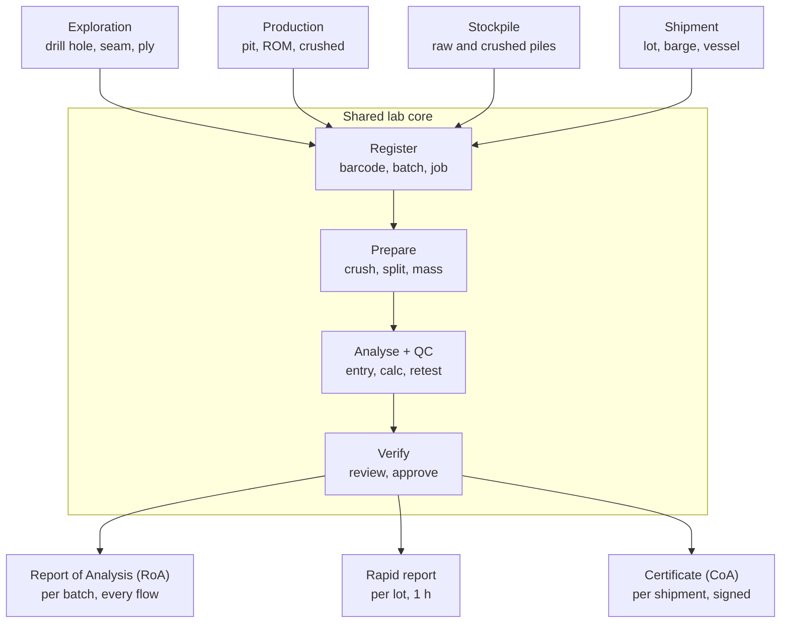
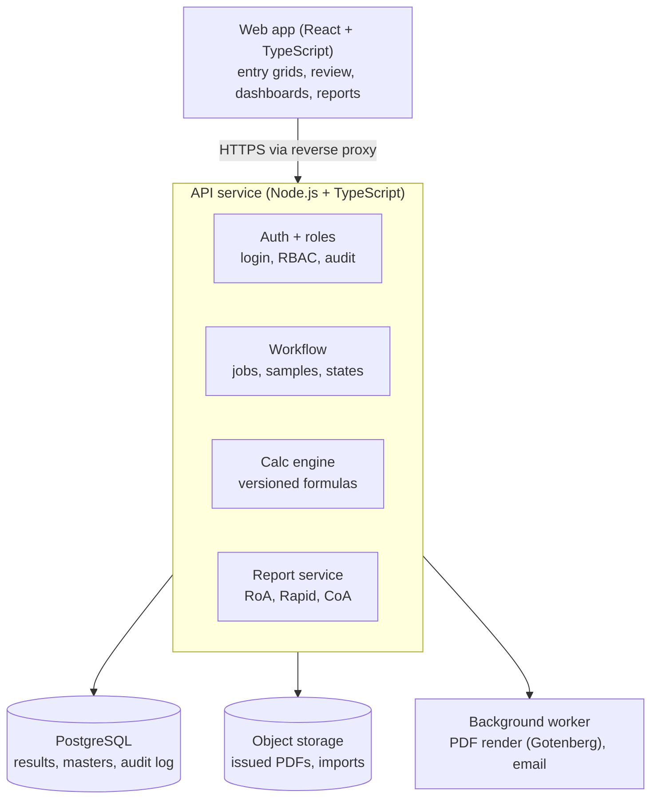

# Coal LIMS — Research & Project Plan

Oct 16, 2026 · Boy (updated Oct 19, 2026 with the sample CoA and RoA)

## Executive summary

v1 ships in 4 weeks and matches SIM Lab screen for screen: exploration samples from drill hole to a verified Report of Analysis (RoA). SIM Lab is itself a lite take on CCLAS, so the target is "CCLAS-lite for coal exploration"; shipment, the generated CoA, production/stockpile flows and supporting modules follow in later releases on the same core.

- **v1 target (4 weeks):** the 9 SIM Lab screens in the SUCOFINDO proposal — Dashboard, Users, Companies, Drill hole, Lithology, Seam, Batch, Input ROA, Review ROA — plus RoA export (PDF/XLSX/CSV) and CoA upload per drill hole, as SIM Lab does.
- **Why this cut:** SIM Lab's screens are the only fully specified reference, and its exploration flow needs no contract specs, lot composites or certificate rules — the parts that would not fit in a month.
- **Benchmarks:** CCLAS for feature depth (public help site), SENAITE for workflow design. Of the enterprise vendors, only LabWare and Thermo SampleManager have real mining offerings; STARLIMS, LabVantage and Caliber do not fit.
- **Core design kept for later releases:** one Job → Sample → Analysis → Result → Report model, method stored on every result, versioned server-side formulas.
- **Stack for speed:** Supabase (Postgres, auth, storage) + React/TypeScript, Docker on a VPS; no custom auth or file service in v1.
- **Mobile and tablet from day one:** every v1 screen works on a phone (from 360 px wide) and a tablet as well as on desktop. Lab staff and clients check batches, dashboards and reports in the field and at the bench; heavy grid entry stays desktop-first but must still be usable on smaller screens (see Responsive, tablet and mobile).
- **First action (day 1–2):** get a SIM Lab login or screen recording and one real batch export to test against.

## Scope

v1 is SIM Lab parity for the exploration flow, delivered in 4 weeks; everything else is sequenced into v2–v4. Instrument and hardware integration stays out of every release.

| Area | v1 — 4 weeks (SIM Lab parity) | v2 | v3+ |
| --- | --- | --- | --- |
| Sample flows | Exploration: drill hole, seam, lithology, depth interval, ply/composite | Shipment/loading: lots, composite, rapid report | Production, stockpile, discharge port |
| Outputs | RoA per batch (PDF/XLSX/CSV); CoA uploaded per drill hole | Generated CoA with numbering, versions, distribution | Pit-to-port dashboard (CQM) |
| Results entry | Manual grid entry per tab, Excel/CSV import | Rapid entry per lot | — |
| Parameter tabs | Information, Basic Analysis, Ultimate, AFT, Ash Analysis, Form of Sulphur, Metal in Ash, Trace Element | Sizing, HGI | Maceral |
| Calculations | FC by difference, ADB → AR/DB/DAF, TM from ADL + RM | Weighted lot averages, NCV, contract formula variants | DMMF |
| QA/QC | Mandatory-field and range checks, recheck flag in review | Duplicates vs repeatability, CRMs, control charts | Proficiency/interlab |
| Workflow | Batch: created → preparation → analysis → finished analysis → completed | Multi-level approval, report void/supersede | — |
| Users | Superadmin, Admin, Client (as SIM Lab) | Analyst/supervisor/signatory split | — |
| Supporting | Audit log | — | Equipment, consumables, personnel (proposal modules) |

The one-month cut follows SIM Lab exactly because it is the only reference with complete screens; the proposal's wider module list (pit-to-port, discharge verification, consumables, equipment, personnel) describes where SIM Lab is going, not what it shows today.

Sources for the scope: SIM Lab screens in the SUCOFINDO proposal for PT Energy Fortune Investment, and the shipment workbook `source-documents/52. OL.294_MV ZHONGHAIHUARUN 1_MELAWAN COAL (1).xlsm` for v2.

## Domain primer

The RoA is the lab's working result report for a batch of samples; the CoA is a signed, binding quality statement for one lot or shipment, issued against a contract. Everything else in this plan exists to produce those two documents correctly.

For v1 only the RoA and the Bases section below apply; RoA vs CoA, rapid vs final and standards per contract are v2 context.

### RoA vs CoA

| | Report of Analysis (RoA) | Certificate of Analysis (CoA) |
| --- | --- | --- |
| Unit | Batch/job of many samples (e.g. 258 drill-hole plies in SIM Lab Batch 3) | One lot, barge, or vessel composite (e.g. MV Zhonghaihuarun 1, 74,000 t) |
| Flows | Exploration, production, stockpile, shipment sub-lots | Shipment/loading (and barge) |
| Content | One row per sample, raw + calculated results, ADB default | One result set, every parameter on every basis the contract names, plus method, sizing, AFT, ultimate |
| Audience | Geology, mine planning, QC, client | Seller, buyer, bank (L/C), customs |
| Status | Can be revised and reissued | Legally binding; changes = new certificate number + void of old |
| Disputes | — | Buyer can call an umpire sample; the umpire result wins only if it differs by more than the reproducibility limit |

On shipments, the seller appoints an independent inspection agency that samples during loading and issues a Certificate of Sampling and Analysis covering the contract parameters ([Law Insider, loadport clause](https://www.lawinsider.com/clause/loadport)). Sub-lot and composite samples are split into shipment, buyer, and umpire portions. If the umpire certificate differs from the challenged certificate by more than inter-laboratory reproducibility (61 kcal/kg for GCV ARB in one contract), the umpire result prevails ([Law Insider, umpire clause](https://www.lawinsider.com/clause/umpire-analysis)). ALS runs certificates through a separate certificate app holding over 30,000 possible calculations, with the seller supplying certificate type and wording per cargo ([ALS](https://www.alsglobal.com/nb/coal/superintending-services)) — the CoA engine is a product of its own, not a print template.

### Sample documents (project files)

Two real documents now fix the output formats: a SUCOFINDO Certificate of Sampling and Analysis for one barge, and a PT Jasa Mutu Mineral Indonesia Report of Analysis for four outcrop samples. Both use ASTM methods, and every converted value on both reproduces with the formulas in Bases and moisture below.

| | CoA sample (`source-documents/pdf-p-COA contoh.pdf`) | RoA sample (`source-documents/pdf-roa-contoh.pdf`) |
| --- | --- | --- |
| Issuer | SUCOFINDO Padang; signed for Dept. of Testing and Consultancy | PT Jasa Mutu Mineral Indonesia, Samarinda; signed by Laboratory Manager |
| Title and number | Certificate of Sampling and Analysis No. 05442/BLAEAP, 9 Dec 2022 | Report of Analysis, Job 640/SS/LAB/X/2018, issued 21 Oct 2018 |
| Unit reported | One barge load: 5,466.721 MT, BG Titan 38 / TB Titan 37 | One job of 4 samples: outcrop codes OC-1, 2, 3, 5 with thickness in the code; lab codes SS-1172 to SS-1176 |
| Header fields | Quantity, tug boat/barge, shipper, consignee, port of loading, port of discharge, date loaded | Job number, date sample received, amount of sample, date issued, attention, email, principal (client), reference |
| Statements | Sampling per ASTM D2234/D2234M-20 during loading from trucks; preparation per ASTM D2013/D2013M-20; analysis per ASTM | Analysis according to ASTM |
| Layout | One table: parameter, unit, AR / ADB / DB / DAFB, method | One block per sample: Air Dried, Dry, Dry Ash Free, As Received columns; method per row |
| Parameters | TM, moisture in analysis sample, Ash, VM, FC, TS, GCV (kcal/kg), HGI | Mass as received (kg), TM, moisture in analysis sample, Ash, VM, FC, TS, GCV |
| Method editions | D3302-19, D3173-17a, D3174-12 (2018 e1), D3175-20, D3172-13 (2021 e1), D4239-18e1 Method A, D5865-19, D409-16 | D3302-12, D3173-11, D3174-12, D3175-11, D3172-07a, D4239-12, D5865-12 |
| Footer | Terms and conditions clause, stamp, signature, form code SCI-2007A, serial barcode | Signature, form code JAMMIN-508 |

Checks run on the printed values. CoA: GCV 6257 ADB gives 6017.6 AR (printed 6018) and 7998.2 DAF (7998); Ash AR 15.75 (15.75); VM DAF 45.19 (45.19); FC DAF 54.81 (54.81). RoA sample OC-1: Ash AR 0.55 (0.55); VM DAF 52.76 (52.76); GCV AR 4748.4 (4748).

What this changes in the build:

- **Method editions are stored, not just method codes.** The same lab moved from D3174-12 to D3174-12 (2018 e1) between the two documents; each result keeps the edition it was run under and the report prints it.
- **A CoA certifies sampling and preparation, not only analysis.** The CoA record carries the sampling standard, the preparation standard and the quantity sampled, and the unit can be a barge as well as a vessel.
- **RoA PDF uses the per-sample block layout** from the sample RoA (4 bases × 8 rows fits a page cleanly); XLSX/CSV keep SIM Lab's one-row-per-sample grid.
- **Mass as received (kg)** is captured at sample receipt and printed on the RoA.

### Rapid vs final (shipment)

The shipment workbook shows two result tiers. Rapid: per sub-lot (2,000–5,000 t), TM, IM, Ash, TS only, 1-hour target, checked live against contract min/max with a rolling average. Final: composite of all lots, full parameter set, TAT 24 h (single loading point) or 36 h (two points). The rapid report goes to the client's shift QC; the final goes to marketing and becomes the CoA.

### Standards

ISO (international), ASTM (US), and GB/T (Chinese recommended national standard) each define their own procedure per parameter. Ash and volatile matter differ in temperature (ASTM ash 750 °C vs ISO/GB/T 815 °C; ASTM VM 950 °C vs ISO/GB/T 900 °C), so the same coal gives different numbers. The workbook's Database sheet records Method = ISO or ASTM per shipment. Rule for the system: method is chosen per job, stored on every result, and drives repeatability limits and the certificate's basis notation.

### Bases and moisture

Results are measured on the air-dried analysis sample (ADB/AD) and converted. Formulas below were checked against the workbook (Ash AD 8.1, IM 12.7, TM 23.3 gives Ash AR 7.1, DB 9.3; VM DAF 47.3).

```latex
X_{ar} = X_{ad}\cdot\frac{100-TM}{100-IM}\qquad X_{db} = X_{ad}\cdot\frac{100}{100-IM}\qquad X_{daf} = X_{ad}\cdot\frac{100}{100-IM-A_{ad}}
```

```latex
FC_{ad} = 100-(IM+A_{ad}+VM_{ad})\qquad TM = ADL + RM\cdot\frac{100-ADL}{100}
```

Two-stage total moisture (air-dry loss ADL 10.74 + residual moisture RM 14.12 → TM 23.3) matches the workbook. Net calorific value needs hydrogen (and per ISO 1928, oxygen and nitrogen), so its formula is method-specific and must be confirmed with the lab.

## Competitor & reference research

SIM Lab is the target and CCLAS is the ceiling: SIM Lab delivers the CCLAS core (registration, prep, results, review, reports) for coal exploration without instrument capture, consumables or invoicing. The enterprise LIMS vendors confirm that mining labs buy depth we deliberately leave out; none documents a coal-exploration or coal-shipment flow out of the box.

### Systems reviewed

| System | What it is | Role in this project |
| --- | --- | --- |
| SIM Lab (SUCOFINDO) | Internal web LIMS, a lite version of CCLAS; 9 screens shown in the proposal, exploration only | **v1 target — screen-for-screen parity** |
| [CCLAS (Datamine)](https://docs.dataminesoftware.com/CCLAS-EL/Latest/B-Introduction-Topics/What-is-CCLAS-EL.htm) | Commercial mining/commercial-lab LIMS; Windows CCLAS EL and SaaS [CCLAS 6](https://docs.dataminesoftware.com/CCLAS-6/index.htm); ex-Mincom/ABB, Datamine since 2019 ([LIMSWiki](https://test.limswiki.org/index.php/Datamine_Software_Ltd.)) | Reference SIM Lab was built from; feature source for v2+. Public help site |
| [SENAITE](https://github.com/senaite/senaite.core) | Open-source LIMS, Python on Plone ([docs](https://senaitecore.readthedocs.io/)); publishes PDF reports via [SENAITE IMPRESS](https://pypi.org/project/senaite.impress/) | Design reference for states, retest, publish/email |
| [Bika LIMS](https://sourceforge.net/p/bika/) | Built on SENAITE core; adds bulk import, COA templates, geochemistry branch | Shows which add-ons labs ask for first |
| [MetaLIMS](https://github.com/cheinle/MetaLIMS) | PHP/MySQL LIMS for metagenomics; unmaintained | Not relevant |
| Shipment workbook | Excel/VBA per vessel: rapid per lot, composite, COA sheet | Requirements for v2 |

### Enterprise vendors

LabWare and Thermo SampleManager are the only two with real mining offerings; both sell on instrument, ERP and plant integration, which v1 excludes. Use them for feature ideas, not as a scope or price model.

| Vendor | Mining fit | What the public material shows |
| --- | --- | --- |
| [LabWare](https://www.labware.com/industries/mining-metals) | Strong | Pre-configured Mining Template; customers incl. Barrick, Newmont, BHP, Boliden. A regional [mining template](https://2025.minexasia.com/?p=228983) covers equipment, internal QC, standards and reagents, personnel, crucibles, signed reports, non-conformities |
| [Thermo Fisher SampleManager](https://www.thermofisher.com/mx/en/home/digital-solutions/lab-informatics/lims-metal-mining-industry.html) | Strong | Metals and mining page; links lab to PIMS, MES and ERP; ISO 17025 support; [coal developers named](https://agg-net.com/news/data-management-solutions-from-thermo-fisher-scientific) as LIMS adopters |
| [STARLIMS](https://en.wikipedia.org/wiki/Starlims) | Weak | Enterprise, regulated-lab focus; no mining package found. Owner changed twice: Francisco Partners (2021), Turn/River Capital (January 2026) |
| [LabVantage](https://technology-products.dksh.com/product/labvantage-pre-packaged-solutions/) | Weak | Packaged editions for pharma, food and beverage, oil and gas, biobanking, diagnostics; no mining edition |
| [Caliber Technologies](https://test.limswiki.org/index.php/Caliber_Technologies_Pvt._Ltd) | None | CaliberLIMS is pharma-focused; its petrochemical Pet-LIMS appears discontinued end of 2019 |

Closer in size to this project and worth a later look: [LabKey Mining LIMS](https://www.labkey.com/solutions/mining-lims/) and [Wavefront LIMS](https://www.wavefrontsoftware.com/lims-for-mining/).

### Feature matrix

Y = documented, P = partial, — = not documented. CCLAS and SENAITE columns come from their public docs; SIM Lab from the proposal screens.

| Capability | CCLAS | SIM Lab | SENAITE | v1 (4 wk) | Later |
| --- | --- | --- | --- | --- | --- |
| Users and roles | Y | Y (Superadmin, Admin, Client) | Y | Y | Finer roles v2 |
| Company/client master | Y | Y | Y | Y | — |
| Drill hole, lithology, seam masters | — | Y | — | Y | — |
| Batch registration with deadline | Y | Y | Y | Y | — |
| Barcode labels | Y | — | Y | — | v2 |
| Preparation start/finish tracking | Y | Y | — | Y | Prep stages + masses v2 |
| Tabbed result entry (Basic … Trace element) | Y | Y | P | Y | — |
| Configurable calculations | Y | P | Y (Python) | P (fixed set, versioned) | Per-contract v2 |
| Recheck flag in review | — | Y | Y | Y | Full retest workflow v2 |
| Duplicates, CRMs, control charts | Y (SPC) | — | Y | — | v2 |
| Specs min/max per contract | Y | — | Y | — | v2 |
| RoA export PDF/XLSX/CSV | Y | Y | Y | Y | — |
| CoA | Y (generated) | Upload only | Y (publish) | Upload only | Generated v2 |
| Dashboard: batch stats, bivariate, trend | Y | Y | P | Y | Pit-to-port v3 |
| Lot/barge/vessel + composite | — | — | — | — | v2 |
| Instrument data capture | Y | — | Y | Out | Out |
| Equipment, consumables, personnel | Y | — | — | — | v4 |
| Audit trail | Y | — | Y | Y | — |
| REST API | — | — | Y | Y (Supabase) | — |

### What to borrow

- **From SENAITE:** an explicit analysis state machine (registered → received → to be verified → verified → published, with retract/retest), QC items as first-class rows on a worksheet, specifications with open min or max, and calculations that take other results as inputs.
- **From CCLAS:** SPC charts on reference standards, worklist generation per instrument/analyst, multi-format and multi-language client reports.
- **From SIM Lab:** the exploration master data (drill hole, lithology, seam), the tabbed result entry (Basic, Ultimate, AFT, Ash analysis, Form of sulphur, Metal in ash, Trace element), and per-sample recheck flags in review.
- **From the workbook:** contract spec per buyer, rapid vs final tiers, rolling averages, TAT clocks, distribution lists per client.

SIM Lab column is read from the proposal screens; the dashboard and recheck behaviour should be confirmed against a live SIM Lab session in week 1.

## Functional design

v1 builds the exploration column of the flow below plus the shared lab core and the RoA; the other three sources, the rapid report and the generated CoA arrive in v2–v3 on the same core.



In v1, Prepare and Analyse are tracked as start/finish timestamps per batch (as SIM Lab does), and Verify is the Review ROA screen with per-sample recheck flags.

### v1 screens (SIM Lab parity)

| # | Screen | What SIM Lab shows | v1 build notes | Week |
| --- | --- | --- | --- | --- |
| 1 | Users (Manajemen User) | Search; filter by role, created date, status; company, email, name, role, status, registration date; view/delete; add user | Supabase Auth; roles Superadmin, Admin, Client; client users scoped to one company | 1 |
| 2 | Companies (Manajemen Perusahaan) | Name, code, address, status, total samples, created date; edit/delete | Total samples as a count view | 1 |
| 3 | Drill hole | Code, description, total samples, company, CoA status; edit, upload CoA, delete | CoA = PDF upload to storage, one per drill hole | 1 |
| 4 | Lithology | Name, description (coal/parting/no lithology), total samples, company | Per-company list | 1 |
| 5 | Seam classification | Code, description, company | Per-company list | 1 |
| 6 | Batch list | Filters status, arrival date, deadline; company, batch no., batch date, deadline, samples done/total, status, RoA downloads; delete/edit/open | Status: created → preparation → analysis → finished analysis → completed | 2 |
| 7 | Input ROA | Pick batch; batch info; export PDF/XLSX/CSV; Preparation and Analysis start/finish with user; entry rules; tabs Information, Basic Analysis, Ultimate, AFT, Ash Analysis, Form of Sulphur, Metal in Ash, Trace Element; grid lab code, drill hole, sample ID, ply/comp, depth from/to; save per row, save-and-add | Spreadsheet-style grid; comma decimal; sample info locked after Start Preparation; Excel import; live calc preview | 2–3 |
| 8 | Review ROA | Same batch info and tabs; select samples to flag recheck; thickness and interval lithology shown; save all; Complete Batch | Recheck sends sample back to Input ROA; Complete Batch locks results and enables RoA | 3 |
| 9 | Dashboard | Batch counts (in progress, completed, total) for a date range; bivariate plots CV vs Ash, RD vs Ash, FC vs GCV (ADB) with regression and R²; CV (arb) trend; drill-hole list with RoA downloads and CoA status | Regression computed server-side; filters by company. v1 ships dashboard v2 instead (Nov 5, 2026): Operations and Quality & reports tabs on v1 data (`../Dashboard/Dashboard_v2_Screen_Plan.md`) | 4 |
| — | RoA export | PDF, XLSX, CSV per batch and per drill hole | HTML → PDF (Gotenberg); XLSX via SheetJS | 3 |

The proposal's "Dashboard Pit to Port" (TM, Ash, TS bars by stage) needs production, stockpile and shipment data, so it moves to v3.

RoA export layouts in v1: the PDF follows the sample RoA in the project files (header block, then one table per sample with Air Dried, Dry, DAF and As Received columns and the method on each row); XLSX and CSV follow SIM Lab's one-row-per-sample grid.

### Responsive, tablet and mobile

v1 is one responsive web app, not a separate mobile or tablet app: the same React screens adapt to the width. Each screen is designed in `screens.pen` at three sizes, desktop (1440), tablet (834, portrait) and mobile (390), and all three are reviewed before it is built. Tablet landscape (1112–1194 px) uses the tablet layout with more room, and is checked on the device rather than drawn.

| Breakpoint | Width | Navigation | Layout |
| --- | --- | --- | --- |
| Mobile | 360–767 px | Top bar with a menu button that opens a full-height drawer holding all nav entries; user chip inside the drawer | One column; filters in a bottom sheet; tables become card lists |
| Tablet | 768–1199 px | Collapsed icon rail (64 px, icons only, labels as tooltips); Master Data group opens as a flyout. From dashboard v2: an expand button opens the full sidebar over the content | Two columns where it fits; filters inline in the page header; tables keep their columns but drop the least important ones |
| Desktop | ≥ 1200 px | Icon rail and top bar in v1. From dashboard v2: expandable sidebar, 248 px with labels and groups, or collapsed to the 88 px rail, with the choice remembered per user | As designed at 1440 |

The expandable sidebar is specified in `../Dashboard/Dashboard_v2_Screen_Plan.md` (Expandable sidebar). It is in the component library and applies to every screen.

How each v1 screen behaves on tablet and phone:

| Screen | Tablet behaviour | Mobile behaviour |
| --- | --- | --- |
| Dashboard | KPI cards in one row of three; bivariate charts two per row, the third full width; trend chart full width; drill-hole list as a table | KPI cards in a 2-up then 1-up grid; each chart full width and stacked; trend chart scrolls sideways; drill-hole list as cards with RoA and CoA actions |
| Users, Companies, Drill hole, Lithology, Seam | Table with the key columns; row actions in an overflow menu; add/edit in a side sheet | List as cards (primary field, two secondary fields, status badge); row actions in an overflow menu; add/edit as a full-screen form |
| Batch list | Table with batch no., company, deadline, samples done/total, status; RoA downloads in the overflow menu | Cards showing batch no., company, deadline, samples done/total and status; filters in a bottom sheet |
| Input ROA | Spreadsheet grid with the sample columns frozen and the parameter columns scrolling sideways; Excel import available | One sample at a time as a form, with next/previous sample and the active tab's fields; Excel import is desktop and tablet only |
| Review ROA | Grid as on desktop with frozen sample columns; Complete Batch in the header | Sample cards with the key results and a recheck toggle; Complete Batch as a sticky bottom button |
| RoA / CoA | Downloads and uploads as on desktop | Downloads and uploads work from a phone (native file picker and share sheet) |

Rules: touch targets at least 44 × 44 px on tablet and phone; no horizontal page scroll (only inside a chart or a wide table); body text at least 14 px; numbers keep their full precision and are never shortened to fit.

### Later modules

| Module | Release |
| --- | --- |
| Shipment desk: lots, rapid report, composite, contract specs | v2 |
| Generated CoA with numbering, versions, email distribution | v2 |
| QA/QC: duplicates vs repeatability, CRMs, control charts, retest queue | v2 |
| Production and stockpile registration; pit-to-port dashboard | v3 |
| Equipment, consumables, personnel (proposal supporting modules) | v4 |

### Roles

| Role (v1, as SIM Lab) | Can |
| --- | --- |
| Superadmin | Everything, including users and companies |
| Admin (lab staff) | Masters, batches, preparation/analysis, result entry, review, complete batch, uploads |
| Client | Read own company's batches, RoA downloads, CoA uploads and dashboard |

v2 splits Admin into sample clerk, analyst, supervisor and signatory once CoAs need sign-off.

## Data model

One generic core — Job → Sample → Analysis → Result → Report — with flow-specific context tables hanging off Job and Sample. Exploration and shipment differ only in where a sample comes from, not in how it is analysed or reported.

**v1 builds only:** Company, Drill hole, Seam, Lithology, Interval, Job (type exploration), Batch, Sample, Parameter, Method, Formula, Analysis, Replicate, Result, Report (RoA + uploaded CoA file), User/Role/Audit log. Contract, Spec, Location, Shipment, Lot, Prep event, QC item and Distribution list are created as empty tables in v1 so v2 adds features, not migrations.

**Fields added from the sample RoA, CoA and workbook:** Method gets an edition (e.g. ASTM D3174-12 (2018 e1)); Sample gets mass as received (kg); Report gets issuer office, form code, signatory and title, attention/principal/reference (RoA) and quantity, barge/vessel, shipper, consignee, ports, date loaded, sampling and preparation standards (CoA). The Parameter master is seeded from the workbook's `Surveyor_Template` sheet: about 230 lab parameters in 14 categories, each with an ID (P001…), basis, unit and required flag.

| Domain | Entity | Key fields | Notes |
| --- | --- | --- | --- |
| Parties | Company / Client | name, code, address | PT Bukit Asam, KPC, etc. |
| Parties | Contract | client, buyer, S-number, method (ISO/ASTM/GB/T), formula set | Workbook: S-19642, RWOOD China, ISO |
| Parties | Spec | contract, parameter, basis, min, max, target | Drives warning/critical flags |
| Work | Job | type (exploration, production, stockpile, shipment), order no., client, contract, deadline, status | Order no. e.g. 61010226000267.OL.294 |
| Work | Batch | job, lab batch no., received, prep start/end, analysis start/end | Matches SIM Lab Batch screen |
| Exploration | Drill hole, Seam, Lithology | code, company; seam code; lithology type | SIM Lab master data |
| Exploration | Interval | drill hole, seam, lithology, depth from/to, thickness, ply/composite | Thickness = to − from |
| Production/stockpile | Location | pit, ROM pad, stockpile, crusher; raw/crushed | Free-form hierarchy, configurable |
| Shipment | Shipment | vessel/barge, loading port, BL date, destination, tonnage draught/belt | |
| Shipment | Lot | shipment, lot no. (1, 6A, 6B…), tonnage, loading point, start/finish | Splits like 6A/6B seen in workbook |
| Samples | Sample | code, barcode, job, batch, context (interval / location / lot), type (routine, composite, duplicate, umpire, retained), parent(s) | Composite has many parents with weights |
| Samples | Prep event | sample, stage (crush −11.2 mm, −4.75 mm, −212 µm), mass, by, at | No balance integration — manual entry |
| Catalogue | Parameter | code (TM, IM, Ash, VM, FC, TS, GCV, NCV, C, H, N, O, HGI, AFT, sizing…), unit, decimals, measured or calculated | |
| Catalogue | Method | parameter, standard family, code (e.g. ISO 1171), repeatability r, reproducibility R | |
| Catalogue | Formula | parameter, inputs, expression, version, valid from | Versioned, never edited in place |
| Results | Analysis | sample, parameter, method, status, retest of | State machine below |
| Results | Replicate | analysis, raw value(s), entered by, at | Duplicate pair lives here |
| Results | Result | analysis, value, basis, formula version, verified by, at | Reported value |
| QC | QC item | batch, type (CRM, blank, duplicate), reference material, expected range | |
| Output | Report | type (RoA, Rapid, CoA), number, version, status (draft, issued, superseded, void), signed by, PDF hash | Immutable once issued |
| Output | Distribution list | client, report type, to/cc emails | Workbook "Report" sheet |
| System | User, Role, Audit log | who, what, before/after, when | Every result and report change |

Analysis states: registered → in prep → in analysis → submitted → verified → reported, with branches retract → retest and reject. A report can only include verified results.

## Calculations & QA/QC rules

All calculations run server-side from versioned formulas, and every stored result keeps the formula version that produced it — a CoA must reproduce exactly years later. The client sees a live preview while typing, but only the server value is saved.

**v1 subset:** FC by difference, ADB → AR/DB/DAF for Basic Analysis and Ultimate, TM from ADL + RM, depth thickness, and the dashboard regressions. QA/QC in v1 is rules 6 (range and logic checks) and a manual recheck flag; rules 1–5 and 7 arrive in v2.

### Calculation engine

| Group | Calculations | Inputs |
| --- | --- | --- |
| Moisture | TM from ADL + RM; IM (M ad) | Raw weights or % |
| Proximate | FC by difference | IM, Ash, VM (AD) |
| Basis conversion | AD → AR, DB, DAF (DMMF later) for Ash, VM, FC, TS, GCV, ultimate | TM, IM, Ash AD |
| Calorific | GCV unit conversion (cal/g, kcal/kg, MJ/kg); NCV AR | GCV, H, O, N, TM — formula per method |
| Shipment | Tonnage-weighted lot averages; rolling average; composite vs lot-average difference | Lot tonnage (belt/draught), rapid results |
| Sizing | % passing / retained per sieve (−2, −3, −10, −50, +50, −100 mm) | Fraction weights |
| Ultimate | O by difference; C, H, N, S on all bases | C, H, N, S, Ash, IM |

Formulas are stored as a parameter graph: each calculated parameter declares its inputs, so the engine recomputes dependents when an input changes (SENAITE uses the same idea). The workbook's "SCI formula" vs "KPC formula" columns show clients can require their own variant — formulas are therefore selectable per contract, not hard-coded.

### QA/QC rules

1. **Duplicates.** Each parameter is run in duplicate; the pair must agree within the method's repeatability limit r. Outside r → automatic retest flag, result cannot be verified.
2. **Reference materials.** A CRM or in-house standard per run; result must sit inside its certified range. Plotted on a Shewhart control chart with warning (±2σ) and action (±3σ) lines.
3. **Blanks** where the method calls for them (sulfur, trace elements).
4. **Rapid vs final check.** Final composite ash (DB) compared with the tonnage-weighted rapid average — the workbook already has a sheet for this difference.
5. **Contract spec check.** Every lot and the composite compared with the buyer's min/max/target: normal, warning, critical.
6. **Range and logic checks.** e.g. IM < TM, Ash + VM + IM < 100, GCV within plausible band for the seam.
7. **TAT clocks.** Rapid: received → reported (target 1 h). Final: end of loading → report (24 h or 36 h by loading configuration).

Repeatability limits and CRM ranges are master data per method, entered from the lab's controlled copy of each standard.

## Technical architecture & stack

For a 4-week v1, run Supabase (self-hosted Postgres, Auth, Storage) under a thin TypeScript API and a React front end, all in Docker Compose. Supabase removes auth, file storage and CRUD plumbing from the month; the TypeScript API keeps the batch state machine, calc engine and report rendering out of the browser so v2 can grow on it.



The calc engine is highlighted because every RoA and CoA number passes through it; it gets the heaviest test coverage.

### Recommended stack

| Layer | Choice | Why |
| --- | --- | --- |
| Database | PostgreSQL 16, `numeric` for results | Relational model fits LIMS; exact decimals, no float drift on certificates |
| API | Node.js + TypeScript (NestJS or Fastify), Drizzle ORM | One language with the UI; typed state machine and formulas |
| Calc engine | Shared TS package, decimal.js, formulas as versioned rows | Same code for live preview and server; reproducible years later |
| Front end | React + TypeScript, AG Grid (or TanStack Table) for entry, ECharts for control charts; responsive layout, mobile-first CSS with the breakpoints in Responsive, tablet and mobile | Lab users live in spreadsheet-style grids; ECharts is touch-friendly and resizes with the container |
| Auth | Keycloak or Supabase Auth; role checks in the API | SSO-ready if the client has AD |
| Reports | HTML templates → PDF via Gotenberg; SHA-256 stored with each issued file | Pixel-stable CoA, tamper evidence |
| Icons | [Phosphor Icons](https://phosphoricons.com/) via `@phosphor-icons/react`; regular weight by default | One consistent set with six weights; tree-shakeable per-icon imports; same library as the design file (`screens.pen`) |
| Files | MinIO or Supabase Storage (S3 API) | Issued PDFs, import files |
| Jobs | BullMQ + Redis worker | PDF rendering and email off the request path |
| Audit | Postgres triggers into an append-only audit table | Cannot be bypassed by app bugs |
| Deploy | Docker Compose behind Caddy/Traefik; nightly pg_dump + WAL archive | Runs on one VPS or an on-site server |

### Typography

Three families, set as variables in `screens.pen`: `font-display` for headings and titles, `font-primary` for body and controls, and `font-mono` (JetBrains Mono) for codes, numbers in tables and every uppercase label.

| Style | Spec | Use |
| --- | --- | --- |
| Section header | Mono 11 / 16, weight 500, letter-spacing +1.5, uppercase, `text-muted` | Section titles inside forms, sheets, modals and cards (COMPANY, WORK, REPORT); navigation group labels |
| Overline | Same spec | Page overline (date line), small captions above a heading |

Table header rows have a `primary-50` background with radius 8, in every table and grid (components `Table/Header Row`, `· Drill hole`, `· Job order`, `· Job order · Compact`, and the hand-built grid and batch headers).

Rule: uppercase labels are always JetBrains Mono, never the body font. Sentence-case field labels, panel titles and buttons stay in `font-primary`. Both styles are documented in the Typography scale of the Foundations frame.

### Iconography

All icons come from [Phosphor Icons](https://phosphoricons.com/), in the design file and in the app. Sizes 16 / 18 / 20 (22 in the navigation rail); regular weight by default, bold for 14px indicators, duotone only for empty states. Import icons individually from `@phosphor-icons/react` and never mix in another icon set. Icon names used in `screens.pen`:

| Use | Phosphor icon |
| --- | --- |
| Dashboard / Users / Companies | `squares-four` / `users` / `buildings` |
| Drill hole / Lithology / Seam | `cylinder` / `stack` / `rows` |
| Batch / Input ROA / Review ROA | `package` / `flask` / `clipboard-text` |
| RoA, CoA file / Upload / Export | `file-text` / `upload-simple` / `download-simple` |
| Recheck / Alert / Error | `arrows-counter-clockwise` / `warning` / `warning-circle` |
| Locked cell / Calculated cell / TAT clock | `lock-simple` / `function` / `alarm` |
| Add / Confirm / Search / Date | `plus` / `check` / `magnifying-glass` / `calendar-blank` |
| Sort / Expand / Pagination | `arrows-down-up` / `caret-down` / `caret-left`, `caret-right` |
| Trend / open link | `arrow-up-right` |
| Sidebar collapse / expand / mobile menu | `caret-double-left` / `caret-double-right` / `list` |
| CoA uploaded / download PDF, XLSX, CSV | `check-circle` / `file-pdf`, `file-xls`, `file-csv` |

Drill hole has no exact Phosphor glyph; `cylinder` is the stand-in until the team picks something better.

### Dark mode

**Superseded values (Oct 29, 2026).** The product owner corrected the colour tokens in the FigCraft file (nine dark values and the light `muted`). The current set, with contrast ratios and open findings, is in `../Design System/Design_Tokens.md`; the dark values quoted in this section and in Revisions 1 and 2 below are history and no longer match the design file (for example `accent` is amber `#F1AA41` again and `primary` is the mid blue `#3D69B0`).

Status (Oct 27, 2026): **built**, then revised the same day: the accent is a **lighter blue (`#8DB4F0`)** and the dark logo is **all white** (Revision 2 below, built). Sections written before it still describe the first yellow build; where they differ, Revision 2 wins.

#### Revision 2 · Lighter blue accent and all-white logo (BUILT, Oct 27, 2026)

The user changed two decisions after seeing the build:

| Was | Now |
| --- | --- |
| Dark-mode accent and active states are yellow (`#F5B700`) | They are a **lighter blue** |
| Reversed logo: navy parts turned light, orange-to-rust stripes kept | Inverted logo is **all white**: mark, divider rule and wordmark |

**1. Lighter blue.** Candidates measured against the dark surfaces (contrast ratios):

| Blue | Navy text `#0A1A33` on it | White text on it | Against `card #101F36` | Against `background #0A1424` |
| --- | --- | --- | --- | --- |
| `#5B8FE0` | 5.3 | 3.3 | 5.1 | 5.7 |
| `#6E9BE6` | 6.2 | 2.8 | 5.9 | 6.6 |
| `#7FA3DB` (today's `brand-text`) | 6.8 | 2.6 | 6.4 | 7.2 |
| **`#8DB4F0` (chosen)** | **8.2** | 2.1 | **7.8** | **8.7** |

`#8DB4F0` is clearly lighter than every blue surface, so active states still stand out, and navy text on it reads at 8.2:1. White text fails on all light blues, so text and icons on the blue stay navy (`action-foreground #0A1A33`, unchanged). Links and text buttons use the same blue, so dark mode has one accent blue instead of two near-identical ones.

Dark values that change (light values do not change):

| Token | Dark now | Dark after |
| --- | --- | --- |
| `action`, `action-strong` | `#F5B700` | `#8DB4F0` |
| `action-hover` | `#FFD24D` | `#A9C6F5` |
| `nav-indicator`, `selected-ring` | `#F5B700` | `#8DB4F0` |
| `brand-text` | `#7FA3DB` | `#8DB4F0` |
| `accent` | `#F5B700` | `#8DB4F0` |
| `accent-soft`, `accent-text` | `#FFD24D` | `#A9C6F5` |
| `accent-100` | `#3A2E0A` | `#1E3A66` |
| `accent-foreground` | `#0A1A33` | `#0A1A33` (unchanged) |

What stays yellow or amber in dark: `warning`, `status-prep` and `chart-2`. They carry meaning (a warning, the Preparation stage, a chart series), not the accent, so they keep their own hue; otherwise Preparation would look like "Analysis" (also blue).

**2. All-white logo.** Every visible pixel of the logo becomes `#FFFFFF` with its alpha kept: stripes, wave, divider rule and wordmark. The transparent gaps between the stripes keep the mark readable as a single-colour mark. White on `background #0A1424` is 18.5:1. New files, same script with "all pixels" instead of "navy pixels only":

| New file | Replaces |
| --- | --- |
| `assets/sgsi-logo-white.png` | `assets/sgsi-logo-reversed.png` |
| `assets/sgsi-logo-icon-white.png` | `assets/sgsi-logo-icon-reversed.png` |
| `images/sgsi-logo-white.png` (for `screens.pen`) | `images/sgsi-logo-reversed.png` |

The three `-reversed` files were deleted after nothing pointed to them. Documents (RoA, CoA, labels, emails) still use the original colour logo.

**3. Build steps (done).**

1. Generate the three white files; check them on `#0A1424`.
2. Update the dark values listed above with `SetVariables` (merge; light values untouched).
3. Point the logo in both dark frames and in the Foundations "Dark mode" stage to `images/sgsi-logo-white.png`; delete the `-reversed` files.
4. Update the Foundations texts: role-token hex labels, dark-stage description, swatch hex labels for `accent`, `action` and `brand-text`.
5. Zoom-check both dark frames: primary button, switch, active chip, tabs, selected pills, nav item and indicator, pagination, logo. Check one light frame is unchanged.
6. Update this section (tokens table, decisions, build result) and the job order plan.

No component needs rebinding: they already use the role tokens, so only the token values change.

#### Tokens (built)

Colour tokens are themed: theme axis `mode` with `light` (default, the existing values) and `dark`. In `screens.pen` a frame switches with `theme: {mode: "dark"}`; in the app the same values become CSS variables under `[data-theme="dark"]`.

| Group | Dark values |
| --- | --- |
| Blue (darker than light mode) | `primary #122B52`, `primary-deep #081B38`, `primary-hover #0E2347`, `primary-50..400` `#0F1E36` `#14284A` `#1E3A66` `#3A5A8E` `#6E8EC0` |
| Accent (yellow) | `accent #F5B700`, `accent-soft #FFD24D`, `accent-100 #3A2E0A`, `accent-text #FFD24D`, `accent-foreground #0A1A33` |
| Surfaces | `background #0A1424`, `shell #0D1A2E`, `card #101F36`, `muted #14243D`, `sand #1A2C48`, `border #1F3250`, `border-strong #2C4468`, `divider #172740` |
| Text | `foreground #EDF1F7`, `heading #F4F7FB`, `text-secondary #A9B6CC`, `text-muted #7F8DA6` |
| Status and charts | Lighter versions of each hue on dark tints, e.g. `success #4FB287` on `#12302A`, `error #E2573A` on `#3A1D16`, `chart-1 #5B8FE0` |

#### Problems found in the dark preview

| Problem | Cause |
| --- | --- |
| Primary button, switch "on", active status chip, "on" toggle chip and active nav item do not stand out | They fill with `primary` / `primary-deep`, which in dark are as dark as the surfaces (`card #101F36`, `background #0A1424`) |
| Active tab underline is invisible | `Tab/Underline` uses `accent-foreground` for its stroke; that token is the navy meant for text on yellow |
| Selected parameter pill looks flat | Pale `primary-50` fill with a `primary` stroke, both dark in dark mode |
| Logo mark blends into the top bar | The mark is a PNG; its navy wave (`#012042`) and the wordmark sit on a navy-black bar. Tokens cannot recolour an image |

Root cause: `primary` means both "the brand blue" and "the colour of anything active". A darker blue cannot do both jobs on dark surfaces.

#### Decisions

| Decision | Status |
| --- | --- |
| Active and standout elements use the **yellow accent** in dark mode (navy text on yellow) | Confirmed Oct 27; **replaced by Revision 2: lighter blue `#8DB4F0`** |
| The logo uses a **reversed version** in dark mode (navy parts turned light), not a light tile behind it | Confirmed Oct 27; **replaced by Revision 2: all-white logo** (built) |
| Active sidebar item: lighter navy fill with a thin yellow bar on the left, not fully yellow | Default, not confirmed |
| `primary` stays the darker brand blue for surfaces and large brand areas | Follows from the first decision |

#### Role tokens (built)

Light values equal today's, so light mode does not change.

| Token | Light | Dark | Used for |
| --- | --- | --- | --- |
| `action` | `#1B3A6F` | `#F5B700` | Fill of the primary button, switch on, active filter chip, "on" toggle chip, segmented control active segment, checked checkbox; stroke of the active tab underline and the selected pill |
| `action-hover` | `#15305C` | `#FFD24D` | Hover and pressed state of the above |
| `action-foreground` | `#FFFFFF` | `#0A1A33` | Text and icons on `action` |
| `brand-text` | `#1B3A6F` | `#7FA3DB` | Links, tertiary buttons (+ Add contact), icons and text that use `primary` on a surface |
| `nav-active` | `#0E2A4E` | `#1E3A66` | Active sidebar item fill |
| `action-strong` | `#0E2A4E` | `#F5B700` | Active elements that are deep navy in light: active status chip, "on" toggle chip, tab underline, filled icon button, active pagination page. Added during the build so light mode stays identical |
| `nav-indicator` | transparent | `#F5B700` | 3 px bar on the active nav item, ring on the active rail item; invisible in light |
| `selected-ring` | transparent | `#F5B700` | 1 px stroke on selected ghost elements (the active quick-select template); invisible in light |

Contrast check targets: navy `#0A1A33` on yellow `#F5B700` is about 9:1; `brand-text #7FA3DB` on `card #101F36` is about 6:1; both pass WCAG AA.

#### Components rebound (built)

| Component | Change |
| --- | --- |
| `Button/Primary` | Fill `action`, label and icon `action-foreground` |
| `Switch · On` | Fill `action`; knob stays `card` |
| `Chip/Status` (active), `Toggle Chip · On`, `Segmented Control` active segment | Fill `action`, text `action-foreground` |
| `Tab/Underline`, `Tab/Active` | Underline stroke `action`; active label stays `heading` |
| `Pill/Parameter · On`, `Pill/Group · On` | Stroke `action`, icon `brand-text`, label `heading` |
| `Nav Item/Active`, `Rail/Active` | Fill `nav-active`, plus the yellow bar in dark |
| `Checkbox/Checked` and the checkboxes in the Ash analysis checklist | Fill `action`, check `action-foreground` |
| Frames built by hand (contact and signatory dropdowns, sheets, Ash checklist) | Sweep: shape fills that use `$primary` become `$action`; text and icons that use `$primary` become `$brand-text` |

#### Reversed logo (built)

What the files are:

| File | Size | Use |
| --- | --- | --- |
| `assets/sgsi-logo.png` (same as `images/sgsi-logo.png`, which `screens.pen` uses) | 1000 × 354, lockup: mark, divider rule, wordmark | Login, top bar brand |
| `assets/sgsi-logo-icon.png` | 256 × 256, mark only | Collapsed sidebar, mobile top bar, favicon source |

Both are PNGs with transparent gaps between the stripes. The navy is a single colour, `#012042`, used for the bottom wave of the mark, the divider rule and the wordmark. The orange-to-rust stripes (`#FA9D10` to `#BB2810`) already read on dark backgrounds.

How the reversed version is made:

1. A short Pillow script turns every navy pixel to `#F4F7FB` (the dark-mode `heading` colour) and keeps each pixel's alpha, so the anti-aliased edges stay smooth. Pixels are matched by distance to `#012042`, so stripe colours are never touched.
2. The stripes are left as they are. Because the gaps are transparent, the dark background still shows between the rust stripe and the now-light wave, so the wave keeps its shape. The darkest stripe (rust `#BB2810`) is 3.0:1 on `background #0A1424`, exactly the WCAG minimum for graphics; the light wave (`#F4F7FB`, 17:1) carries the shape, so the stripes are not changed.
3. Output files: `assets/sgsi-logo-reversed.png`, `assets/sgsi-logo-icon-reversed.png`, and a copy at `images/sgsi-logo-reversed.png` for `screens.pen`. Each is checked by eye on `background #0A1424` and on `shell #0D1A2E`.

Where it is used:

| Place | Light | Dark |
| --- | --- | --- |
| Top bar, sidebar header, mobile top bar and drawer, login | Original | Reversed |
| RoA and CoA PDFs, printed labels, emails | Original | Original (documents are always light) |

In `screens.pen`, an image fill cannot follow the theme, so dark frames override the `Logomark` fill of their Top Bar or Sidebar instance with the reversed file. In the app, the brand component picks the file from the active theme (`data-theme`), with `prefers-color-scheme` as the fallback on the login page.

Brand approval: the reversed logo changes the brand artwork. It is our stand-in until SGSI supplies an official reversed or single-colour version; ask them for one before go-live.

#### Build result (Oct 27, 2026)

| Item | Result |
| --- | --- |
| Reversed logo files | `assets/sgsi-logo-reversed.png`, `assets/sgsi-logo-icon-reversed.png`, `images/sgsi-logo-reversed.png`; checked on `#0A1424`, clean edges |
| Role tokens | 8 tokens (table above), light values equal to the old ones |
| Components | Button/Primary, Switch · On, Chip/Status, Toggle Chip · On, Tab/Underline, Tab/Active, Pill/Parameter · On, Pill/Group · On, Nav Item/Active (plus indicator bar), Rail/Active (plus ring), Checkbox/Checked, IconButton/Filled. Light versions checked by screenshot: unchanged |
| Dark frames | "Job Orders · Create · Dark mode preview · Desktop" and "Job Order · Detail · Overview · Desktop · Dark" (in the Detail row). Both swept so direct `$primary` uses follow the roles, and both show the reversed logo |
| Foundations | Colour section: new "Role tokens · light / dark" swatch row and a "Dark mode" stage (dark swatches, reversed logo, live button, switch, tab, chip, pill and nav item) |

Known issue found during the build (not caused by it): in the job order screens the sidebar instance no longer shows the **Job orders** item at all, in light and dark, so no nav item is highlighted on those screens. The sidebar override that turns "Dashboard" into a normal item drops it; resetting the override through the tool did not work. To fix next.

#### Build steps (as planned)

1. Generate and check the two reversed logo files.
2. Add the five role tokens with `SetVariables` (merge, light values unchanged).
3. Rebind the components in the table; sweep the hand-built frames.
4. Override the logo in the dark preview frame.
5. Re-render the dark preview; zoom on the tab, primary button, switch, active chip, selected pill, nav item and logo; check contrast; confirm a light frame looks unchanged.
6. Add a "Dark" row of swatches and the role tokens to the Foundations colour section, plus the reversed logo next to the original.

#### Open points

- Active sidebar item: lighter navy with a yellow bar (default) or fully yellow.
- Official reversed logo from SGSI.
- Scope (Oct 27): dark frames only where asked. Now two: "Job Orders · Create · Dark mode preview · Desktop" and "Job Order · Detail · Overview · Desktop · Dark". Component rebinding still applies everywhere, but light values do not change, so light frames look the same.

### v1 shortcuts (4 weeks)

| Take | Instead of | Revisit in |
| --- | --- | --- |
| Supabase Auth + Row Level Security per company | Keycloak, custom RBAC service | v2 if SSO/AD needed |
| Supabase Storage for CoA uploads and RoA files | MinIO | — |
| Gotenberg called directly from the API | BullMQ worker queue | v2 (email distribution) |
| One RoA template (SIM Lab layout) | Template editor | v2 (CoA templates) |
| Fixed formula set, stored versioned | Formula editor UI | v2 |
| AG Grid community edition for entry | Custom grid | — |

### Alternatives considered

| Option | For | Against |
| --- | --- | --- |
| Fork SENAITE | Mature workflow, QC, publication; ISO 17025-minded | Python/Plone/ZODB stack; lots, tonnage-weighted composites and basis conversion are all custom anyway |
| Supabase only (DB + edge functions) | Fast start, auth and storage built in | State machine, calc engine and report issuing want a real API layer; Supabase still fits underneath |
| Python API (FastAPI) | Strong for scientific calcs | Two languages; calc preview in the browser would need duplication |

### Non-functional requirements

- Works on a slow mine-site connection: grids save per row, retry offline edits for the session.
- Works on phones and tablets: every screen usable from 360 px wide in current mobile Chrome and Safari, portrait and landscape, with the layouts in Responsive, tablet and mobile. UAT includes a pass on a real phone and a real tablet.
- Every result change and report issue is in the audit log with before/after values.
- Issued reports are immutable; corrections create a new version and mark the old one superseded.
- Exports to XLSX/CSV on every list, because users will keep Excel alongside for a while.

## Roadmap & phasing

v1 goes live at the end of week 4, one week per milestone, each closed by a check against real SIM Lab data. This assumes two full-stack developers fluent in React/TypeScript and Supabase, and a lab user available about half-time in weeks 3–4. For comparison, SUCOFINDO's proposal schedules its full module list over 12 months; v1 is the slice of that which SIM Lab already shows.

```mermaid
flowchart TB
  W1["Week 1 · Setup and master data<br/>Docker + Supabase, schema; Users, Companies, Drill hole, Lithology, Seam; SIM Lab walkthrough"]
  W2["Week 2 · Batch and Input ROA (Basic Analysis)<br/>batch list and states, prep/analysis start-finish, entry grid, Excel import, calc engine"]
  W3["Week 3 · Other tabs, Review ROA, RoA export<br/>Ultimate, AFT, Ash, Sulphur forms, Metal in ash, Trace element; recheck; Complete Batch; PDF/XLSX/CSV"]
  W4["Week 4 · Dashboard, UAT, go-live<br/>batch stats, bivariate and trend charts; UAT with lab users on desktop, tablet and phone; fixes; deploy and handover"]
  V2["v2 · Shipment, generated CoA, QA/QC<br/>contracts and specs, lots, rapid report, composite, CoA engine, duplicates, CRMs, control charts"]
  V3["v3 · Production, stockpile, pit-to-port dashboard<br/>location masters, registration for both flows, quality by stage, spec compliance"]
  V4["v4 · Supporting modules<br/>equipment and calibration, consumables, personnel"]
  W1 -->|"Gate: masters seeded with the drill holes of one real SIM Lab batch"| W2
  W2 -->|"Gate: Basic Analysis results match SIM Lab for the test batch"| W3
  W3 -->|"Gate: exported RoA matches SIM Lab layout and numbers"| W4
  W4 -->|"Gate: v1 live; new exploration batches entered in it, not in Excel"| V2
  V2 -->|"Gate: generated CoAs match past workbook CoAs digit for digit"| V3
  V3 -->|"Gate: UAT script passes for each new flow"| V4
```



v2–v4 are sequenced but not dated: estimate them after v1 from the team's real pace. Anything not on the v1 screen list goes to the v2 backlog, not into the month.

## Open questions & risks

For v1 the biggest risk is the calendar: four weeks only works if SIM Lab access and the tab field lists arrive in week 1. From v2 on, the biggest risk is the CoA, which is binding and client-specific.

### Open questions for the lab / client

**Needed in week 1 for v1:**

- [ ] SIM Lab access (demo login or screen recording of every screen in use)
- [ ] One completed SIM Lab batch with its RoA export, to prove numeric parity. The sample RoA in the project files covers layout but is from another lab
- [ ] Field lists for Form of Sulphur and Metal in Ash. The other tabs are covered by the workbook's `Surveyor_Template`: Ultimate (24 parameters), AFT (11), Ash Analysis (30), Trace Elements (64), plus proximate and CV on all bases
- [x] RoA PDF layout: sample RoA in the project files; confirm logo, signatory and form code with the lab
- [ ] Hosting target and domain for go-live

**For v2 and later:**

- [ ] Rapid-lot CV DAF formula: the workbook gives 7291.7 for lot 1 where the standard formula gives 7224; final composite values match the standard formula. Likely a surveyor correction (see the workbook's Corr. Combust. & Non Combust. sheet)
- [ ] CoA layout per issuer: the sample CoA (SUCOFINDO, per barge, ASTM) vs the workbook's COA sheet (per vessel, ISO) — one template or several
- [ ] Is PT Energy Fortune Investment's lab doing shipment work itself, or does a superintending surveyor (SUCOFINDO, SCI) issue the CoA? If the surveyor issues it, our CoA may be an internal quality certificate, not the commercial one.
- [ ] Which methods are used per parameter today (ISO, ASTM, GB/T, or mixed)? Need the lab's controlled method list with repeatability limits.
- [ ] NCV formula and any client-specific "formula" variants (workbook has SCI vs KPC formula columns).
- [ ] CoA templates: one per buyer or one house template? Required wording, signatories, numbering scheme.
- [ ] Are production and stockpile samples real flows at this site, and what are their sample codes and locations?
- [ ] Rapid analysis: which parameters and what TAT target outside shipments?
- [ ] Who verifies and who signs: roles and the number of approval levels.
- [ ] Hosting: on-premise at the mine site, client cloud, or vendor-hosted? Internet reliability at site.
- [ ] Data migration: how much historical drill-hole and shipment data must be loaded?

### Risks

| Risk | Impact | Mitigation |
| --- | --- | --- |
| Formula error on CoA | Commercial claim, rework | Golden-file tests against past workbook CoAs; dual verification before issue |
| Scope creep into instrument integration | Schedule slip | Keep import-from-file as the only automated input in v1 |
| Shipment flow unclear for this client | Building the wrong CoA | Resolve first open question before phase 3 |
| Users stay in Excel | Low adoption | Excel import/export at every step; match workbook layout in rapid screen |
| Report immutability vs corrections | Audit findings | Issued reports never edited; reissue as new version, old marked superseded |

### v1 (4-week) risks

| Risk | Impact | Mitigation |
| --- | --- | --- |
| Field lists for the 8 tabs arrive late | Weeks 2–3 slip | Ask on day 1; build tabs from a config table so fields are data, not code |
| Scope creep from the proposal's wider module list | Miss the month | Screen list above is the contract; everything else goes to the v2 backlog |
| No SIM Lab access to compare against | Parity can't be proven | Fall back to the proposal screenshots plus one real RoA export |
| Lab users unavailable for UAT | Go-live without acceptance | Book UAT sessions for week 4 in week 1 |
| Tablet and mobile layouts add design and QA work to every screen | Weeks 2–4 slip | Design desktop, tablet and mobile together in `screens.pen`; card-list, collapsed-rail and drawer patterns shared across screens; one phone and tablet test pass per weekly gate |

## Sources

- [CCLAS EL — What is CCLAS EL (Datamine help)](https://docs.dataminesoftware.com/CCLAS-EL/Latest/B-Introduction-Topics/What-is-CCLAS-EL.htm)
- [CCLAS 6 documentation index](https://docs.dataminesoftware.com/CCLAS-6/index.htm)
- [LIMSWiki — Datamine Software Ltd.](https://test.limswiki.org/index.php/Datamine_Software_Ltd.)
- [SENAITE core repository](https://github.com/senaite/senaite.core) and [senaite.core docs](https://senaitecore.readthedocs.io/)
- [SENAITE IMPRESS](https://pypi.org/project/senaite.impress/)
- [Bika LIMS on SourceForge](https://sourceforge.net/p/bika/)
- [MetaLIMS repository](https://github.com/cheinle/MetaLIMS)
- [ALS — coal superintending services](https://www.alsglobal.com/nb/coal/superintending-services)
- [Law Insider — loadport clause](https://www.lawinsider.com/clause/loadport) and [umpire analysis clause](https://www.lawinsider.com/clause/umpire-analysis)
- Enterprise vendors: [LabWare mining & metals](https://www.labware.com/industries/mining-metals), [LabWare mining template (MINEX Asia)](https://2025.minexasia.com/?p=228983), [Thermo SampleManager for mining](https://www.thermofisher.com/mx/en/home/digital-solutions/lab-informatics/lims-metal-mining-industry.html), [Thermo on coal LIMS (Agg-Net)](https://agg-net.com/news/data-management-solutions-from-thermo-fisher-scientific), [STARLIMS (Wikipedia)](https://en.wikipedia.org/wiki/Starlims), [LabVantage packaged editions (DKSH)](https://technology-products.dksh.com/product/labvantage-pre-packaged-solutions/), [Caliber Technologies (LIMSWiki)](https://test.limswiki.org/index.php/Caliber_Technologies_Pvt._Ltd)
- Project files: SUCOFINDO LIMS proposal for PT Energy Fortune Investment (SIM Lab screens); shipment workbook `source-documents/52. OL.294_MV ZHONGHAIHUARUN 1_MELAWAN COAL (1).xlsm`; sample CoA `source-documents/pdf-p-COA contoh.pdf` (SUCOFINDO No. 05442/BLAEAP); sample RoA `source-documents/pdf-roa-contoh.pdf` (PT Jasa Mutu Mineral Indonesia, Job 640/SS/LAB/X/2018)

#### Build result of Revision 2 (Oct 27, 2026)

- New files `assets/sgsi-logo-white.png`, `assets/sgsi-logo-icon-white.png`, `images/sgsi-logo-white.png` (checked on `#0A1424`); the `-reversed` files are deleted.
- Dark values updated with `SetVariables`: `action`, `action-strong`, `nav-indicator`, `selected-ring`, `brand-text`, `accent` are `#8DB4F0`; `action-hover`, `accent-soft`, `accent-text` are `#A9C6F5`; `accent-100` is `#1E3A66`. Light values untouched; no component changed.
- The logo in both dark frames and in the Foundations dark stage now uses the white file; the Foundations role-token labels and dark-stage text show the blue values.
- Checked by screenshot: both dark frames (blue active states, white logo) and the light Detail frame (unchanged). No hard-coded yellow remains in the dark frames. The yellow `warning`, `status-prep` and `chart-2` stay on purpose.
